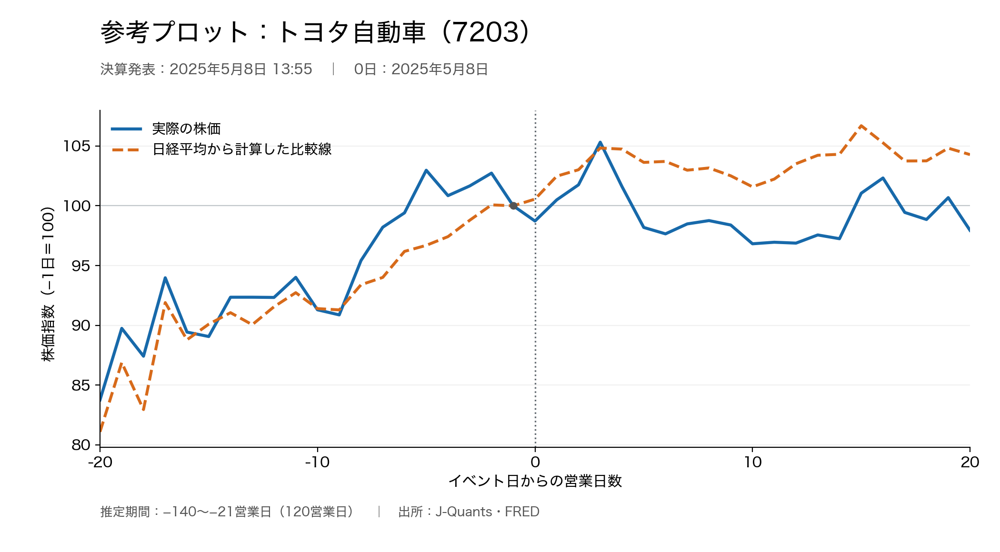

# 金融論　宿題2

日本の上場企業3社について、1社につき1つの決算発表または業績予想修正（以下「イベント」）を選び、その前後で株価がどう動いたかを比較してください。実際の株価と、日経平均の動きから計算した比較線を描き、ニュースや会社の発表資料を使って解釈します。

チーム毎に取り組んで、以下の問1〜問5に沿ってレポートをまとめ、また動画を撮影してください。

## 課題

### 問1　企業の選択

比較する意味のある上場企業を3社選び、選んだ理由を簡潔に説明してください。なお、ユニークな会社に取り組んでみて欲しいので、他のチームと1社被るごとに1点減点にします。よろしくです。（全部被ると3点減点）

### 問2　企業の説明

各社の沿革、事業内容、主要な製品・サービス、最近の業績を簡潔にまとめてください。また、就職先として応募したいかどうか、理由とともにチームとしての見解を述べてください。

### 問3　イベントの内容と発表日時

各社のイベントについて、具体的な内容と発表日時をまとめてください。決算発表なら対象の決算期と主な実績・予想、業績予想修正なら同じ決算期の修正前後の予想額を示してください。なお、決算以外で分析に値するイベントがあればそれでも構いませんし、内容が面白ければ加点します。

発表後に初めて取引できる営業日を「0日」とします。取引終了後や休業日の発表なら、次の営業日です。発表日時と当時の取引時間を確認し、各社の0日を示してください。

### 問4　株価と比較線の図

それぞれの会社について、0日の前後20営業日（−20日〜＋20日）の実際の株価と比較線を、1つの図に重ねてください。トータル3つ図を書きます。個別株にはJ-Quantsの調整済み終値（AdjC）、日経平均にはFREDの系列「NIKKEI225」の日次終値を使ってください。

比較線については、イベント前の−140日〜−21日の120営業日を使い、各社の株価の日次変化率を、同じ日の日経平均の日次変化率に回帰してください。回帰には定数項付きのOLSを使います。推定した回帰式に、−20日〜＋20日の各日の日経平均の変化率を入れ、各社の株価変化率を予測してください。予測した日々の変化率から比較線を作ってください。比較線は、−20日を起点に、予測した変化率を1日ずつ積み重ねて作ります。例えば、前日の値が100で、予測した変化率が＋2%なら、翌日の値は102です。最後に、株価と比較線の両方を、−1日の値が100になるよう、線全体を同じ倍率で割り戻します。

### 問5　ニュースに基づく解釈と3社の比較

図書館の新聞データベースを使って、各社のイベント前後のニュースを調べてください。決算・業績修正の内容や背景を踏まえ、実際の株価と比較線の違いをどう解釈できるか、3社を比較して説明してください。参照した記事や会社資料の名称、日付、出所を示してください。

## 取り組み方

- 登録済みの2〜3人のチームで取り組んでください。
- 分析結果をレポートにまとめてください。ファイルはPDFとします。
- 空き教室を使ってホワイトボード（もしくは黒板）に、分析内容を手描きでまとめてください。それを使って3〜5分のプレゼン動画を撮影してください。動画では、チームメンバー全員が発言するようにしてください。
- 例えば、こんな感じ。[中田敦彦のYouTube大学「古事記」](https://www.youtube.com/watch?v=jidCDQCJGT0&t=453s)
- 配点は、レポートと動画を合わせて20点です。

## 提出物と締切

- 出題日：2026年11月5日（木）
- 提出締切：2026年11月26日（木）23:59
- 提出先：Google Classroom
- 提出物：
  - 分析結果をまとめたレポートのPDFファイル
  - 3〜5分のプレゼン動画。動画ファイルの形式は一般的なものにしてください。

Pythonのcodeなど他のファイルは提出しなくてかまいません。

## 採点基準

- 分析自体はCodexがあるので、どのチームも100％OKなことを前提とします。点数は、企業や分析結果の説明がレポートで適格に行われており、かつ動画で人間の言葉として説得力があるかどうかで決めます。

## 参考プロット

参考プロットです。実線が実際の株価、破線が日経平均から計算した比較線です。どちらも−1日を100にそろえています。

