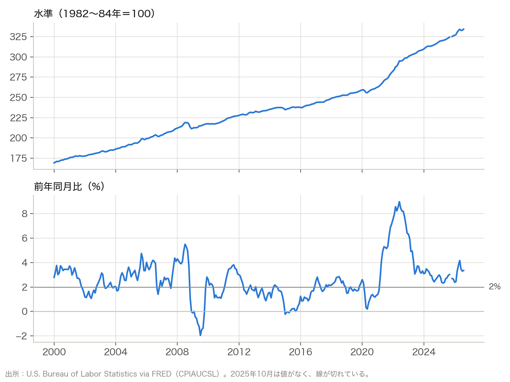
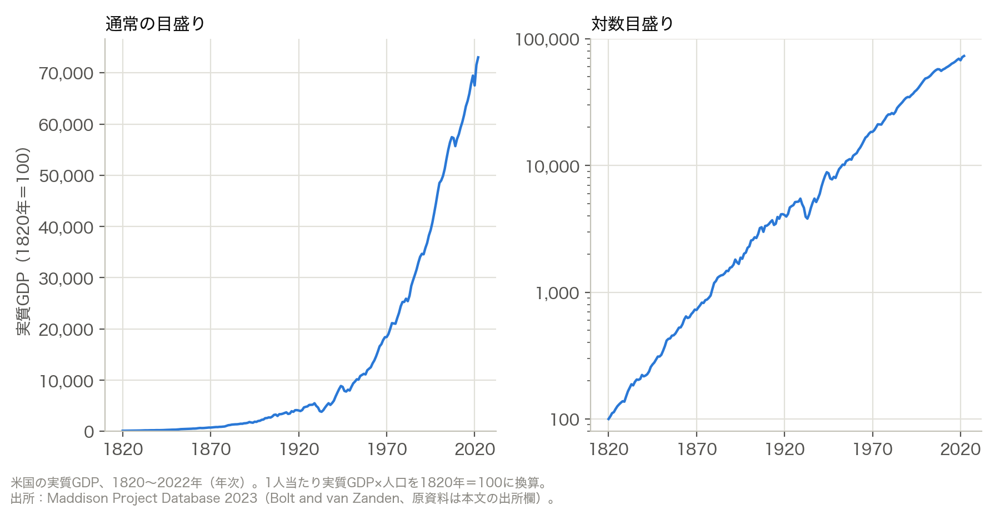
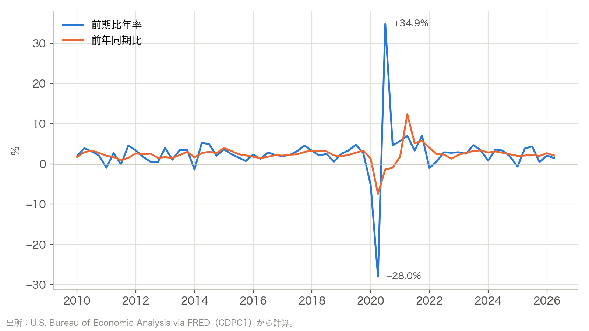
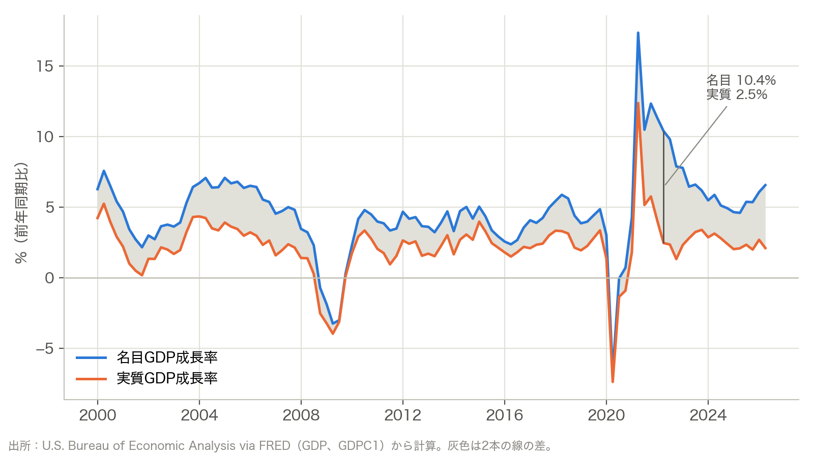
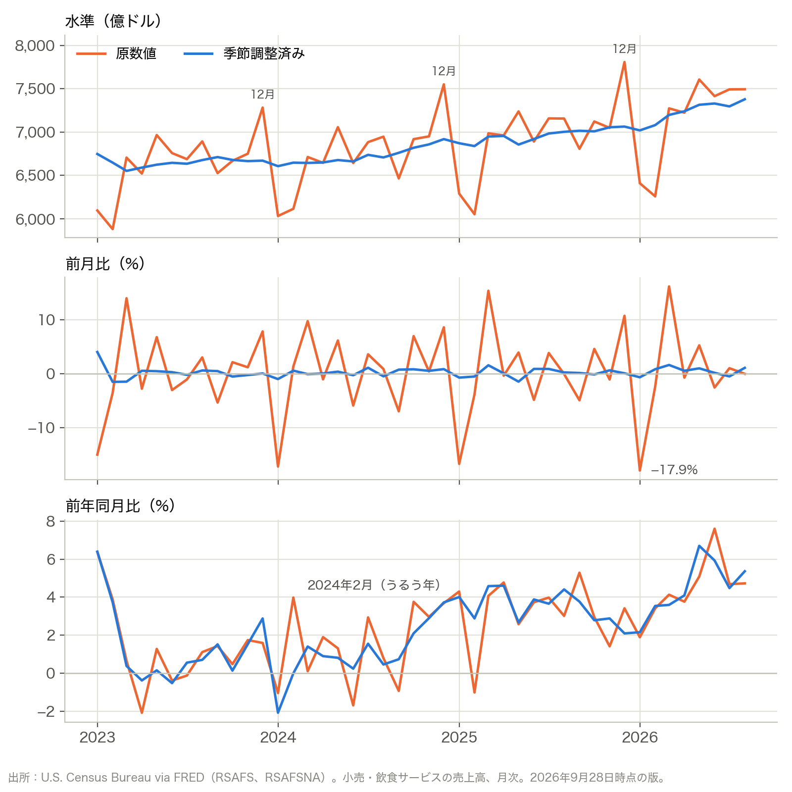
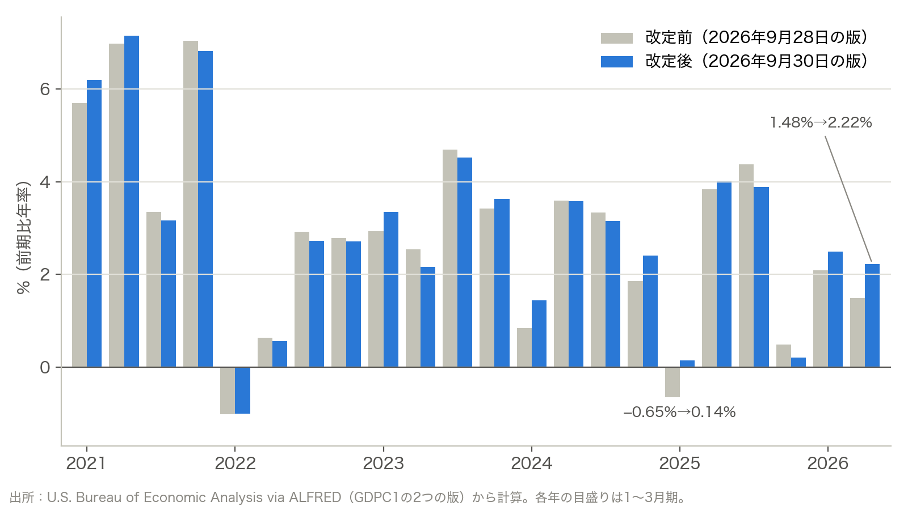
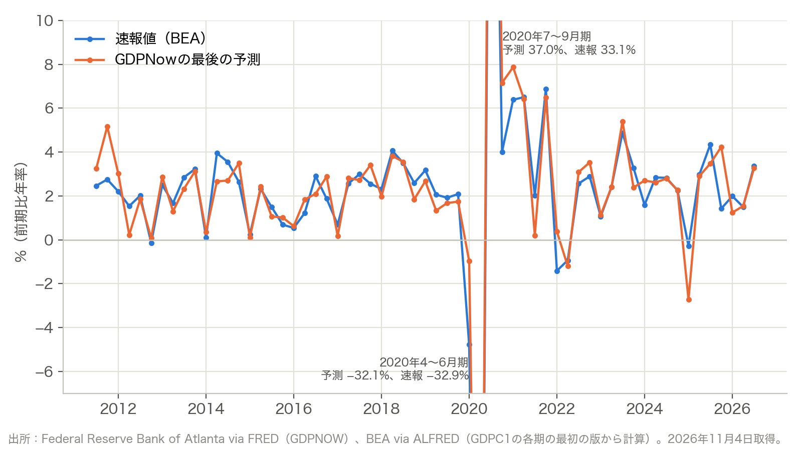

# この回の資料

第10回は、次の4つの資料で進めます。

| 資料 | 内容 |
|---|---|
| (1) マクロ時系列データの読み方（この資料） | 頻度、変化率、名目と実質、季節調整、欠損 |
| [(2) FREDをウェブで使う](02_fred_web.md) | 系列の検索、図の変換、CSVのダウンロード |
| [(3) PythonでFREDのデータを取得し、図を描く](03_fred_download.md) | CSVでの取得、欠損の扱い、作図 |
| [(4) 新聞記事の検索と、AIによるニュース検索の問題](04_news_search.md) | 図書館の新聞DB、検索の記録、AI検索の偏り |

図と数値には、主に2026年9月28日時点のFREDデータを使っています。GDP改定の比較には9月30日版を使い、Maddison Projectの長期GDPとGDPNowは11月4日に取得しました。

# 1. 時系列データは日付と値の表

時系列データは、同じ指標を一定の間隔で記録した表です。1行が1つの時点に対応します。次は、米国の失業率（FREDの系列ID `UNRATE`）の最後の3行です。

| observation_date | UNRATE |
|---|---:|
| 2026-06-01 | 4.2 |
| 2026-07-01 | 4.1 |
| 2026-08-01 | 4.1 |

記録の間隔を頻度と呼びます。日次、週次、月次、四半期、年次があります。

FREDでは、月次の値をその月の1日の日付で表します。2026-08-01は2026年8月の値で、8月1日の1日だけの値ではありません。四半期も同じで、2026-04-01は2026年4〜6月期の値です。

# 2. よく使う4つの系列

経済全体の動きは、生産、物価、雇用、金利の4つの系列から見始めることが多いです。

| 系列 | 測るもの | 頻度 | 単位 | 日本の作成機関 | 米国の作成機関（FREDのID） |
|---|---|---|---|---|---|
| 実質GDP | 国内で生み出された付加価値の合計 | 四半期 | 金額 | 内閣府 | BEA（`GDPC1`） |
| 消費者物価指数（CPI） | 家計が買う財・サービスの価格 | 月次 | 指数 | 総務省統計局 | BLS（`CPIAUCSL`） |
| 失業率 | 労働力人口に占める失業者の割合 | 月次 | % | 総務省統計局 | BLS（`UNRATE`） |
| 政策金利 | 中央銀行が誘導する短期の金利 | 日次・月平均 | 年率% | 日本銀行 | FRB（`FEDFUNDS`） |

BEAは米国商務省の経済分析局、BLSは米国労働省の労働統計局、FRBは米国の連邦準備制度理事会です。労働力人口は、働いている人と、仕事を探している人の合計です。

日本の政策金利は、日本銀行が誘導目標を決める無担保コール翌日物金利です。米国は、フェデラルファンド金利（FF金利）の誘導目標の範囲です。`FEDFUNDS` は、実際に取引されたFF金利の月平均です。

# 3. 水準と変化率

CPIは、基準の時点の物価を100とした指数です。`CPIAUCSL` は、1982〜84年の平均を100としています。2026年8月の値は334.131で、物価が基準の時点の約3.3倍になったことを表します。

指数の値そのものより、どれだけ変わったかに意味があります。物価の上昇率（インフレ率）は、1年前の同じ月と比べた前年同月比で表すのが一般的です。

$$
\text{前年同月比（\%）} = \left(\frac{x_t}{x_{t-12}} - 1\right)\times 100
$$

$x_t$ は当月の値、$x_{t-12}$ は12か月前の値です。2025年8月のCPIは323.291でした。2026年8月の前年同月比は、(334.131÷323.291−1)×100で3.35%です。

水準の図は右上がりの線になり、いつ物価が速く上がったのかが読み取りにくくなります。前年同月比にすると、2021年春からの急な上昇が見えます。上昇率は2022年6月の8.98%が2000年以降で最も高く、その後は下がりました。2025年の秋に線が切れているのは、第9節で扱う欠損です。

水準の図は、対数目盛りで描くこともできます。対数目盛りでは、上昇率が同じなら線の傾きも同じになります。

米国の実質GDPは、1820年から2022年までに約730倍になりました。通常の目盛りでは、後になるほど増加幅が大きくなる、指数的な上昇が見えます。対数目盛りでは、長期的な動きがほぼ右上がりの直線になります。右の縦軸では、100から1,000、1,000から10,000への増加が同じ間隔です。どちらも10倍への増加だからです。おおむね一定の割合で成長すると、対数目盛りでは直線に近い形になります。大恐慌や第二次世界大戦の時期には、この長期的な流れからのずれも見えます。

## Maddison Project Databaseとは

[Maddison Project](https://www.rug.nl/ggdc/historicaldevelopment/maddison/)は、Angus Maddisonが作った歴史経済データを引き継ぎ、各国の長期的な経済成長を調べる研究プロジェクトです。オランダのフローニンゲン大学のGroningen Growth and Development Centreがデータを公開しています。

[2023年版](https://www.rug.nl/ggdc/historicaldevelopment/maddison/releases/maddison-project-database-2023)には、169か国の1人当たり実質GDPと人口が、2022年まで収録されています。過去の資料や研究に基づく推計を組み合わせているため、現在のGDP統計が整備される前までさかのぼれます。国によって収録期間は異なります。ExcelやStataの形式でダウンロードできます。

図2では、このデータの米国の1820〜2022年を使っています。1人当たり実質GDPに人口を掛けて米国全体の実質GDPを求め、1820年を100として表しました。同じデータから、国ごとの長期成長や、1人当たりの豊かさの変化も比べられます。

# 4. 前期比年率と前年同期比

四半期のGDPは、直前の期と比べる前期比と、1年前の同じ期と比べる前年同期比の両方で表されます。前期比を、同じ伸びが1年続いたとして換算したものが前期比年率です。米国の報道では、前期比年率がよく使われます。

$$
\text{前期比年率（\%）} = \left[\left(\frac{Y_t}{Y_{t-1}}\right)^4 - 1\right]\times 100
$$

$$
\text{前年同期比（\%）} = \left(\frac{Y_t}{Y_{t-4}} - 1\right)\times 100
$$

米国の実質GDPは、2026年1〜3月期が24兆1,804億ドル、4〜6月期が24兆2,696億ドルでした。前期比は0.37%で、前期比年率は1.48%です。前年同期比は2.10%です。

前期比年率は振れが大きく、2020年4〜6月期は−28.0%、7〜9月期は+34.9%でした。前年同期比は動きがなめらかで、2020年4〜6月期は−7.4%です。

# 5. パーセントとパーセントポイント

率どうしの差は、パーセントポイント（%ポイント）で表します。金利が1.0%から1.5%に上がったとき、上昇幅は0.5%ポイントです。変化率で表すと、元の1.0%に対して50%の上昇になります。失業率が4.3%から4.1%に下がったときは、0.2%ポイントの低下です。

# 6. 名目と実質

名目GDPは、その時点の価格で測った金額です。実質GDPは、物価の変化を取り除いた金額です。物価が上がる時期には、生産量が同じでも名目GDPは増えます。経済成長率は、実質GDPの変化率で表します。

米国の2026年4〜6月期は、名目GDP（`GDP`）が32兆4,861億ドル、実質GDP（`GDPC1`）が24兆2,696億ドルです。実質GDPは、2017年を基準年とする連鎖方式で計算した値です。どちらも、四半期の値を1年分に換算した年率で表示されています。

名目の成長率は、実質の成長率に物価の上昇率をほぼ足したものです。図4の灰色の幅が、GDPに含まれる財・サービス全体の物価の上昇率（GDPデフレーターの上昇率）にあたります。2010〜2019年の平均は、名目が4.1%、実質が2.4%でした。2022年4〜6月期は名目が10.4%、実質が2.5%で、差は7.9%ポイントに開きました。2026年4〜6月期も、名目の6.6%に対して実質は2.1%です。

金利にも名目と実質があります。実質金利は、名目金利から予想インフレ率を差し引いたものです。

# 7. 季節調整

月次や四半期の値には、季節による決まった動きが入ります。年末の消費や、ボーナスの時期の支出がその例です。季節調整済み（Seasonally Adjusted）の系列は、この動きを統計的に取り除いたものです。

前月比や前期比は、季節調整済みの系列で計算します。前年同月比は同じ月どうしの比較なので、季節調整をしていない原数値（Not Seasonally Adjusted）でも計算できます。FREDには、同じCPIの季節調整済みの `CPIAUCSL` と、原数値の `CPIAUCNS` があります。2026年8月の値は、それぞれ334.131と334.980です。

季節の動きは、小売売上高ではっきり見えます。FREDでは、季節調整済みが `RSAFS`、原数値が `RSAFSNA` です。

原数値は毎年12月に高くなり、1月と2月に落ち込みます。2026年1月の前月比は、原数値では−17.9%、季節調整済みでは−0.6%です。前年同月比にすると、2本の線は近い動きになります。離れるのは、曜日や祝日の並びが前年と違う月です。2024年2月はうるう年で1日多く、原数値の前年同月比は4.0%、季節調整済みは0.0%でした。

# 8. 基準年の変更と改定

指数の基準年が変わると、過去の値もさかのぼって変わります。GDPは、最初の公表の後に何度も改定されます。同じ系列でも、取得した日によって過去の値が違うことがあります。

この資料のデータを取得した2日後の2026年9月30日に、BEAは米国GDPの年次改定を公表しました。2021年1〜3月期以降の22期がすべて改定され、2020年10〜12月期までの値は変わっていません。

2026年4〜6月期の実質GDPは24兆2,696億ドルから24兆4,080億ドルに、前期比年率は1.48%から2.22%になりました。2025年1〜3月期は−0.65%から0.14%に変わり、マイナス成長がプラス成長になっています。授業の日にFREDから取得すると、第4節と第6節の数値とは違う値が返ってきます。改定前の値は、FREDの過去の版を保存している[ALFRED](https://alfred.stlouisfed.org/)で取り出せます。

速報が出る前から、GDPは予測されています。アトランタ連銀のGDPNowは、公表済みの月次の統計からその期の成長率を推計する予測で、FREDでは `GDPNOW` として見られます。2026年の2つの期について、予測、速報、改定の値を並べると次のようになります。値はどれも実質GDPの前期比年率です。

| 段階 | 2026年4〜6月期 | 2026年7〜9月期 |
|---|---:|---:|
| GDPNowの最後の予測 | 1.54% | 3.27% |
| 速報値 | 1.5%（7月30日） | 3.4%（10月29日） |
| 第2次推計 | 1.5%（8月26日） | |
| 第3次推計と年次改定 | 2.2%（9月30日） | |

4〜6月期は、速報値までは予測とほぼ同じ値でした。2か月後の年次改定で、0.7%ポイント上がっています。

図7は、2011年7〜9月期以降の各期について、GDPNowの最後の予測と速報値を重ねたものです。GDPNowは2014年7月に公開が始まりました。それより前の値も、当時のデータでその時点に計算され、保存されていた予測です。

2020年の2期を除く59期で、予測と速報値の差は平均0.73%ポイントでした。速報値と現在の値の差は平均0.87%ポイントで、予測の外れより大きくなっています。外れが大きかったのは、2020年1〜3月期（予測−1.0%、速報−4.8%）と2025年10〜12月期（予測4.2%、速報1.4%）です。

# 9. 欠けている値

## 2025年10月の米国のCPIと失業率

米国のCPIと失業率には、2025年10月の値がありません。図1の線が切れているのは、この月です。

米国では、2025年10月1日から11月12日まで、予算が成立せずに政府機関の一部が閉鎖されました。BLSは、この期間にCPIのデータを集めていません（[BLSの説明](https://www.bls.gov/cpi/additional-resources/2025-federal-government-shutdown-impact-cpi.htm)）。失業率のもとになる家計調査も、10月分は行われませんでした。後からさかのぼって集めることもしなかったため、10月の失業率は存在しません（[BLSの雇用統計](https://www.bls.gov/news.release/archives/empsit_12162025.htm)）。

どちらも、長く途切れずに続いてきた系列です。季節調整をしていない月次のCPIは1921年1月から、失業率は1948年1月から、毎月公表されてきました（[Richmond連銀の解説](https://www.richmondfed.org/research/national_economy/macro_minute/2025/phantom_figures_missing_data_in_october)）。2025年10月は、その初めての空白です。

同じ月でも、値が残った統計があります。企業に聞く事業所調査の雇用者数（`PAYEMS`）は、10月分が11月分と一緒に後から公表されました。金融市場の取引から作るFF金利（`FEDFUNDS`）にも、欠けた月はありません。家計調査は、毎月12日を含む1週間に仕事をしていたか、仕事を探していたかを本人に聞く調査です。過ぎた週の状況を、後から同じ質で聞き直すことはできません。欠けるかどうかは、データの集め方で決まります。

## 空欄の理由はひとつではない

| 空欄の理由 | 例 |
|---|---|
| 調査が行われなかった | 米国のCPIと失業率の2025年10月 |
| まだ公表されていない | 取得した2026年9月28日時点の、2026年9月のCPI（10月14日公表予定） |
| 系列が終わった | FREDにある日本の月次CPI（2021年6月まで） |
| 計算の材料がない | 系列の最初の12か月の前年同月比、2025年11月の前月比 |
| 片方の系列にしか値がない | 2036年までの見通しがある `GDPPOT` と実質GDPから作ったGDPギャップの、2026年7〜9月期以降 |

待てば埋まる空欄、別の資料で探せる空欄、埋まらない空欄があります。

## 欠損の書き方

欠損の書き方は、データによって違います。

| データ | 欠損の書き方 |
|---|---|
| FREDのCSV（2026年9月） | 空欄 |
| FREDのAPI（JSON） | `.` |
| FREDのCSV（2024年にダウンロードしたもの） | `.` |
| BLSの表 | `-`（ダッシュ）と注 |

同じFREDでも、取り出し方と時期で書き方が違います。`.` を欠損として読み込めないと、プログラムが止まったり、列全体が文字として扱われたりします。

欠けた値を推計で補うこともできます。9月と11月の値を直線で結ぶと、10月のCPIは324.654になります。欠損の扱い方で計算結果がどう変わるかは、[(3)の第3節](03_fred_download.md)で確かめます。

# 10. 系列はどこから来るか

FREDは、米国のセントルイス連邦準備銀行が運営するデータベースです。BLSやBEAなどの作成機関が公表した系列を集め、同じ形式で提供しています。系列のページには、元の作成機関（Source）が書かれています。

日本の系列もFREDにありますが、国際機関を経由したものが多く、更新が止まっているものがあります。例えば、日本の月次CPIの系列は、どれも2021年6月で終わっています。日本の最新の数値は、作成機関の統計で確かめます。

| 統計 | 作成機関の入口 |
|---|---|
| 消費者物価指数 | [総務省統計局：消費者物価指数](https://www.stat.go.jp/data/cpi/) |
| 失業率 | [総務省統計局：労働力調査](https://www.stat.go.jp/data/roudou/) |
| GDP | [内閣府：国民経済計算](https://www.esri.cao.go.jp/jp/sna/menu.html) |
| 金利・マネー | [日本銀行：時系列統計データ検索サイト](https://www.stat-search.boj.or.jp/) |
| 各府省の統計 | [e-Stat（政府統計の総合窓口）](https://www.e-stat.go.jp/) |

# 出所

- 図2を除く本文と図の数値：FRED（`UNRATE`、`CPIAUCSL`、`CPIAUCNS`、`GDPC1`、`GDP`、`PAYEMS`、`FEDFUNDS`、`RSAFS`、`RSAFSNA`、`GDPNOW`）。作成機関はBLS、BEA、FRB、Census Bureau。2026年9月28日取得。図6の改定後の値は、ALFREDの `GDPC1` の2026年9月30日の版。第8節の表の速報値と推計値は、ALFREDの `A191RL1Q225SBEA` の各版。図7の速報値は、ALFREDの `GDPC1` の各期の最初の版から計算。`GDPNOW` と、現在の値（`A191RL1Q225SBEA`）は2026年11月4日取得。
- 図2：[Maddison Project Database 2023](https://doi.org/10.34894/INZBF2)。Bolt, J. and J. L. van Zanden (2024), "[Maddison-style estimates of the evolution of the world economy: A new 2023 update](https://doi.org/10.1111/joes.12618)." 2026年11月4日取得。
- 図2の米国系列の原資料（データベースのSources・Maddison original sourcesシート）：Sutch, R. (2006), "National Income and Product," *Historical Statistics of the United States: Earliest Times to the Present*, III-23–25；Prados de la Escosura, L. (2009), "Lost Decades? Economic Performance in Post-Independence Latin America," *Journal of Latin American Studies* 41, 279–307（更新データ）；Maddison (1995)の1820〜1950年系列；2008〜2022年はThe Conference BoardのTotal Economy Database。
- [BEA：2026年の年次改定の案内](https://www.bea.gov/AnnualUpdate)
- [BLS：2025年の政府機関閉鎖によるCPIへの影響](https://www.bls.gov/cpi/additional-resources/2025-federal-government-shutdown-impact-cpi.htm)
- [BLS：Employment Situation（2025年11月分、2025年12月16日公表）](https://www.bls.gov/news.release/archives/empsit_12162025.htm)
- [BLS：欠損データの扱い](https://www.bls.gov/bls/bls-handling-of-missing-data.htm)
- O'Trakoun, J. (2025) "[Phantom Figures: Missing Data in October](https://www.richmondfed.org/research/national_economy/macro_minute/2025/phantom_figures_missing_data_in_october)," Federal Reserve Bank of Richmond, Macro Minute.
