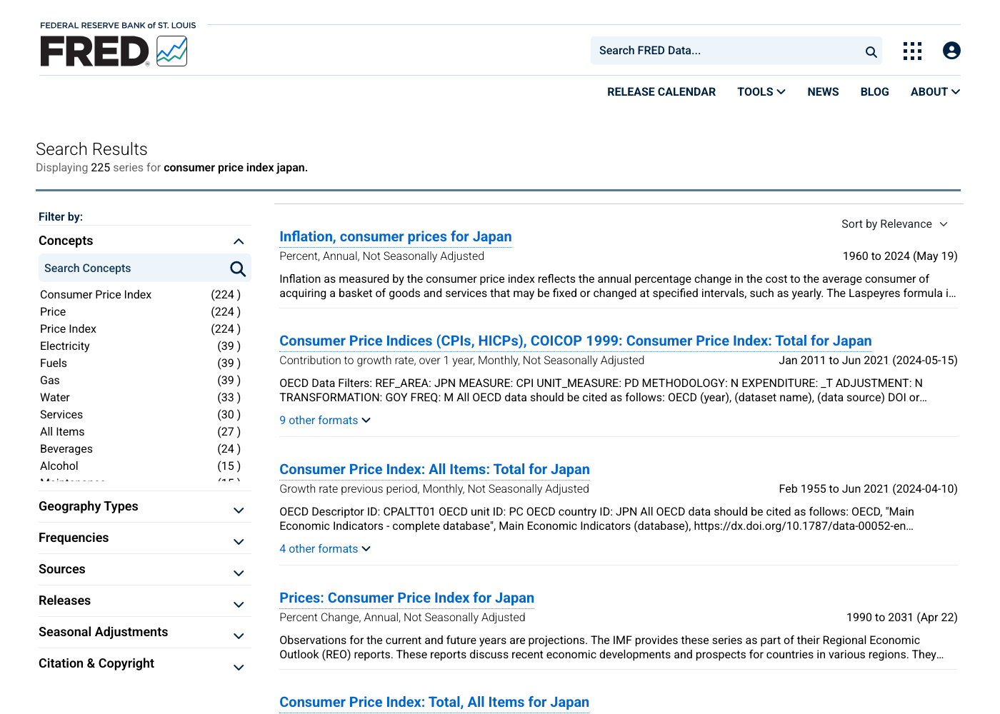
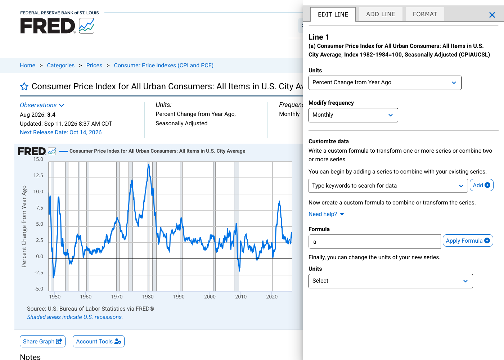
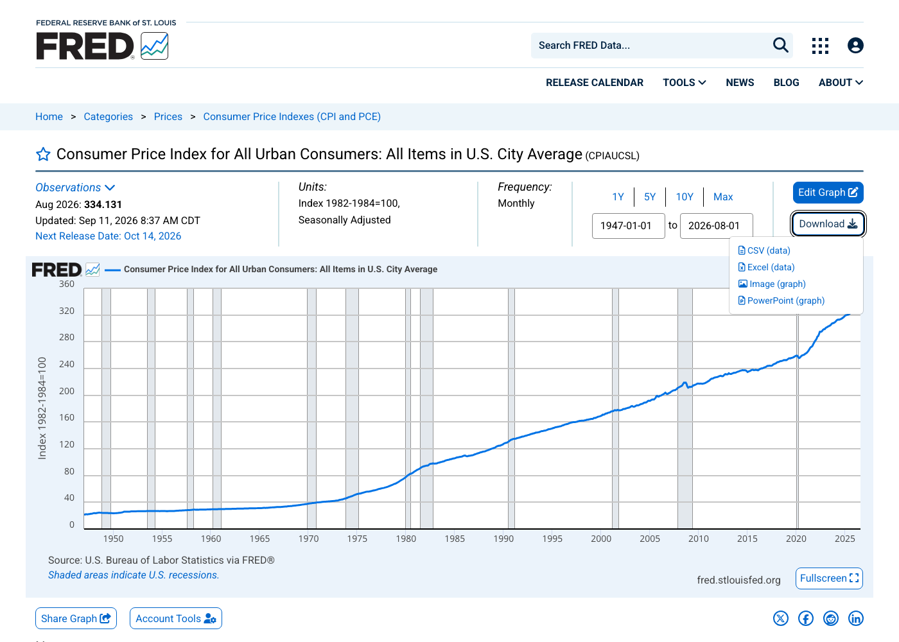

# この資料で作るもの

[FRED](https://fred.stlouisfed.org/)のサイトで系列を探し、図を変換してCSVに保存します。題材は、米国のCPIから作るインフレ率と、実質GDPと潜在GDPから作るGDPギャップです。ここまではブラウザだけでできて、アカウントは要りません。

画面は2026年9月28日のものです。

# 1. 系列を探す

トップページの検索欄に、英語で語を入れて探します。例えば「consumer price index」「unemployment rate」です。

検索結果には、同じ指標の系列が複数並びます。月次と四半期、季節調整済みと原数値、国の違いで、それぞれ別の系列になっています。左側の「Filter by」で、頻度（Frequencies）、季節調整（Seasonal Adjustments）、作成機関（Sources）などを絞り込めます。



各系列の右側には、収録期間と最終更新日が出ます。図1の2番目と3番目は日本の月次CPIですが、2021年6月で終わっていて、最終更新も2024年です。4番目はIMFの年次の系列で、2031年までの値には予測が含まれます。

各系列には、系列ID（series ID）という英数字の名前があります。米国のCPIは `CPIAUCSL`、失業率は `UNRATE` です。IDが分かっていれば、`https://fred.stlouisfed.org/series/UNRATE` のようにURLで直接開けます。次の資料でも、このIDで系列を指定してCSVを取得します。

# 2. 系列ページを読む


系列ページの上部に、系列の基本情報がまとまっています。

| 表示 | 図2の例 | 意味 |
|---|---|---|
| Observations | Aug 2026: 334.131 | 最新の観測値と、その時点 |
| Updated | Sep 11, 2026 | FREDで最後に更新された日時 |
| Next Release Date | Oct 14, 2026 | 次の公表予定日 |
| Units | Index 1982-1984=100, Seasonally Adjusted | 単位と季節調整の有無 |
| Frequency | Monthly | 頻度 |

図の下の「Source」が作成機関で、この系列はBLS（米国労働統計局）です。ページの下の「Notes」には、系列の定義と作成方法の説明があります。

さらに下には、データの著作権の区分が表示されます。`CPIAUCSL` は「Public Domain: Citation Requested」で、使うときに出所を書くよう求められています。株価指数など、著作権のある系列もあります。

期間は、図の右上の「1Y」「5Y」「10Y」「Max」か、日付の欄で変えられます。図の灰色の帯は、米国の景気後退期です。

# 3. 単位を変える：CPIからインフレ率を作る

「Edit Graph」を押すと、右側に編集画面が開きます。上のタブの「EDIT LINE」で、表示中の系列を変換できます。

「Units」で「Percent Change from Year Ago」を選ぶと、前年同月比の図になります。系列ページの上の「Units」の表示も変わり、2026年8月の値は3.4になります。(1)で計算した3.35%を丸めた値です。



「Units」の選択肢は、(1)で扱った変化率と次のように対応します。

| Unitsの表示 | 変化率 |
|---|---|
| Percent Change | 前期比（月次なら前月比） |
| Percent Change from Year Ago | 前年同期比（月次なら前年同月比） |
| Compounded Annual Rate of Change | 前期比年率 |

「Modify frequency」では、頻度を変えられます。月次のCPIを「Quarterly」にすると、集計方法（Average、Sum、End of Period）を選ぶ欄が出ます。Averageなら3か月の平均が、End of Periodなら各期の最後の月の値が、四半期の値になります。欠けた月がある期は、残った月だけの平均になります（[(1)の第9節](01_macro_timeseries.md)）。

# 4. 系列を組み合わせる：GDPギャップ

GDPギャップは、実際のGDPが潜在GDPからどれだけ離れているかを表します。潜在GDPは、景気の過熱や落ち込みがないときに実現する生産の水準です。

$$
\text{GDPギャップ（\%）} = 100\times\frac{\text{実質GDP} - \text{潜在GDP}}{\text{潜在GDP}}
$$

米国の潜在GDPは、議会予算局（CBO）の推計がFREDにあります（`GDPPOT`）。次の手順で、2つの系列から式でGDPギャップの図を作れます。

1. 実質GDP（`GDPC1`）の系列ページで「Edit Graph」を開きます。
2. 「Customize data」の検索欄に `GDPPOT` と入れ、候補を選んで「Add」を押します。最初の系列が a、追加した系列が b になります。
3. 「Formula」に `100*(a-b)/b` と入れ、「Apply Formula」を押します。


2026年4〜6月期のGDPギャップは、画面を保存した9月28日時点では0.83%でした。9月30日のGDP年次改定を反映すると1.40%になります。どちらも、実際のGDPが潜在GDPを少し上回っています。2020年4〜6月期は−8.83%でした。

`GDPPOT` には2036年までの見通しも入っています。

「ADD LINE」のタブでは、別の系列を同じ図に重ねられます。インフレ率に政策金利（`FEDFUNDS`）を重ねると、どちらも%なので同じ目盛りで比べられます。

# 5. CSVをダウンロードする

「Download」から「CSV (data)」を選ぶと、図に表示している系列のデータを保存できます。Unitsや式で変換した場合は、変換した後の値が保存されます。



図3の状態でダウンロードしたCSVを、テキストエディタで開くと次のようになっています。

```text
observation_date,CPIAUCSL_PC1
2025-09-01,3.02257
2025-10-01,
2025-11-01,2.69644
```

1行目は列名です。`_PC1` は、前年同月比（Percent Change from Year Ago）に変換したことを表します。2025年10月の空欄は、この月のCPIが作成されなかったためです。

式で作った列は、`GDPC1_GDPPOT` のように、使った系列IDをつないだ名前になります。式そのものはCSVに残りません。

Excelで開くと、日付の表示が変わることがあります。元の値のまま見るには、テキストエディタで開きます。

# 6. 日本のデータを探すとき

FREDには日本の系列もあります。失業率（`LRUNTTTTJPM156S`）、コールレート（`IRSTCI01JPM156N`）、円ドル相場（`EXJPUS`）は、2026年7〜8月の値まで入っています。一方、月次のCPIは2021年6月で止まっています。

日本の統計を作成機関のAPIから取得する方法は、第11回で扱います。

# 7. 豆知識：画面を自動で撮る

この資料の図1〜図5は、人がブラウザで撮った画面ではありません。プログラムがブラウザを開き、FREDのページを表示し、ボタンを押してから画面を保存しました。Claudeが作って実行したプログラムです。

使ったのは、ブラウザをプログラムから操作するPlaywrightというライブラリです。ページを開く、「Edit Graph」を押す、「Units」の選択肢を選ぶ、式を入力する、画面を保存する、という操作を1つずつ書いてあります。人がブラウザで行う操作を、そのまま順番に並べた形です。同じプログラムを `example/fred_screenshots.py` に置いています。