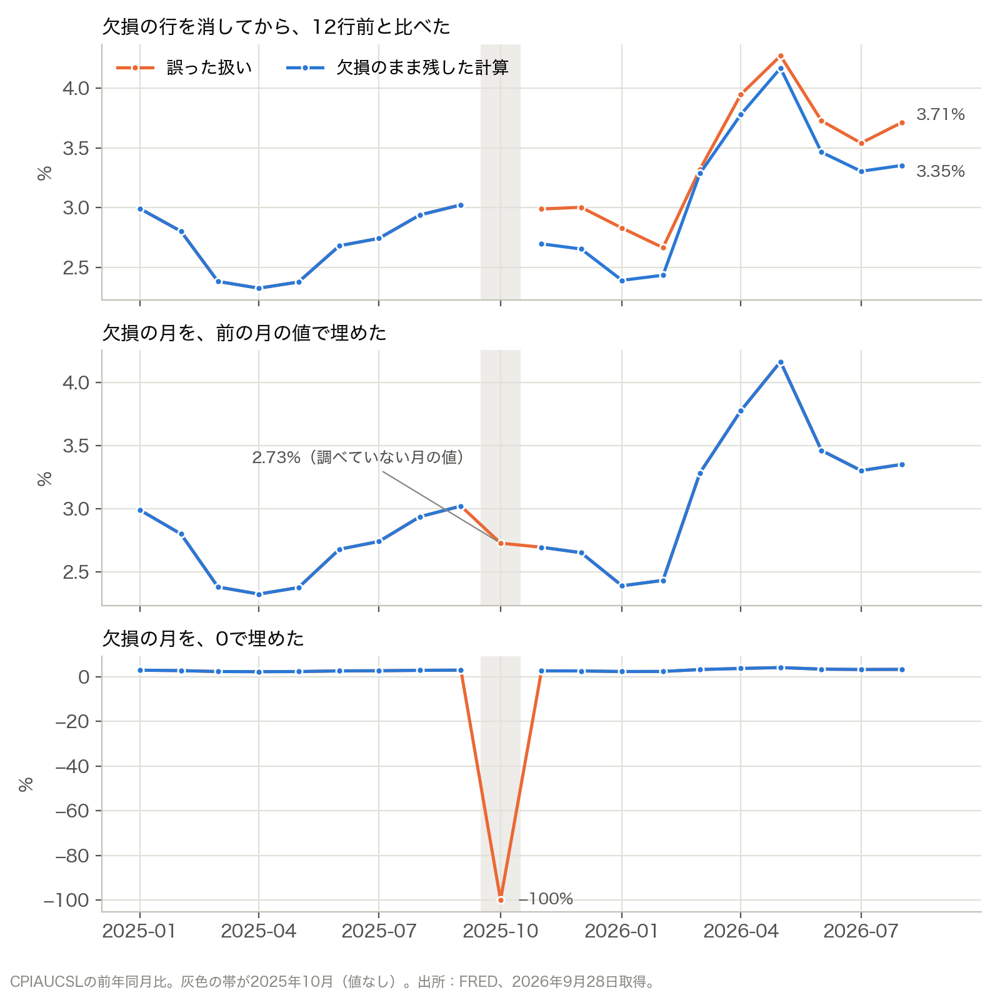
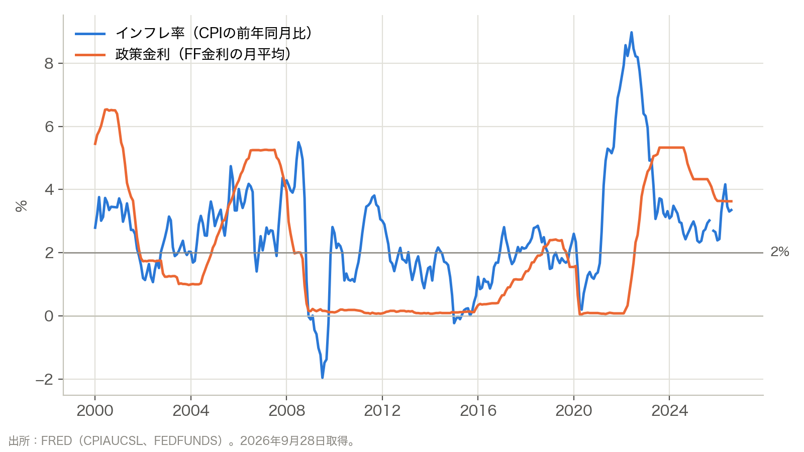
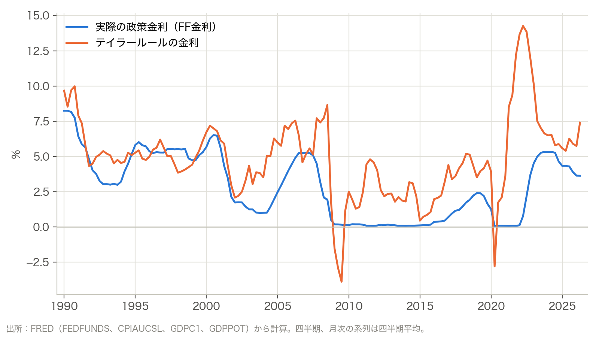
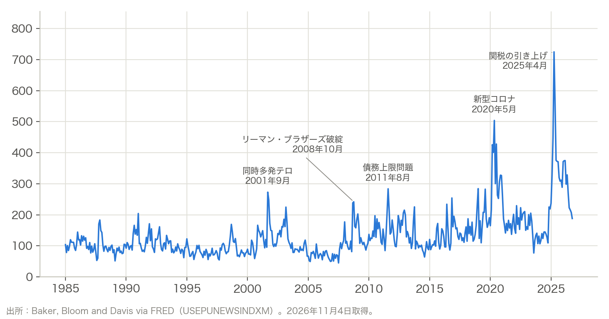

# この資料で作るもの

FREDから米国のCPIと政策金利をCSVで取得し、インフレ率と政策金利の図を作ります。次に4つの系列を組み合わせて、テイラールールの図を描きます。新聞記事の件数から作られた経済政策不確実性指数も扱います。

| 段階 | 作るもの |
|---|---|
| 系列を取得する | 取得したCSV、取得条件の記録 |
| インフレ率を計算する | 前年同月比の表、FREDの計算との照合 |
| 欠損の扱いを比べる | 4通りの扱いによる前年同月比の表と図 |
| 図を描く | インフレ率と政策金利の図 |
| 系列を組み合わせる | 四半期の表、テイラールールの図 |
| 記事の件数から作られた指数を見る | 経済政策不確実性指数の図 |

作業用フォルダは `fred_analysis/` です。取得・計算・作図のプログラムはCodexに作ってもらい、出てきた表と図を確かめます。インフレ率と政策金利の図までを1つのファイルにまとめた手本が、`example/fred_example.py` にあります。

# 1. 系列を取得する

FREDのデータは、ウェブの「Download」と同じCSVを、プログラムから取得できます。アカウントは要りません。取得先は `https://fred.stlouisfed.org/graph/fredgraph.csv` で、系列IDを `id`、開始日を `cosd` で指定します。Pythonでは次のように書けます。`URL` には、この取得先のアドレスが入っています。

```python
params = {"id": "CPIAUCSL", "cosd": "1999-01-01"}
r = requests.get(URL, params=params, timeout=30)
cpi = pd.read_csv(io.StringIO(r.text))
```

返ってくるCSVは、[(2)の第5節](02_fred_web.md)でダウンロードしたものと同じ形です。1列目が `observation_date`、2列目が系列IDの列で、欠けている時点は空欄です。

Codexへの依頼文です。

```text
fred_analysis/ に、FREDの fredgraph.csv から系列を取得するプログラムを作ってください。
CPIAUCSL を1999年1月から、FEDFUNDS を2000年1月から取得したいです。
取得したCSVをそのまま raw/ に、date と value の列にしたCSVを data/ に保存してください。
各系列の取得に使ったURLと取得日時を settings.md にまとめてください。
```

取得できたら、画面に出た行数、最初と最後の日付、欠損の数を見ます。`CPIAUCSL` は2025年10月が欠損です。ウェブの系列ページの最新値と、CSVの最後の行が一致すれば、同じ系列を取得できています。CPIを1999年から取るのは、2000年1月の前年同月比に1999年1月の値が要るからです。

# 2. インフレ率を計算する

前年同月比は、12か月前の値との比で計算します。`cpi` は、`CPIAUCSL` のCSVを読み込んだ表です。

```python
cpi["inflation"] = (cpi["value"] / cpi["value"].shift(12) - 1) * 100
```

`shift(12)` は、12行前の値を同じ行に並べます。行が1か月ずつ並んでいれば、12行前は12か月前です。欠損の2025年10月も行としては残っているので、行はずれません。2025年10月の前年同月比は欠損になります。

URLに `transformation=pc1` を加えると、FREDが計算した前年同月比を受け取れます。ウェブの「Percent Change from Year Ago」と同じ変換です。手元の計算と比べると、式の誤りや行のずれに気づけます。

```text
data/ のCPIAUCSLから、前年同月比のインフレ率を計算してください。
同じ期間を transformation=pc1 でも取得し、手元の計算との差の最大値を表示してください。
欠損の月は、前後の値で埋めずに欠損のまま残してください。
結果を data/inflation.csv に保存してください。
```

2026年9月28日に取得したデータでは、2026年8月の前年同月比は、FREDの変換でも手元の計算でも3.353%です。

# 3. 欠損の扱いで数字が変わる

2025年10月のCPIは欠損しています（[(1)の第9節](01_macro_timeseries.md)）。この欠損の扱いを変え、CPIから計算する前年同月比がどう変わるかを比べます。まず、欠損した10月と、その直後の11月を見ます。

`shift(12)` が参照するのは、12行前の値です。10月の値が空欄でも行を残せば、毎月1行ずつ並ぶので12行前は前年の同じ月になります。10月の行を消すと、11月以降の行が1つずつ詰まり、比較相手がずれます。

| 2025年11月の計算 | 12行前にある月 | 比較する期間 |
|---|---|---|
| 10月の行を残す | 2024年11月 | 12か月 |
| 10月の行を消す | 2024年10月 | 13か月 |

行を残した計算では、11月の前年同月比は2.70%です。行を消した計算では、13か月前からの変化率である2.99%が、前年同月比の欄に入ってしまいます。

次に、10月の行を消す代わりに、空欄を前月の値や0で埋めた場合も並べます。

| 扱い方 | 2025年10月：欠損した月 | 2025年11月：その直後の月 |
|---|---:|---:|
| 欠損のまま残す | 欠損 | 2.70% |
| 欠損の行を消してから、12行前と比べる | 行がない | 2.99% |
| 欠損の月を、前の月の値で埋める | 2.73% | 2.70% |
| 欠損の月を、0で埋める | −100% | 2.70% |

前の月の値で埋めると、観測値のない10月に2.73%という変化率が生まれます。0で埋めると、CPIが前年からゼロまで下がった計算になり、−100%になります。11月は11月同士を比べるので、この2通りの補完では値が変わりません。

図は、影響が後の月にも続く様子を、保存データの最後の2026年8月まで示しています。



行を消した場合、12行前が13か月前になる状態は、2025年11月から2026年10月まで続きます。また、2026年10月の前年同月比では、補完した2025年10月の値が分母になります。前月の値で埋めていればその値との比較になり、0で埋めていれば0で割る計算になります。

同じ計算は、`cpi["value"].pct_change(12, fill_method=None) * 100` でもできます。pandas 3系では、欠損値を自動で補完しません。pandas 2.2では既定で前月の値を使って補完するため、`fill_method=None` を明示すると、欠損のまま計算できます（[pandasの仕様](https://pandas.pydata.org/docs/reference/api/pandas.DataFrame.pct_change.html)）。

```text
data/ のCPIAUCSLについて、2025年10月の欠損を次の4通りで扱い、前年同月比を比べて。
欠損のまま残す、欠損の行を消してから12行前と比べる、前の月の値で埋める、0で埋める。
まず2025年10月と11月の結果を表にして。11月の計算で比較している相手の年月も示して。
次に、2025年9月から2026年8月までを1つの表にし、欠損のまま残した計算と値が違う月を示して。
4通りの結果を並べた図を figures/missing_handling.png に保存して。
```

欠損の月の前後の行を表示させると、扱いの違いが見えます。

# 4. 図を描く

インフレ率と政策金利は、どちらも%で表されます。同じ目盛りの1枚の図に重ねられます。

```text
data/inflation.csv と FEDFUNDS のデータから、2000年以降のインフレ率と政策金利を1枚の折れ線グラフにしてください。
縦軸は%、横軸は年です。2%の水平線を細く引いてください。
凡例を付け、出所（FRED、系列ID）と取得日を図の下に入れてください。
figures/inflation_policy_rate.png に保存してください。
```



2021年春からインフレ率が上がり、政策金利は2022年3月から上がり始めました。インフレ率が3%前後まで下がった後も、政策金利は1年ほど5%台にありました。2026年8月は、インフレ率が3.35%、政策金利が3.63%です。

図ができたら、図の1点を元のCSVに戻して確かめます。右端の2つの値が、CSVの2026年8月の行と一致するかを見ます。

# 5. 系列を組み合わせる：テイラールール

テイラールールは、政策金利をインフレ率とGDPギャップから計算する式です（Taylor 1993）。中央銀行がおおむねこう動いてきた、という経験則を1本の式にしたものです。

$$
i_t = r^* + \pi_t + 0.5\,(\pi_t - \pi^*) + 0.5\,\text{gap}_t
$$

$i_t$ は政策金利、$\pi_t$ はインフレ率、$\text{gap}_t$ はGDPギャップです。$\pi^*$ はインフレ目標、$r^*$ は均衡実質金利で、Taylorの論文に合わせてどちらも2%とします。インフレ率が1%ポイント上がると、式の金利は1.5%ポイント上がります。

GDPは四半期、CPIと政策金利は月次です。月次の系列を四半期の平均にして、頻度をそろえます。2025年10〜12月期のCPIは、11月と12月の2か月の平均になります。平均に使った月数を表に残しておくと、後から見てもこの期だけ2か月分だと分かります。GDPギャップは、[(2)の第4節](02_fred_web.md)と同じ式です。

## FREDのウェブ上で計算する

FREDの「Customize data」で3つの系列を同じ線に加えると、テイラールールの金利を計算できます。ブラウザだけで、実際の政策金利と重ねた図まで作れます。

1. [実質GDP（GDPC1）](https://fred.stlouisfed.org/series/GDPC1)を開き、「Edit Graph」の「EDIT LINE」を選びます。
2. 「Customize data」で `GDPPOT` を検索して追加し、続けて `CPIAUCSL` も追加します。系列に付いた文字は、実質GDPが a、潜在GDPが b、CPIが c になります。
3. 「Modify frequency」を「Quarterly」、集計方法を「Average」にします。各系列の「Units」を、次の表のように設定します。

| 文字 | 系列 | Unitsで使う値 |
|---|---|---|
| a | 実質GDP（GDPC1） | 元の金額（Billions of Chained 2017 Dollars） |
| b | 潜在GDP（GDPPOT） | 元の金額（Billions of Chained 2017 Dollars） |
| c | CPI（CPIAUCSL） | Percent Change from Year Ago |

FREDは、頻度の集計、Unitsの変換、Formulaの計算の順に処理します。この設定では、c は「CPIの四半期平均から計算した前年同期比」です（[FREDの処理順序](https://fred.stlouisfed.org/help/data/understanding-the-data/what-is-the-order-of-processing-in-fred-graph)）。

4. 「Formula」に次の式を入れ、「Apply Formula」を押します。

```text
2+c+0.5*(c-2)+0.5*100*(a-b)/b
```

`c` がインフレ率、`100*(a-b)/b` がGDPギャップです。式を適用した値が、テイラールールの金利（%）になります。追加順を変えた場合は、画面に表示された文字と式の対応をそろえます。

5. 「ADD LINE」から `FEDFUNDS` を追加します。この線は「Quarterly」「Average」にし、「Units」は元の「Percent」にします。これで実際の政策金利と、式から計算した金利が同じ図に並びます。
6. 表示期間の開始を1990年1月にすると、下の作例と期間をそろえられます。「Download」の「CSV (data)」で、2本の線の値を保存できます。

同じ取得時点のデータなら、この方法と次のPythonの計算で同じ値になります。例えば、2026年4〜6月期のテイラールールの金利は7.40%、実際の政策金利は3.63%です。

## Pythonで同じ計算をする

```text
FREDの fredgraph.csv から GDPC1、GDPPOT、CPIAUCSL、FEDFUNDS を取得し、1990年以降の四半期の表を作ってください。
月次の系列は四半期の平均にし、平均に使った月数も列に残してください。
インフレ率はCPIの四半期平均の前年同期比、GDPギャップは 100*(GDPC1-GDPPOT)/GDPPOT とします。
テイラールールの金利を 2 + インフレ率 + 0.5*(インフレ率-2) + 0.5*GDPギャップ で計算してください。
表を data/taylor.csv に保存し、実際の政策金利と1枚の図にして figures/taylor_rule.png に保存してください。
```



1990年代半ばから2000年ごろは、2本の線が近い動きをしています。2009年7〜9月期には式の金利が−3.89%まで下がりましたが、実際の金利はゼロ近くで止まりました。名目金利は、ゼロより大きく下げにくいためです。2022年4〜6月期には式の金利が14.26%まで上がり、実際の金利は遅れて上がりました。2026年4〜6月期は、式の金利が7.40%、実際の金利が3.63%です。

式の値は、どの物価指数を使うか、GDPギャップを誰の推計で測るか、係数をいくつにするかで変わります。

# 6. 記事の件数を指数にする

新聞記事の件数は、それ自体がデータになります。経済政策不確実性指数（Economic Policy Uncertainty Index）は、経済、不確実性、政策にかかわる語をそれぞれ1つ以上含む記事の割合を、月ごとに求めて作る指数です（Baker, Bloom and Davis 2016）。米国の指数は、New York TimesやWall Street Journalなど10紙の記事から作られています。FREDでは `USEPUNEWSINDXM` として取得できます。



1985年以降で最も高いのは、2025年4月の724.9です。2020年5月の504.0を上回っています。2001年9月、2008年10月、2011年8月にも山があります。

日本の指数は、読売新聞、朝日新聞、毎日新聞、日本経済新聞の4紙から作られています（Arbatli et al. 2022）。[新聞DBの一覧](04_news_search.md)にあるヨミダス、朝日新聞クロスサーチ、毎索、日経テレコンが収録している新聞です。FREDにある日本の指数（`JPNEPUINDXM`）は、2016年4月で止まっています。

# 7. 保存したデータから作り直す

取得したデータを保存しておくと、図を直すたびにFREDへ問い合わせずに済みます。

```text
FREDに再アクセスせず、data/ の保存済みCSVから2つの図を作り直してください。
前の図と同じ値になるかを確かめ、取得と作図のプログラムの場所を settings.md に書いてください。
```

# 参考資料

- Baker, S. R., N. Bloom and S. J. Davis (2016) "[Measuring Economic Policy Uncertainty](https://www.policyuncertainty.com/methodology.html)," *Quarterly Journal of Economics* 131(4), 1593–1636.
- Arbatli Saxegaard, E. C., S. J. Davis, A. Ito and N. Miake (2022) "Policy Uncertainty in Japan," *Journal of the Japanese and International Economies* 64, 101192. 作業論文版は[NBER Working Paper 23411](https://www.nber.org/papers/w23411)。
- 図4の数値：FRED（`USEPUNEWSINDXM`）。2026年11月4日取得。
- FREDのCSV：`https://fred.stlouisfed.org/graph/fredgraph.csv`（ウェブの「Download」と同じ形式）、[利用規約](https://fred.stlouisfed.org/legal/)。2026年11月4日確認。
- FREDのグラフ編集：[系列の追加と式の入力](https://fred.stlouisfed.org/help/graphs/customize-a-fred-graph/data-transformation-add-series-to-existing-line)、[集計・変換・式の処理順序](https://fred.stlouisfed.org/help/data/understanding-the-data/what-is-the-order-of-processing-in-fred-graph)。2026年11月4日確認。
- Taylor, J. B. (1993) "Discretion versus policy rules in practice," *Carnegie-Rochester Conference Series on Public Policy* 39, 195–214.
- 図の数値：FRED（`CPIAUCSL`、`FEDFUNDS`、`GDPC1`、`GDPPOT`）。作成機関はBLS、FRB、BEA、CBO。2026年9月28日取得。図3の `GDPC1` は、ALFREDの2026年9月30日の版。
