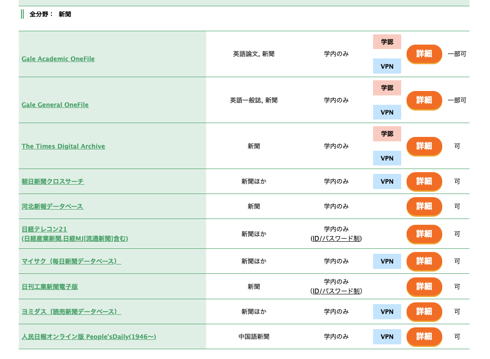
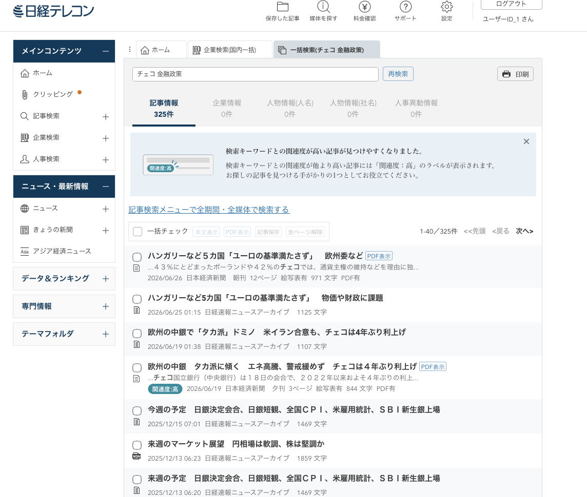
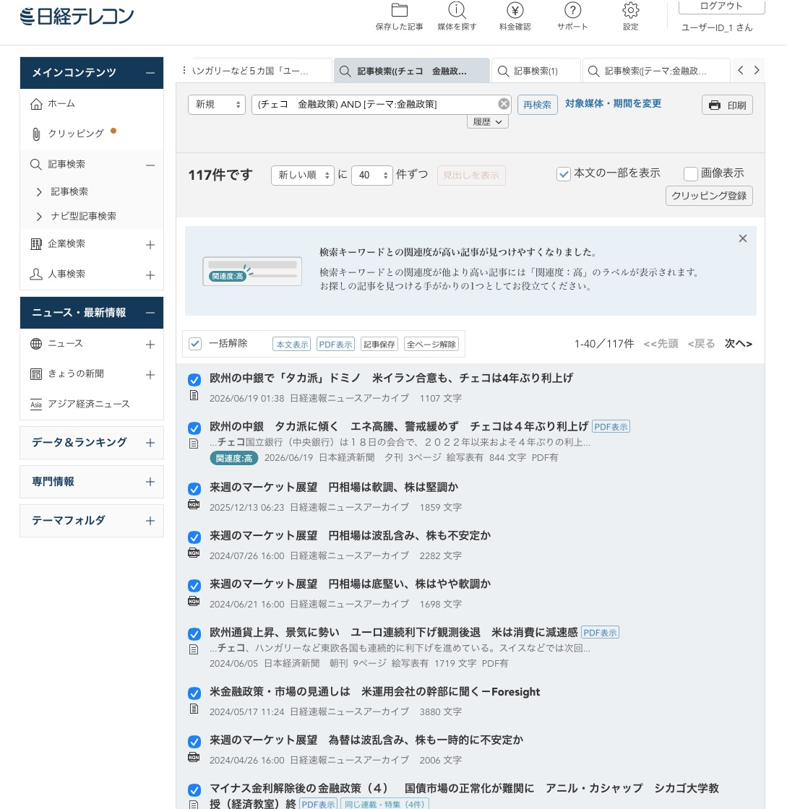
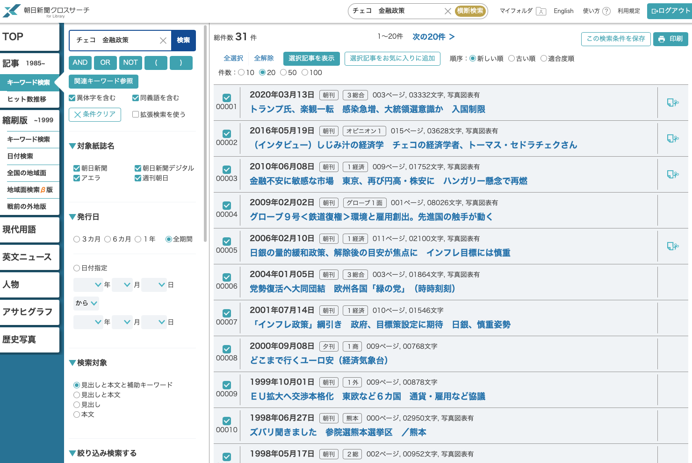
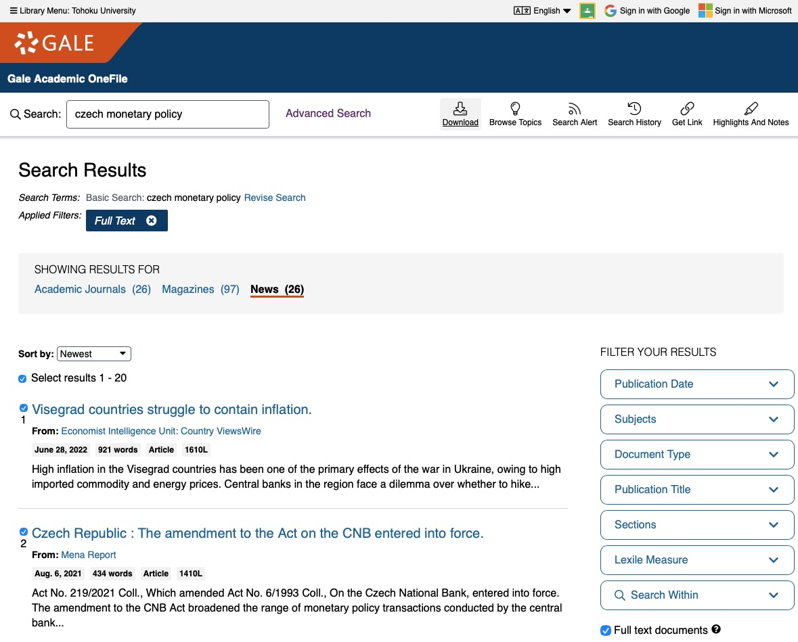

# この資料で扱うこと

新聞記事は、出来事がいつどう報じられたか、当時どんな論点があったかを知るために使います。

前半は、大学が契約している新聞データベース（新聞DB）で記事を探す手順です。後半は、AIにニュースを探させたときに一覧がどう偏るかを、保存してある2つの例で見ます。

# 1. 図書館から新聞DBに入る

新聞DBは、[東北大学附属図書館のデータベース一覧](https://www.library.tohoku.ac.jp/search/database.html)から開きます。

| DB | 主な収録 | 同時アクセス数 |
|---|---|---|
| 日経テレコン21 | 日本経済新聞（1981年10月〜）、日経産業新聞、日経MJ など | 2 |
| 朝日新聞クロスサーチ | 朝日新聞（1879年〜） | 3 |
| ヨミダス | 読売新聞（1874年〜）、The Japan News | 2 |
| 毎索 | 毎日新聞（1872年〜） | 1 |
| 河北新報 | 河北新報（1991年8月〜） | 5 |
| Gale Academic OneFile | 英語の新聞・雑誌 | 制限なし |

同時アクセス数は、同じ時間に使える人数の上限です。

学外からは、学認（東北大ID）かVPNで入ります。使える方法はDBごとに違い、河北新報は学内からだけ使えます。方法は[学外からの利用の案内](https://www.library.tohoku.ac.jp/search/ejournal/remote2.php)にまとまっています。表は2026年9月に確かめた内容です。

# 2. 日経テレコンで記事を探す

1. 図書館のDB一覧で「日経テレコン21」を開きます。
2. 図書館が案内するID・パスワードを、認証画面に自分で入力してログインします。
3. 記事検索の画面で、検索語、対象期間、媒体を指定します。
4. 結果の一覧から、読む記事を絞ります。
5. 読む記事のチェックボックスを選びます。「一括チェック」を使うときは、選ばれる範囲を画面で確かめます。
6. 「本文表示」で、選んだ記事をまとめて表示します。
7. 「印刷」から印刷画面を開きます。
8. 保存先をPDFにして、自分が読むために保存します。
9. 終わったら「ログアウト」を押します。

図の例は「チェコ　金融政策」の検索です。

## PDFの保存：MacとWindows

Macでは、印刷画面の「PDF」から「PDFとして保存」を選ぶか、ブラウザの送信先で「PDFに保存」を選びます。Windowsでは、送信先で「PDFに保存」か「Microsoft Print to PDF」を選びます。名前はブラウザによって少し違います。

# 3. 検索語と条件を変える

同じ出来事でも、検索語と条件によって件数と記事が変わります。例として、日本銀行が2024年3月19日にマイナス金利政策を解除した出来事を調べる場合を考えます。

| 変える条件 | 例 |
|---|---|
| 検索語 | 「マイナス金利 解除」「日銀 利上げ」「金融政策決定会合」 |
| 期間 | 決定日の前後1週間、全期間 |
| 検索する範囲 | 見出しだけ、本文も含める |
| 媒体 | 日本経済新聞の朝刊・夕刊、日経産業新聞 |

期間を決定日の前後に絞ると、当日の報道と、事前の予想記事を分けて読めます。見出しだけの検索は件数が少なく、本文も含めると関連する記事が広く入ります。言い換えた語で検索し直すと、別の角度から書かれた記事が見つかります。「圧力」「対立」のような語を入れると、その見方で書かれた記事が集まります。

# 4. 朝日新聞クロスサーチと英語の新聞

朝日新聞クロスサーチでも、検索語と期間を決め、記事を選び、本文表示、印刷、PDF保存、ログアウトの順に進みます。ボタンの名前は日経テレコンと違いますが、作業の順番は同じです。

英語の新聞は、Gale Academic OneFileで探せます。検索結果を「News」に切り替えると、新聞記事だけが並びます。右側の「Publication Date」「Publication Title」で、期間や紙名を絞れます。

# 5. 検索結果を残す

検索結果の画面をスクリーンショットで保存すると、検索語、件数、記事の見出し、掲載日、紙面が残ります。

# 6. 新聞記事とAI

日経テレコンの[著作権・提供情報の案内](https://b2b-user-support-telecom-support-navi.user-support.b12s.jp/qanavi/copyright/)は、提供する情報を生成AIなどに入力し、学習・解析・加工させることを禁止しています。データを第三者に提供することや、ほかのサイトへ転載することも禁止されています。

# 7. AIが探したニュースは何に偏るか

## 同じ依頼から違う一覧ができる

[Codexの検索例](examples/ai_news_test_codex.md)と[Claudeの検索例](examples/ai_news_test_claude.md)は、歴代の政権による日本銀行の政策への発言を、AIに調べさせた記録です。期間、媒体、言語、一次資料に当たるかどうかは指定していません。どちらも2026年9月17日の出力です。

2つの記録の検索語と出典の一覧を比べると、次の違いがあります。

| 見るところ | Codexの例 | Claudeの例 |
|---|---|---|
| 調べた範囲 | 第2次安倍政権以降と、自分で決めています | 菅政権に触れず、岸田首相の発言は「見つからなかった」で終えています |
| 情報源 | 参照したニュース13件のうち8件が、Reutersの記事とその転載です | 参照した14件のうち4件が、同じ著者の解説コラムです |
| 一次資料 | 官邸・日銀・内閣府の資料と照合したと書いています | 一次資料を開いていないと、自ら書いています |
| 本文を読めた範囲 | 出典ごとの読んだ程度は示していません | 「読んだ」「要約のみ」を区別していて、読んだのは4件です |

AIが自分の記録について書いた説明にも、誤りが入ります。Claudeの例は末尾で「本文を読んだ4件のうち3件が同じ著者のコラム」と書いていますが、出典の表で「読んだ」とある4件のうち、その著者のコラムは2件です。

## 探しやすいものが、重要なものに見える

| 偏り | 一覧に起きること |
|---|---|
| 新近性 | 最近の出来事ほど詳しくなります。Codexの例の政権別の表は、安倍・菅政権が各1項目、高市氏・高市政権が6項目です |
| 公開Webへの集中 | 契約DBの中の記事より、無料で開ける記事や解説が多くなります |
| 言語 | 英語で探すと、海外の読者向けの論点が入りやすくなります |
| 通信社の転載 | URLが違っても、元は同じ記事ということがあります |
| 検索語 | 「圧力」「利上げ」で探すと、対立を扱う記事を拾いやすくなります。AIが前から知っている発言を検索語に入れると、既知の発言に検索が偏りやすくなります |
| 期間と対象 | 依頼にない期間や比較の対象を、AIが断らずに決めます |
| 本文の未確認 | 見出しや、検索結果の短い要約が、本文の代わりに使われます |

## 「しんぶん赤旗」を参照するAI

スタンフォード大学のAndrew B. Hallと早稲田大学のSho Miyazakiによる研究（2026年）は、日本の衆院選を題材に、検索機能を使うAIの5モデルに投票先を尋ねました。共産党のサイトが頻繁に引用され、同サイト内の「しんぶん赤旗」を報道機関として扱う例も見られました。左寄りの政策への賛成を示した利用者には、共産党を勧める回答が集中しました。

著者らは、大手新聞社がAIのアクセスを制限する一方、共産党のサイトや「しんぶん赤旗」はアクセスしやすいことを、背景として指摘しています。AIが選ぶ情報源には、記事の内容だけでなく、どのサイトを読めるかも影響します。[論文](https://andrewbenjaminhall.com/Miyazaki_Hall_Japan_AI.pdf)と[スタンフォード大学による紹介](https://fsi.stanford.edu/news/voters-increasingly-use-ai-political-advisor-new-study-shows-risks)で、実験の内容を読めます。

# 8. 余談：新聞の電子版の料金

図書館の新聞DBは、学生は料金なしで使えます。同じ新聞の電子版を個人で購読すると、料金は次のとおりです。どれも税込みの月額で、2026年11月4日に確かめた料金です。

| 新聞 | 電子版の月額 |
|---|---|
| 日本経済新聞（日経電子版） | 4,277円 |
| 朝日新聞（朝日新聞デジタル） | ベーシック980円、スタンダード1,980円、プレミアム3,800円 |
| 毎日新聞（毎日新聞デジタル） | スタンダード1,078円、プレミアム3,520円 |
| 読売新聞（読売新聞オンライン） | 電子版だけの購読はなく、紙の購読者が追加料金なしで使えます。紙は4,800円（朝夕刊）、3,800円（朝刊だけの地域） |
| 河北新報（河北新報オンライン） | 3,400円 |

朝日新聞デジタルのベーシックで読める有料記事は、1日2〜3本です。日経電子版には学生向けの申し込みページがあり、最初の1か月が無料で、その後は通常の4,277円です。

米国の新聞は、新規の購読者向けの料金がずっと安く、日本からも申し込めます。次は2026年11月4日に日本から見た料金で、1ドル158円（2026年10月の平均）で円に直しています。

| 新聞 | 最初の1年 | 2年目から |
|---|---|---|
| New York Times（All Access） | 4週ごとに2ドル（約320円） | 4週ごとに16ドル（約2,530円） |
| Wall Street Journal（WSJ Digital） | 月2ドル（約320円） | 月9.99ドル（約1,580円） |
| Washington Post（Core） | 4週ごとに2ドル（約320円） | 4週ごとに9ドル（約1,420円） |

# 参照先

- [東北大学附属図書館：データベース一覧](https://www.library.tohoku.ac.jp/search/database.html)
- [東北大学附属図書館：学外からの利用](https://www.library.tohoku.ac.jp/search/ejournal/remote2.php)
- 電子版の料金：[日経電子版（学生向け）](https://www.nikkei.com/promotion/campaign/student/)、[朝日新聞デジタル](https://digital.asahi.com/info/price/)、[読売新聞の購読申し込み](https://434381.yomiuri.co.jp/product/newspaper/subscribe/)、[河北新報オンライン](https://id.kahoku.news/service/plan/)。
- [日経テレコン：著作権・ご提供する情報について](https://b2b-user-support-telecom-support-navi.user-support.b12s.jp/qanavi/copyright/)
- Miyazaki, S. and A. B. Hall (2026), "[Why Do AI Models Tell Left-Wing Voters to Support the Communist Party? AI Voting Advice in Japan’s 2026 General Election](https://andrewbenjaminhall.com/Miyazaki_Hall_Japan_AI.pdf)," ワーキングペーパー、2026年3月17日版。

サービスの情報は、2026年9月に確かめた内容です。
