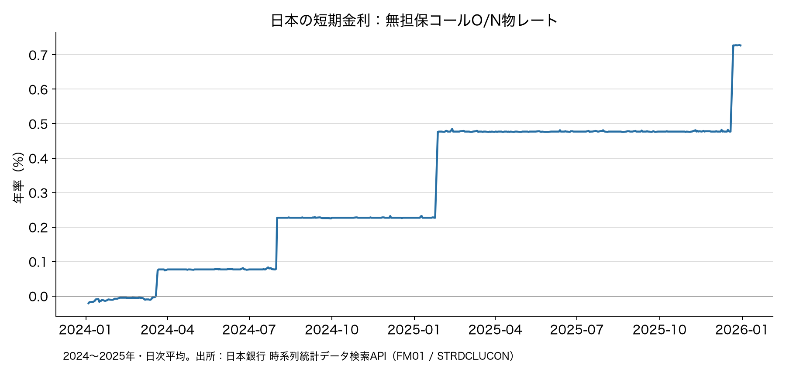
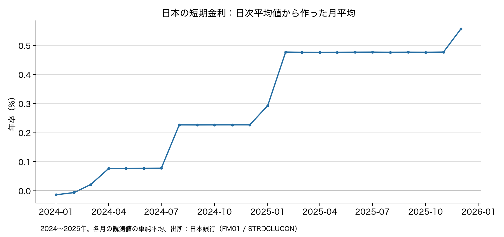

# この資料で作るもの

日本銀行のAPIから、2024〜2025年の無担保コールO/N物レートを取得します。日次の折れ線グラフを作り、同じデータから月平均も計算します。

FREDでは複数の機関が作った統計を取得しました。ここでは、統計を公表する日本銀行から直接取得します。取得後は、pandasで日付と値の表にして、Matplotlibで図を描く流れです。

# 1. 日銀APIで取得できるもの

[日本銀行の時系列統計データ検索サイト](https://www.stat-search.boj.or.jp/)では、金利、為替、マネーストック、企業物価、短観、資金循環などを公開しています。APIでも検索サイトの時系列データを取得できます。ユーザー登録やAPIキーは不要です。

APIは、[2026年2月18日に提供が始まりました](https://www.boj.or.jp/statistics/outline/notice_2026/not260218a.htm)。取得する系列や期間をURLに付けると、JSONやCSVが返ります。

| 使い方 | API | 指定するもの |
|---|---|---|
| 系列コードで時系列を取得する | `getDataCode` | データベース、系列コード、期間 |
| 分類をたどって時系列を取得する | `getDataLayer` | データベース、分類の階層、期間 |
| 系列名などの属性を調べる | `getMetadata` | データベース |

この資料では、系列コードが分かっている場合の `getDataCode` を使います。APIの仕様は[公式マニュアル](https://www.stat-search.boj.or.jp/info/api_manual.pdf)にまとまっています。

# 2. 取得する系列を決める

無担保コールO/N物レートは、金融機関が無担保で翌日まで資金を貸し借りするときの金利です。この例では、市場で成立した金利の日次平均を使います。

| 項目 | この例で使う値 |
|---|---|
| データベース | `FM01` |
| 系列コード | `STRDCLUCON` |
| 系列名 | 無担保コールO/N物レート・平均値 |
| 頻度 | 日次 |
| 単位 | 年率% |
| 取得期間 | 2024年1月〜2025年12月 |

別の系列を探すときは、検索サイトの「系列名称検索」で「コールレート」などの言葉を入れます。表示された系列名、頻度、単位、収録期間を見て、目的に合う系列を選びます。検索サイトでは `FM01'STRDCLUCON` のようにデータベースと系列コードが一緒に表示されます。APIでは、この2つを別々に指定します。

# 3. URLに取得条件を付ける

この例の取得先は、次のURLです。ブラウザでも返答を確認できます。

```text
https://www.stat-search.boj.or.jp/api/v1/getDataCode?db=FM01&code=STRDCLUCON&startDate=202401&endDate=202512
```

`?` の後が取得条件です。`db` はデータベース、`code` は系列コード、`startDate` と `endDate` は期間です。条件どうしは `&` でつながっています。日次系列でも、取得期間は `202401` のように年月で指定します。

Pythonでは、条件を辞書にまとめてURLを作れます。

```python
from urllib.parse import urlencode

params = {
    "db": "FM01",
    "code": "STRDCLUCON",
    "startDate": "202401",
    "endDate": "202512",
}
url = "https://www.stat-search.boj.or.jp/api/v1/getDataCode?" + urlencode(params)
```

# 4. JSONを日付と金利の表にする

返答には、取得結果の状態、系列の情報、日付と値が入っています。保存した返答の冒頭から必要な項目を抜き出すと、次のようになります。

```json
{
  "STATUS": 200,
  "RESULTSET": [{
    "SERIES_CODE": "STRDCLUCON",
    "NAME_OF_TIME_SERIES_J": "無担保コールＯ／Ｎ物レート／平均値 日次／金利",
    "UNIT_J": "年％",
    "FREQUENCY": "DAILY",
    "VALUES": {
      "SURVEY_DATES": [20240101, 20240102, 20240103, 20240104],
      "VALUES": [null, null, null, -0.021]
    }
  }]
}
```

`RESULTSET` は系列のリストです。最初の系列は `[0]` で取り出せます。その中の `SURVEY_DATES` と `VALUES` は同じ順番で対応しています。2024年1月4日の金利は−0.021%です。

[保存済みの返答](example/boj/raw/call_rate.json)を読み込む例です。以下のコードは、作例フォルダを作業場所にして実行します。

```python
import json
from pathlib import Path
import pandas as pd

response = json.loads(Path("raw/call_rate.json").read_text(encoding="utf-8"))
series = response["RESULTSET"][0]
values = series["VALUES"]
df = pd.DataFrame({
    "date": pd.to_datetime([str(date) for date in values["SURVEY_DATES"]], format="%Y%m%d"),
    "rate_pct": values["VALUES"],
})
print(df.head())
```

JSONの `null` は、数値の列ではpandasの欠損になります。この返答には731暦日が入り、観測値があるのは488日です。元の表では休日などの欠損を残し、作図では観測値のある日を結びます。

# 5. 日次のグラフを描く

```python
import matplotlib.pyplot as plt

observed = df.dropna(subset=["rate_pct"])
fig, ax = plt.subplots(figsize=(10, 4.7))
ax.plot(observed["date"], observed["rate_pct"])
ax.axhline(0, color="gray", linewidth=0.8)
ax.set(title="Japan: overnight call rate, 2024–2025",
       xlabel="Date", ylabel="Annual rate (%)")
plt.show()
```



2024年1月4日は−0.021%、2025年12月30日は0.727%です。マイナスの金利からプラスへ移り、段階的に上昇した様子が分かります。両日の差は0.748%ポイントです。金利の水準どうしの差なので、%ポイントで表します。

# 6. 同じデータを月平均にする

日次データを月ごとにまとめると、長い期間の動きを追いやすくなります。各月の観測値の単純平均を計算し、平均に使った日数も残します。

```python
monthly = df.set_index("date")["rate_pct"].resample("MS").agg(["mean", "count"])
monthly = monthly.rename(columns={"mean": "mean_rate_pct", "count": "observations"})
print(monthly.head())
```

`set_index("date")` は日付を表の索引にします。`resample("MS")` は月ごとにまとめ、各月の初日をラベルにします。`mean` は欠損を除いた平均、`count` は値のある日数です。月平均にしても、金利の単位は年率%のままです。



# 7. Codexに取得と作図を頼む

```text
金融論/Lecture10/boj_rate/ に、日銀APIから無担保コールO/N物レートを取得して図にするPythonプログラムを作って。
getDataCodeを使い、dbはFM01、codeはSTRDCLUCONにして。
2024年1月から2025年12月までを取得し、系列名・単位・頻度を確認して。
日付と金利を表にし、休日などのnullは欠損として残して。
観測値のある日を結んだ日次グラフと、各月の観測値の単純平均を使った月次グラフを作って。
元のJSON、取得条件と日時、日次と月次のCSV、2枚の図を保存して。
保存済みの応答があれば、それを使って再実行できるようにして。
```

[実行できる作例](example/boj/boj_example.py)と[使い方](example/boj/README.md)があります。配布する `example/boj/` の中身を `金融論/Lecture10/boj_rate/` に置くと、プログラムとデータがそろいます。プログラムは自分のファイルがある場所を基準に、`raw/` を読み、`data/` と `figures/` に保存します。

| ファイル | 内容 |
|---|---|
| [data/call_rate.csv](example/boj/data/call_rate.csv) | 日付と日次金利 |
| [data/call_rate_monthly.csv](example/boj/data/call_rate_monthly.csv) | 月平均と平均に使った日数 |
| [raw/call_rate.json](example/boj/raw/call_rate.json) | APIから返ったJSON |
| [raw/request.json](example/boj/raw/request.json) | 取得先・取得条件・取得日時 |
| [settings.md](example/boj/settings.md) | 系列の情報と計算結果 |

図の期間や見た目を変えるときは、保存済みのデータを使えます。

```text
APIに再アクセスせず、保存した日銀のデータから2枚の図を作り直して。
日次データが731行、観測値が488個あることと、月平均が24か月分あることを確認して。
```

# 参照先

- [日本銀行：時系列統計データ検索サイト](https://www.stat-search.boj.or.jp/)
- [データ検索の手引き](https://www.stat-search.boj.or.jp/info/nme_aphelp.html)
- [API機能利用マニュアル](https://www.stat-search.boj.or.jp/info/api_manual.pdf)
- [API機能の提供開始](https://www.boj.or.jp/statistics/outline/notice_2026/not260218a.htm)

作例のデータ取得日は2026年11月4日です。APIの説明は2026年11月14日に公式資料で確認しました。
