# この回の資料

マクロ時系列の読み方、FREDの利用、Pythonでのデータ取得、新聞記事とAI検索を扱います。

| 部 | 内容 |
|---|---|
| 1 | [マクロ時系列データの読み方](01_macro_timeseries.md) |
| 2 | [FREDをウェブで使う](02_fred_web.md) |
| 3 | [PythonでFREDのデータを取得し、図を描く](03_fred_download.md) |
| 4 | [新聞記事の検索と、AIによるニュース検索の問題](04_news_search.md) |


# 第1部　マクロ時系列データの読み方 {.part-title}


## この回の資料

第10回は、次の4つの資料で進めます。

| 資料 | 内容 |
|---|---|
| (1) マクロ時系列データの読み方（この資料） | 頻度、変化率、名目と実質、季節調整、欠損 |
| [(2) FREDをウェブで使う](02_fred_web.md) | 系列の検索、図の変換、CSVのダウンロード |
| [(3) PythonでFREDのデータを取得し、図を描く](03_fred_download.md) | CSVでの取得、欠損の扱い、作図 |
| [(4) 新聞記事の検索と、AIによるニュース検索の問題](04_news_search.md) | 図書館の新聞DB、検索の記録、AI検索の偏り |

図と数値には、主に2026年9月28日時点のFREDデータを使っています。GDP改定の比較には9月30日版を使い、Maddison Projectの長期GDPとGDPNowは11月4日に取得しました。

## 1. 時系列データは日付と値の表

時系列データは、同じ指標を一定の間隔で記録した表です。1行が1つの時点に対応します。次は、米国の失業率（FREDの系列ID `UNRATE`）の最後の3行です。

| observation_date | UNRATE |
|---|---:|
| 2026-06-01 | 4.2 |
| 2026-07-01 | 4.1 |
| 2026-08-01 | 4.1 |

記録の間隔を頻度と呼びます。日次、週次、月次、四半期、年次があります。

FREDでは、月次の値をその月の1日の日付で表します。2026-08-01は2026年8月の値で、8月1日の1日だけの値ではありません。四半期も同じで、2026-04-01は2026年4〜6月期の値です。

## 2. よく使う4つの系列

経済全体の動きは、生産、物価、雇用、金利の4つの系列から見始めることが多いです。

| 系列 | 測るもの | 頻度 | 単位 | 日本の作成機関 | 米国の作成機関（FREDのID） |
|---|---|---|---|---|---|
| 実質GDP | 国内で生み出された付加価値の合計 | 四半期 | 金額 | 内閣府 | BEA（`GDPC1`） |
| 消費者物価指数（CPI） | 家計が買う財・サービスの価格 | 月次 | 指数 | 総務省統計局 | BLS（`CPIAUCSL`） |
| 失業率 | 労働力人口に占める失業者の割合 | 月次 | % | 総務省統計局 | BLS（`UNRATE`） |
| 政策金利 | 中央銀行が誘導する短期の金利 | 日次・月平均 | 年率% | 日本銀行 | FRB（`FEDFUNDS`） |

BEAは米国商務省の経済分析局、BLSは米国労働省の労働統計局、FRBは米国の連邦準備制度理事会です。労働力人口は、働いている人と、仕事を探している人の合計です。

日本の政策金利は、日本銀行が誘導目標を決める無担保コール翌日物金利です。米国は、フェデラルファンド金利（FF金利）の誘導目標の範囲です。`FEDFUNDS` は、実際に取引されたFF金利の月平均です。

## 3. 水準と変化率

CPIは、基準の時点の物価を100とした指数です。`CPIAUCSL` は、1982〜84年の平均を100としています。2026年8月の値は334.131で、物価が基準の時点の約3.3倍になったことを表します。

指数の値そのものより、どれだけ変わったかに意味があります。物価の上昇率（インフレ率）は、1年前の同じ月と比べた前年同月比で表すのが一般的です。

$$
\text{前年同月比（\%）} = \left(\frac{x_t}{x_{t-12}} - 1\right)\times 100
$$

$x_t$ は当月の値、$x_{t-12}$ は12か月前の値です。2025年8月のCPIは323.291でした。2026年8月の前年同月比は、(334.131÷323.291−1)×100で3.35%です。

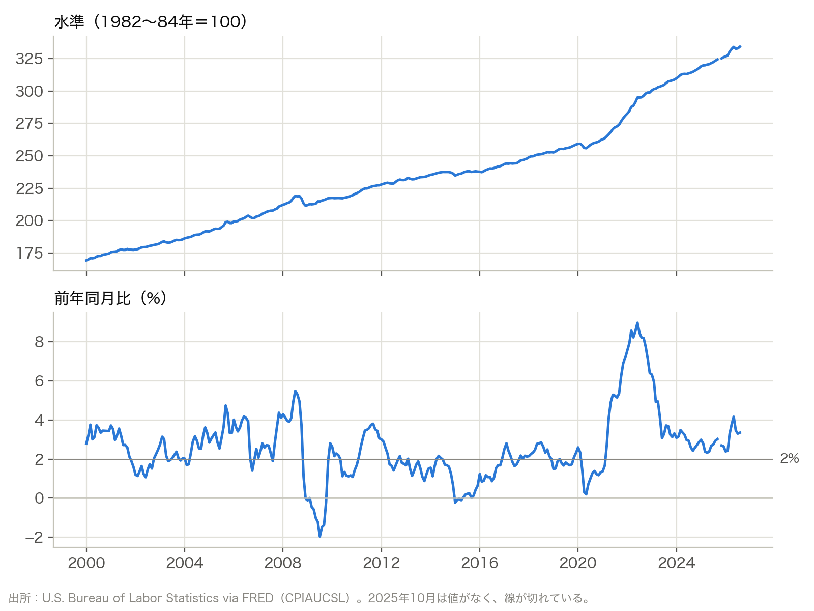

水準の図は右上がりの線になり、いつ物価が速く上がったのかが読み取りにくくなります。前年同月比にすると、2021年春からの急な上昇が見えます。上昇率は2022年6月の8.98%が2000年以降で最も高く、その後は下がりました。2025年の秋に線が切れているのは、第9節で扱う欠損です。

水準の図は、対数目盛りで描くこともできます。対数目盛りでは、上昇率が同じなら線の傾きも同じになります。

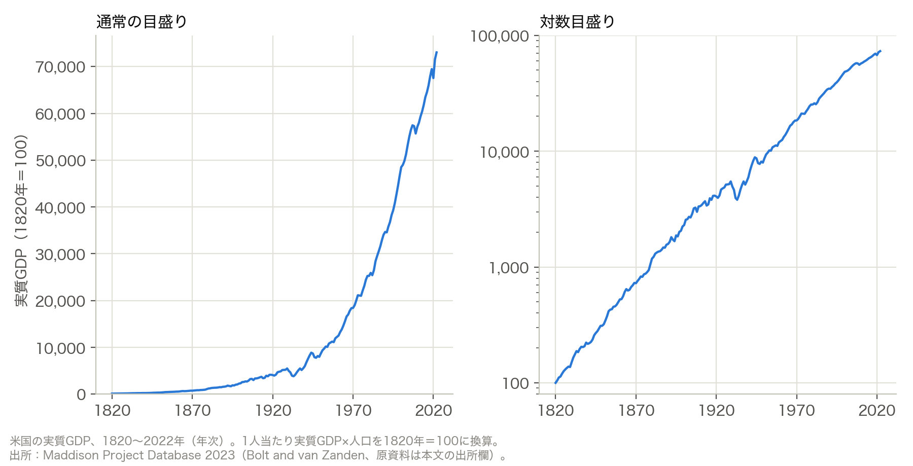

米国の実質GDPは、1820年から2022年までに約730倍になりました。通常の目盛りでは、後になるほど増加幅が大きくなる、指数的な上昇が見えます。対数目盛りでは、長期的な動きがほぼ右上がりの直線になります。右の縦軸では、100から1,000、1,000から10,000への増加が同じ間隔です。どちらも10倍への増加だからです。おおむね一定の割合で成長すると、対数目盛りでは直線に近い形になります。大恐慌や第二次世界大戦の時期には、この長期的な流れからのずれも見えます。

### Maddison Project Databaseとは

[Maddison Project](https://www.rug.nl/ggdc/historicaldevelopment/maddison/)は、Angus Maddisonが作った歴史経済データを引き継ぎ、各国の長期的な経済成長を調べる研究プロジェクトです。オランダのフローニンゲン大学のGroningen Growth and Development Centreがデータを公開しています。

[2023年版](https://www.rug.nl/ggdc/historicaldevelopment/maddison/releases/maddison-project-database-2023)には、169か国の1人当たり実質GDPと人口が、2022年まで収録されています。過去の資料や研究に基づく推計を組み合わせているため、現在のGDP統計が整備される前までさかのぼれます。国によって収録期間は異なります。ExcelやStataの形式でダウンロードできます。

図2では、このデータの米国の1820〜2022年を使っています。1人当たり実質GDPに人口を掛けて米国全体の実質GDPを求め、1820年を100として表しました。同じデータから、国ごとの長期成長や、1人当たりの豊かさの変化も比べられます。

## 4. 前期比年率と前年同期比

四半期のGDPは、直前の期と比べる前期比と、1年前の同じ期と比べる前年同期比の両方で表されます。前期比を、同じ伸びが1年続いたとして換算したものが前期比年率です。米国の報道では、前期比年率がよく使われます。

$$
\text{前期比年率（\%）} = \left[\left(\frac{Y_t}{Y_{t-1}}\right)^4 - 1\right]\times 100
$$

$$
\text{前年同期比（\%）} = \left(\frac{Y_t}{Y_{t-4}} - 1\right)\times 100
$$

米国の実質GDPは、2026年1〜3月期が24兆1,804億ドル、4〜6月期が24兆2,696億ドルでした。前期比は0.37%で、前期比年率は1.48%です。前年同期比は2.10%です。

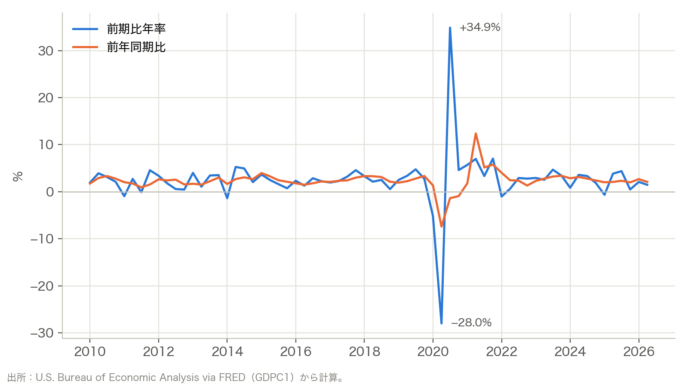

前期比年率は振れが大きく、2020年4〜6月期は−28.0%、7〜9月期は+34.9%でした。前年同期比は動きがなめらかで、2020年4〜6月期は−7.4%です。

## 5. パーセントとパーセントポイント

率どうしの差は、パーセントポイント（%ポイント）で表します。金利が1.0%から1.5%に上がったとき、上昇幅は0.5%ポイントです。変化率で表すと、元の1.0%に対して50%の上昇になります。失業率が4.3%から4.1%に下がったときは、0.2%ポイントの低下です。

## 6. 名目と実質

名目GDPは、その時点の価格で測った金額です。実質GDPは、物価の変化を取り除いた金額です。物価が上がる時期には、生産量が同じでも名目GDPは増えます。経済成長率は、実質GDPの変化率で表します。

米国の2026年4〜6月期は、名目GDP（`GDP`）が32兆4,861億ドル、実質GDP（`GDPC1`）が24兆2,696億ドルです。実質GDPは、2017年を基準年とする連鎖方式で計算した値です。どちらも、四半期の値を1年分に換算した年率で表示されています。

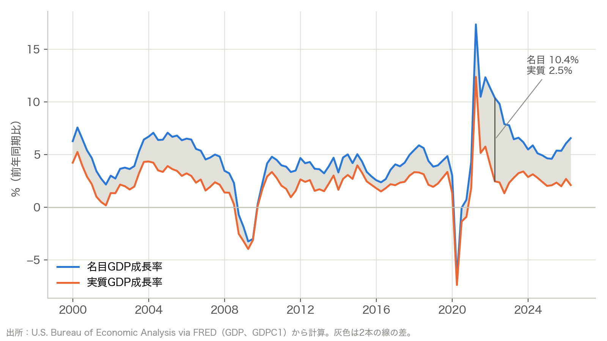

名目の成長率は、実質の成長率に物価の上昇率をほぼ足したものです。図4の灰色の幅が、GDPに含まれる財・サービス全体の物価の上昇率（GDPデフレーターの上昇率）にあたります。2010〜2019年の平均は、名目が4.1%、実質が2.4%でした。2022年4〜6月期は名目が10.4%、実質が2.5%で、差は7.9%ポイントに開きました。2026年4〜6月期も、名目の6.6%に対して実質は2.1%です。

金利にも名目と実質があります。実質金利は、名目金利から予想インフレ率を差し引いたものです。

## 7. 季節調整

月次や四半期の値には、季節による決まった動きが入ります。年末の消費や、ボーナスの時期の支出がその例です。季節調整済み（Seasonally Adjusted）の系列は、この動きを統計的に取り除いたものです。

前月比や前期比は、季節調整済みの系列で計算します。前年同月比は同じ月どうしの比較なので、季節調整をしていない原数値（Not Seasonally Adjusted）でも計算できます。FREDには、同じCPIの季節調整済みの `CPIAUCSL` と、原数値の `CPIAUCNS` があります。2026年8月の値は、それぞれ334.131と334.980です。

季節の動きは、小売売上高ではっきり見えます。FREDでは、季節調整済みが `RSAFS`、原数値が `RSAFSNA` です。

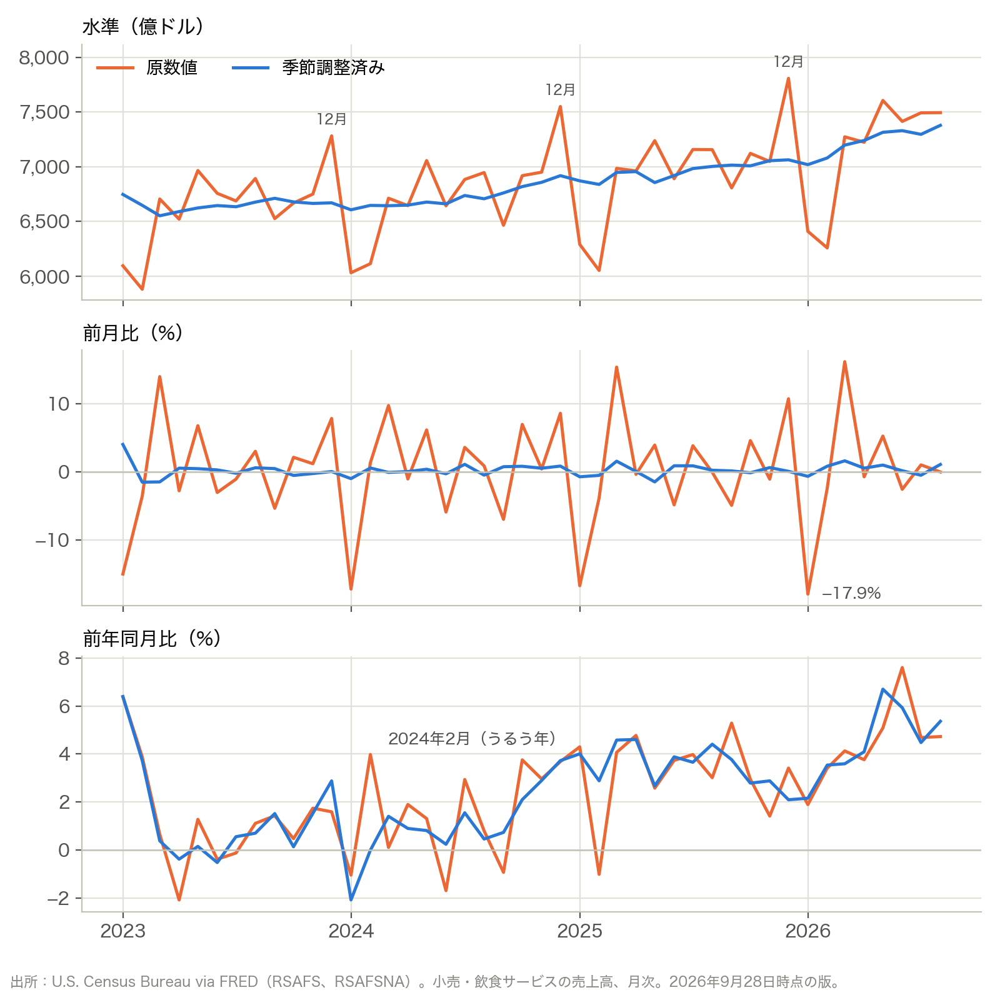

原数値は毎年12月に高くなり、1月と2月に落ち込みます。2026年1月の前月比は、原数値では−17.9%、季節調整済みでは−0.6%です。前年同月比にすると、2本の線は近い動きになります。離れるのは、曜日や祝日の並びが前年と違う月です。2024年2月はうるう年で1日多く、原数値の前年同月比は4.0%、季節調整済みは0.0%でした。

## 8. 基準年の変更と改定

指数の基準年が変わると、過去の値もさかのぼって変わります。GDPは、最初の公表の後に何度も改定されます。同じ系列でも、取得した日によって過去の値が違うことがあります。

この資料のデータを取得した2日後の2026年9月30日に、BEAは米国GDPの年次改定を公表しました。2021年1〜3月期以降の22期がすべて改定され、2020年10〜12月期までの値は変わっていません。

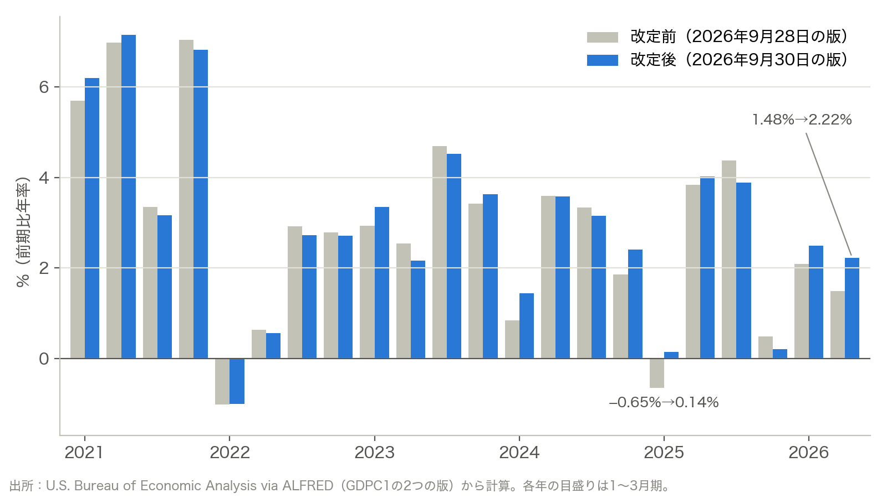

2026年4〜6月期の実質GDPは24兆2,696億ドルから24兆4,080億ドルに、前期比年率は1.48%から2.22%になりました。2025年1〜3月期は−0.65%から0.14%に変わり、マイナス成長がプラス成長になっています。授業の日にFREDから取得すると、第4節と第6節の数値とは違う値が返ってきます。改定前の値は、FREDの過去の版を保存している[ALFRED](https://alfred.stlouisfed.org/)で取り出せます。

速報が出る前から、GDPは予測されています。アトランタ連銀のGDPNowは、公表済みの月次の統計からその期の成長率を推計する予測で、FREDでは `GDPNOW` として見られます。2026年の2つの期について、予測、速報、改定の値を並べると次のようになります。値はどれも実質GDPの前期比年率です。

| 段階 | 2026年4〜6月期 | 2026年7〜9月期 |
|---|---:|---:|
| GDPNowの最後の予測 | 1.54% | 3.27% |
| 速報値 | 1.5%（7月30日） | 3.4%（10月29日） |
| 第2次推計 | 1.5%（8月26日） | |
| 第3次推計と年次改定 | 2.2%（9月30日） | |

4〜6月期は、速報値までは予測とほぼ同じ値でした。2か月後の年次改定で、0.7%ポイント上がっています。

図7は、2011年7〜9月期以降の各期について、GDPNowの最後の予測と速報値を重ねたものです。GDPNowは2014年7月に公開が始まりました。それより前の値も、当時のデータでその時点に計算され、保存されていた予測です。

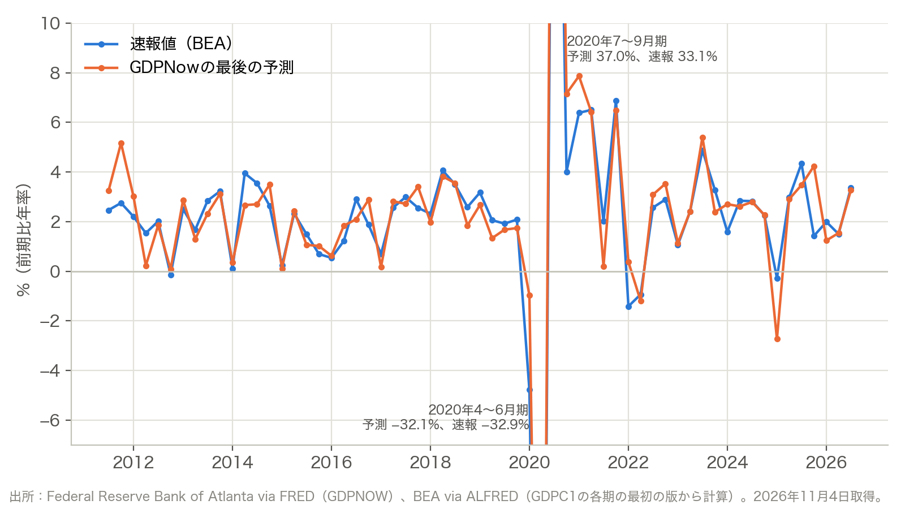

2020年の2期を除く59期で、予測と速報値の差は平均0.73%ポイントでした。速報値と現在の値の差は平均0.87%ポイントで、予測の外れより大きくなっています。外れが大きかったのは、2020年1〜3月期（予測−1.0%、速報−4.8%）と2025年10〜12月期（予測4.2%、速報1.4%）です。

## 9. 欠けている値

### 2025年10月の米国のCPIと失業率

米国のCPIと失業率には、2025年10月の値がありません。図1の線が切れているのは、この月です。

米国では、2025年10月1日から11月12日まで、予算が成立せずに政府機関の一部が閉鎖されました。BLSは、この期間にCPIのデータを集めていません（[BLSの説明](https://www.bls.gov/cpi/additional-resources/2025-federal-government-shutdown-impact-cpi.htm)）。失業率のもとになる家計調査も、10月分は行われませんでした。後からさかのぼって集めることもしなかったため、10月の失業率は存在しません（[BLSの雇用統計](https://www.bls.gov/news.release/archives/empsit_12162025.htm)）。

どちらも、長く途切れずに続いてきた系列です。季節調整をしていない月次のCPIは1921年1月から、失業率は1948年1月から、毎月公表されてきました（[Richmond連銀の解説](https://www.richmondfed.org/research/national_economy/macro_minute/2025/phantom_figures_missing_data_in_october)）。2025年10月は、その初めての空白です。

同じ月でも、値が残った統計があります。企業に聞く事業所調査の雇用者数（`PAYEMS`）は、10月分が11月分と一緒に後から公表されました。金融市場の取引から作るFF金利（`FEDFUNDS`）にも、欠けた月はありません。家計調査は、毎月12日を含む1週間に仕事をしていたか、仕事を探していたかを本人に聞く調査です。過ぎた週の状況を、後から同じ質で聞き直すことはできません。欠けるかどうかは、データの集め方で決まります。

### 空欄の理由はひとつではない

| 空欄の理由 | 例 |
|---|---|
| 調査が行われなかった | 米国のCPIと失業率の2025年10月 |
| まだ公表されていない | 取得した2026年9月28日時点の、2026年9月のCPI（10月14日公表予定） |
| 系列が終わった | FREDにある日本の月次CPI（2021年6月まで） |
| 計算の材料がない | 系列の最初の12か月の前年同月比、2025年11月の前月比 |
| 片方の系列にしか値がない | 2036年までの見通しがある `GDPPOT` と実質GDPから作ったGDPギャップの、2026年7〜9月期以降 |

待てば埋まる空欄、別の資料で探せる空欄、埋まらない空欄があります。

### 欠損の書き方

欠損の書き方は、データによって違います。

| データ | 欠損の書き方 |
|---|---|
| FREDのCSV（2026年9月） | 空欄 |
| FREDのAPI（JSON） | `.` |
| FREDのCSV（2024年にダウンロードしたもの） | `.` |
| BLSの表 | `-`（ダッシュ）と注 |

同じFREDでも、取り出し方と時期で書き方が違います。`.` を欠損として読み込めないと、プログラムが止まったり、列全体が文字として扱われたりします。

欠けた値を推計で補うこともできます。9月と11月の値を直線で結ぶと、10月のCPIは324.654になります。欠損の扱い方で計算結果がどう変わるかは、[(3)の第3節](03_fred_download.md)で確かめます。

## 10. 系列はどこから来るか

FREDは、米国のセントルイス連邦準備銀行が運営するデータベースです。BLSやBEAなどの作成機関が公表した系列を集め、同じ形式で提供しています。系列のページには、元の作成機関（Source）が書かれています。

日本の系列もFREDにありますが、国際機関を経由したものが多く、更新が止まっているものがあります。例えば、日本の月次CPIの系列は、どれも2021年6月で終わっています。日本の最新の数値は、作成機関の統計で確かめます。

| 統計 | 作成機関の入口 |
|---|---|
| 消費者物価指数 | [総務省統計局：消費者物価指数](https://www.stat.go.jp/data/cpi/) |
| 失業率 | [総務省統計局：労働力調査](https://www.stat.go.jp/data/roudou/) |
| GDP | [内閣府：国民経済計算](https://www.esri.cao.go.jp/jp/sna/menu.html) |
| 金利・マネー | [日本銀行：時系列統計データ検索サイト](https://www.stat-search.boj.or.jp/) |
| 各府省の統計 | [e-Stat（政府統計の総合窓口）](https://www.e-stat.go.jp/) |

## 出所

- 図2を除く本文と図の数値：FRED（`UNRATE`、`CPIAUCSL`、`CPIAUCNS`、`GDPC1`、`GDP`、`PAYEMS`、`FEDFUNDS`、`RSAFS`、`RSAFSNA`、`GDPNOW`）。作成機関はBLS、BEA、FRB、Census Bureau。2026年9月28日取得。図6の改定後の値は、ALFREDの `GDPC1` の2026年9月30日の版。第8節の表の速報値と推計値は、ALFREDの `A191RL1Q225SBEA` の各版。図7の速報値は、ALFREDの `GDPC1` の各期の最初の版から計算。`GDPNOW` と、現在の値（`A191RL1Q225SBEA`）は2026年11月4日取得。
- 図2：[Maddison Project Database 2023](https://doi.org/10.34894/INZBF2)。Bolt, J. and J. L. van Zanden (2024), "[Maddison-style estimates of the evolution of the world economy: A new 2023 update](https://doi.org/10.1111/joes.12618)." 2026年11月4日取得。
- 図2の米国系列の原資料（データベースのSources・Maddison original sourcesシート）：Sutch, R. (2006), "National Income and Product," *Historical Statistics of the United States: Earliest Times to the Present*, III-23–25；Prados de la Escosura, L. (2009), "Lost Decades? Economic Performance in Post-Independence Latin America," *Journal of Latin American Studies* 41, 279–307（更新データ）；Maddison (1995)の1820〜1950年系列；2008〜2022年はThe Conference BoardのTotal Economy Database。
- [BEA：2026年の年次改定の案内](https://www.bea.gov/AnnualUpdate)
- [BLS：2025年の政府機関閉鎖によるCPIへの影響](https://www.bls.gov/cpi/additional-resources/2025-federal-government-shutdown-impact-cpi.htm)
- [BLS：Employment Situation（2025年11月分、2025年12月16日公表）](https://www.bls.gov/news.release/archives/empsit_12162025.htm)
- [BLS：欠損データの扱い](https://www.bls.gov/bls/bls-handling-of-missing-data.htm)
- O'Trakoun, J. (2025) "[Phantom Figures: Missing Data in October](https://www.richmondfed.org/research/national_economy/macro_minute/2025/phantom_figures_missing_data_in_october)," Federal Reserve Bank of Richmond, Macro Minute.


# 第2部　FREDをウェブで使う {.part-title}


## この資料で作るもの

[FRED](https://fred.stlouisfed.org/)のサイトで系列を探し、図を変換してCSVに保存します。題材は、米国のCPIから作るインフレ率と、実質GDPと潜在GDPから作るGDPギャップです。ここまではブラウザだけでできて、アカウントは要りません。

画面は2026年9月28日のものです。

## 1. 系列を探す

トップページの検索欄に、英語で語を入れて探します。例えば「consumer price index」「unemployment rate」です。

検索結果には、同じ指標の系列が複数並びます。月次と四半期、季節調整済みと原数値、国の違いで、それぞれ別の系列になっています。左側の「Filter by」で、頻度（Frequencies）、季節調整（Seasonal Adjustments）、作成機関（Sources）などを絞り込めます。

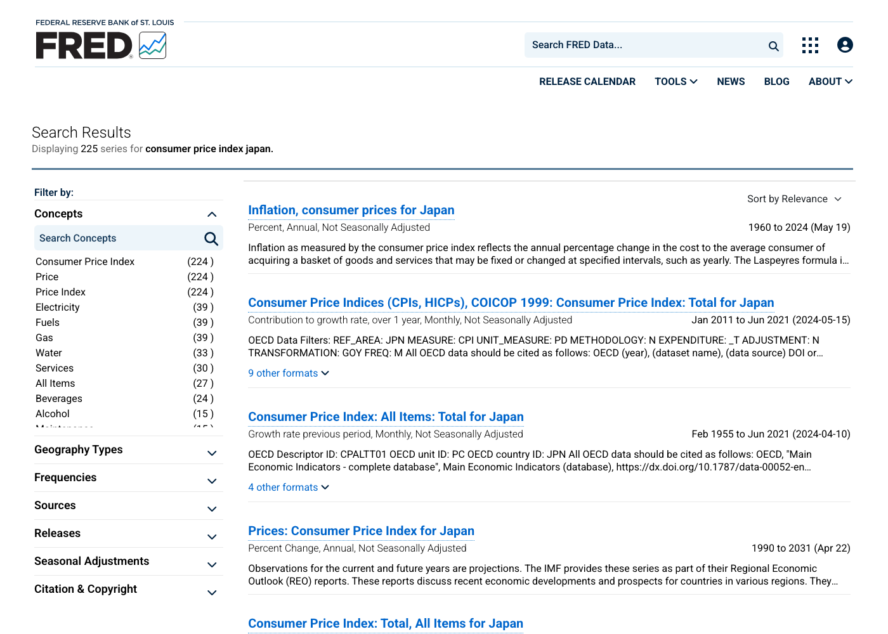

各系列の右側には、収録期間と最終更新日が出ます。図1の2番目と3番目は日本の月次CPIですが、2021年6月で終わっていて、最終更新も2024年です。4番目はIMFの年次の系列で、2031年までの値には予測が含まれます。

各系列には、系列ID（series ID）という英数字の名前があります。米国のCPIは `CPIAUCSL`、失業率は `UNRATE` です。IDが分かっていれば、`https://fred.stlouisfed.org/series/UNRATE` のようにURLで直接開けます。次の資料でも、このIDで系列を指定してCSVを取得します。

## 2. 系列ページを読む


系列ページの上部に、系列の基本情報がまとまっています。

| 表示 | 図2の例 | 意味 |
|---|---|---|
| Observations | Aug 2026: 334.131 | 最新の観測値と、その時点 |
| Updated | Sep 11, 2026 | FREDで最後に更新された日時 |
| Next Release Date | Oct 14, 2026 | 次の公表予定日 |
| Units | Index 1982-1984=100, Seasonally Adjusted | 単位と季節調整の有無 |
| Frequency | Monthly | 頻度 |

図の下の「Source」が作成機関で、この系列はBLS（米国労働統計局）です。ページの下の「Notes」には、系列の定義と作成方法の説明があります。

さらに下には、データの著作権の区分が表示されます。`CPIAUCSL` は「Public Domain: Citation Requested」で、使うときに出所を書くよう求められています。株価指数など、著作権のある系列もあります。

期間は、図の右上の「1Y」「5Y」「10Y」「Max」か、日付の欄で変えられます。図の灰色の帯は、米国の景気後退期です。

## 3. 単位を変える：CPIからインフレ率を作る

「Edit Graph」を押すと、右側に編集画面が開きます。上のタブの「EDIT LINE」で、表示中の系列を変換できます。

「Units」で「Percent Change from Year Ago」を選ぶと、前年同月比の図になります。系列ページの上の「Units」の表示も変わり、2026年8月の値は3.4になります。(1)で計算した3.35%を丸めた値です。

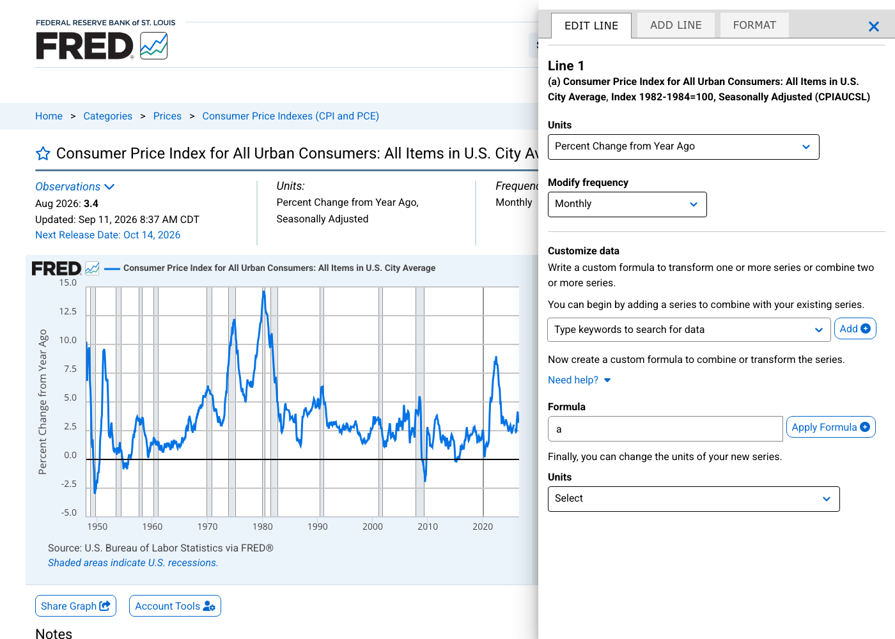

「Units」の選択肢は、(1)で扱った変化率と次のように対応します。

| Unitsの表示 | 変化率 |
|---|---|
| Percent Change | 前期比（月次なら前月比） |
| Percent Change from Year Ago | 前年同期比（月次なら前年同月比） |
| Compounded Annual Rate of Change | 前期比年率 |

「Modify frequency」では、頻度を変えられます。月次のCPIを「Quarterly」にすると、集計方法（Average、Sum、End of Period）を選ぶ欄が出ます。Averageなら3か月の平均が、End of Periodなら各期の最後の月の値が、四半期の値になります。欠けた月がある期は、残った月だけの平均になります（[(1)の第9節](01_macro_timeseries.md)）。

## 4. 系列を組み合わせる：GDPギャップ

GDPギャップは、実際のGDPが潜在GDPからどれだけ離れているかを表します。潜在GDPは、景気の過熱や落ち込みがないときに実現する生産の水準です。

$$
\text{GDPギャップ（\%）} = 100\times\frac{\text{実質GDP} - \text{潜在GDP}}{\text{潜在GDP}}
$$

米国の潜在GDPは、議会予算局（CBO）の推計がFREDにあります（`GDPPOT`）。次の手順で、2つの系列から式でGDPギャップの図を作れます。

1. 実質GDP（`GDPC1`）の系列ページで「Edit Graph」を開きます。
2. 「Customize data」の検索欄に `GDPPOT` と入れ、候補を選んで「Add」を押します。最初の系列が a、追加した系列が b になります。
3. 「Formula」に `100*(a-b)/b` と入れ、「Apply Formula」を押します。


2026年4〜6月期のGDPギャップは、画面を保存した9月28日時点では0.83%でした。9月30日のGDP年次改定を反映すると1.40%になります。どちらも、実際のGDPが潜在GDPを少し上回っています。2020年4〜6月期は−8.83%でした。

`GDPPOT` には2036年までの見通しも入っています。

「ADD LINE」のタブでは、別の系列を同じ図に重ねられます。インフレ率に政策金利（`FEDFUNDS`）を重ねると、どちらも%なので同じ目盛りで比べられます。

## 5. CSVをダウンロードする

「Download」から「CSV (data)」を選ぶと、図に表示している系列のデータを保存できます。Unitsや式で変換した場合は、変換した後の値が保存されます。

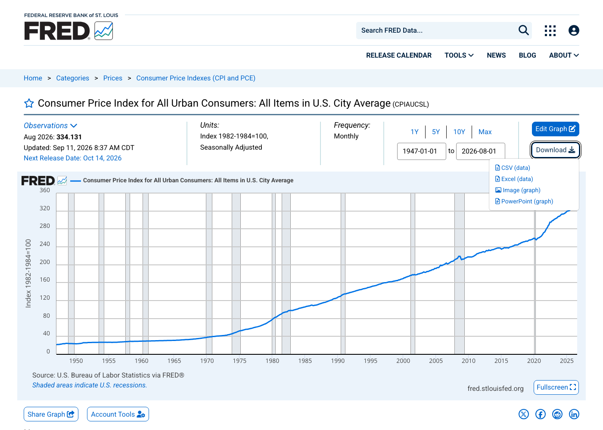

図3の状態でダウンロードしたCSVを、テキストエディタで開くと次のようになっています。

```text
observation_date,CPIAUCSL_PC1
2025-09-01,3.02257
2025-10-01,
2025-11-01,2.69644
```

1行目は列名です。`_PC1` は、前年同月比（Percent Change from Year Ago）に変換したことを表します。2025年10月の空欄は、この月のCPIが作成されなかったためです。

式で作った列は、`GDPC1_GDPPOT` のように、使った系列IDをつないだ名前になります。式そのものはCSVに残りません。

Excelで開くと、日付の表示が変わることがあります。元の値のまま見るには、テキストエディタで開きます。

## 6. 日本のデータを探すとき

FREDには日本の系列もあります。失業率（`LRUNTTTTJPM156S`）、コールレート（`IRSTCI01JPM156N`）、円ドル相場（`EXJPUS`）は、2026年7〜8月の値まで入っています。一方、月次のCPIは2021年6月で止まっています。

日本の統計を作成機関のAPIから取得する方法は、第11回で扱います。

## 7. 豆知識：画面を自動で撮る

この資料の図1〜図5は、人がブラウザで撮った画面ではありません。プログラムがブラウザを開き、FREDのページを表示し、ボタンを押してから画面を保存しました。Claudeが作って実行したプログラムです。

使ったのは、ブラウザをプログラムから操作するPlaywrightというライブラリです。ページを開く、「Edit Graph」を押す、「Units」の選択肢を選ぶ、式を入力する、画面を保存する、という操作を1つずつ書いてあります。人がブラウザで行う操作を、そのまま順番に並べた形です。同じプログラムを `example/fred_screenshots.py` に置いています。


# 第3部　PythonでFREDのデータを取得し、図を描く {.part-title}


## この資料で作るもの

FREDから米国のCPIと政策金利をCSVで取得し、インフレ率と政策金利の図を作ります。次に4つの系列を組み合わせて、テイラールールの図を描きます。新聞記事の件数から作られた経済政策不確実性指数も扱います。

| 段階 | 作るもの |
|---|---|
| 系列を取得する | 取得したCSV、取得条件の記録 |
| インフレ率を計算する | 前年同月比の表、FREDの計算との照合 |
| 欠損の扱いを比べる | 4通りの扱いによる前年同月比の表と図 |
| 図を描く | インフレ率と政策金利の図 |
| 系列を組み合わせる | 四半期の表、テイラールールの図 |
| 記事の件数から作られた指数を見る | 経済政策不確実性指数の図 |

作業用フォルダは `fred_analysis/` です。取得・計算・作図のプログラムはCodexに作ってもらい、出てきた表と図を確かめます。インフレ率と政策金利の図までを1つのファイルにまとめた手本が、`example/fred_example.py` にあります。

## 1. 系列を取得する

FREDのデータは、ウェブの「Download」と同じCSVを、プログラムから取得できます。アカウントは要りません。取得先は `https://fred.stlouisfed.org/graph/fredgraph.csv` で、系列IDを `id`、開始日を `cosd` で指定します。Pythonでは次のように書けます。`URL` には、この取得先のアドレスが入っています。

```python
params = {"id": "CPIAUCSL", "cosd": "1999-01-01"}
r = requests.get(URL, params=params, timeout=30)
cpi = pd.read_csv(io.StringIO(r.text))
```

返ってくるCSVは、[(2)の第5節](02_fred_web.md)でダウンロードしたものと同じ形です。1列目が `observation_date`、2列目が系列IDの列で、欠けている時点は空欄です。

Codexへの依頼文です。

```text
fred_analysis/ に、FREDの fredgraph.csv から系列を取得するプログラムを作ってください。
CPIAUCSL を1999年1月から、FEDFUNDS を2000年1月から取得したいです。
取得したCSVをそのまま raw/ に、date と value の列にしたCSVを data/ に保存してください。
各系列の取得に使ったURLと取得日時を settings.md にまとめてください。
```

取得できたら、画面に出た行数、最初と最後の日付、欠損の数を見ます。`CPIAUCSL` は2025年10月が欠損です。ウェブの系列ページの最新値と、CSVの最後の行が一致すれば、同じ系列を取得できています。CPIを1999年から取るのは、2000年1月の前年同月比に1999年1月の値が要るからです。

## 2. インフレ率を計算する

前年同月比は、12か月前の値との比で計算します。`cpi` は、`CPIAUCSL` のCSVを読み込んだ表です。

```python
cpi["inflation"] = (cpi["value"] / cpi["value"].shift(12) - 1) * 100
```

`shift(12)` は、12行前の値を同じ行に並べます。行が1か月ずつ並んでいれば、12行前は12か月前です。欠損の2025年10月も行としては残っているので、行はずれません。2025年10月の前年同月比は欠損になります。

URLに `transformation=pc1` を加えると、FREDが計算した前年同月比を受け取れます。ウェブの「Percent Change from Year Ago」と同じ変換です。手元の計算と比べると、式の誤りや行のずれに気づけます。

```text
data/ のCPIAUCSLから、前年同月比のインフレ率を計算してください。
同じ期間を transformation=pc1 でも取得し、手元の計算との差の最大値を表示してください。
欠損の月は、前後の値で埋めずに欠損のまま残してください。
結果を data/inflation.csv に保存してください。
```

2026年9月28日に取得したデータでは、2026年8月の前年同月比は、FREDの変換でも手元の計算でも3.353%です。

## 3. 欠損の扱いで数字が変わる

2025年10月のCPIは欠損しています（[(1)の第9節](01_macro_timeseries.md)）。この欠損の扱いを変え、CPIから計算する前年同月比がどう変わるかを比べます。まず、欠損した10月と、その直後の11月を見ます。

`shift(12)` が参照するのは、12行前の値です。10月の値が空欄でも行を残せば、毎月1行ずつ並ぶので12行前は前年の同じ月になります。10月の行を消すと、11月以降の行が1つずつ詰まり、比較相手がずれます。

| 2025年11月の計算 | 12行前にある月 | 比較する期間 |
|---|---|---|
| 10月の行を残す | 2024年11月 | 12か月 |
| 10月の行を消す | 2024年10月 | 13か月 |

行を残した計算では、11月の前年同月比は2.70%です。行を消した計算では、13か月前からの変化率である2.99%が、前年同月比の欄に入ってしまいます。

次に、10月の行を消す代わりに、空欄を前月の値や0で埋めた場合も並べます。

| 扱い方 | 2025年10月：欠損した月 | 2025年11月：その直後の月 |
|---|---:|---:|
| 欠損のまま残す | 欠損 | 2.70% |
| 欠損の行を消してから、12行前と比べる | 行がない | 2.99% |
| 欠損の月を、前の月の値で埋める | 2.73% | 2.70% |
| 欠損の月を、0で埋める | −100% | 2.70% |

前の月の値で埋めると、観測値のない10月に2.73%という変化率が生まれます。0で埋めると、CPIが前年からゼロまで下がった計算になり、−100%になります。11月は11月同士を比べるので、この2通りの補完では値が変わりません。

図は、影響が後の月にも続く様子を、保存データの最後の2026年8月まで示しています。

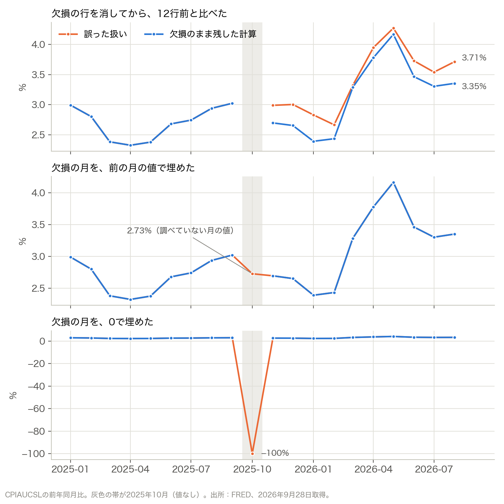

行を消した場合、12行前が13か月前になる状態は、2025年11月から2026年10月まで続きます。また、2026年10月の前年同月比では、補完した2025年10月の値が分母になります。前月の値で埋めていればその値との比較になり、0で埋めていれば0で割る計算になります。

同じ計算は、`cpi["value"].pct_change(12, fill_method=None) * 100` でもできます。pandas 3系では、欠損値を自動で補完しません。pandas 2.2では既定で前月の値を使って補完するため、`fill_method=None` を明示すると、欠損のまま計算できます（[pandasの仕様](https://pandas.pydata.org/docs/reference/api/pandas.DataFrame.pct_change.html)）。

```text
data/ のCPIAUCSLについて、2025年10月の欠損を次の4通りで扱い、前年同月比を比べて。
欠損のまま残す、欠損の行を消してから12行前と比べる、前の月の値で埋める、0で埋める。
まず2025年10月と11月の結果を表にして。11月の計算で比較している相手の年月も示して。
次に、2025年9月から2026年8月までを1つの表にし、欠損のまま残した計算と値が違う月を示して。
4通りの結果を並べた図を figures/missing_handling.png に保存して。
```

欠損の月の前後の行を表示させると、扱いの違いが見えます。

## 4. 図を描く

インフレ率と政策金利は、どちらも%で表されます。同じ目盛りの1枚の図に重ねられます。

```text
data/inflation.csv と FEDFUNDS のデータから、2000年以降のインフレ率と政策金利を1枚の折れ線グラフにしてください。
縦軸は%、横軸は年です。2%の水平線を細く引いてください。
凡例を付け、出所（FRED、系列ID）と取得日を図の下に入れてください。
figures/inflation_policy_rate.png に保存してください。
```

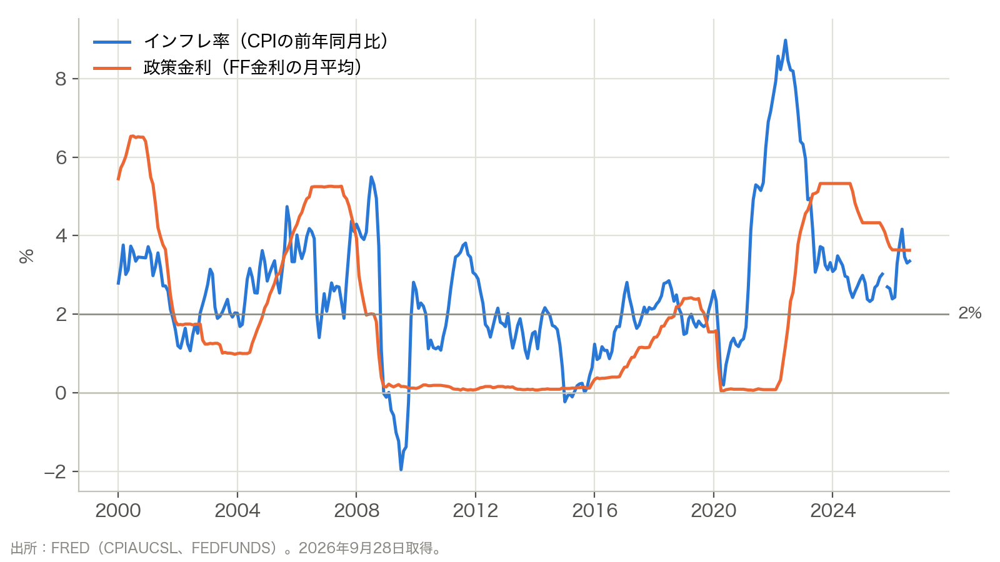

2021年春からインフレ率が上がり、政策金利は2022年3月から上がり始めました。インフレ率が3%前後まで下がった後も、政策金利は1年ほど5%台にありました。2026年8月は、インフレ率が3.35%、政策金利が3.63%です。

図ができたら、図の1点を元のCSVに戻して確かめます。右端の2つの値が、CSVの2026年8月の行と一致するかを見ます。

## 5. 系列を組み合わせる：テイラールール

テイラールールは、政策金利をインフレ率とGDPギャップから計算する式です（Taylor 1993）。中央銀行がおおむねこう動いてきた、という経験則を1本の式にしたものです。

$$
i_t = r^* + \pi_t + 0.5\,(\pi_t - \pi^*) + 0.5\,\text{gap}_t
$$

$i_t$ は政策金利、$\pi_t$ はインフレ率、$\text{gap}_t$ はGDPギャップです。$\pi^*$ はインフレ目標、$r^*$ は均衡実質金利で、Taylorの論文に合わせてどちらも2%とします。インフレ率が1%ポイント上がると、式の金利は1.5%ポイント上がります。

GDPは四半期、CPIと政策金利は月次です。月次の系列を四半期の平均にして、頻度をそろえます。2025年10〜12月期のCPIは、11月と12月の2か月の平均になります。平均に使った月数を表に残しておくと、後から見てもこの期だけ2か月分だと分かります。GDPギャップは、[(2)の第4節](02_fred_web.md)と同じ式です。

### FREDのウェブ上で計算する

FREDの「Customize data」で3つの系列を同じ線に加えると、テイラールールの金利を計算できます。ブラウザだけで、実際の政策金利と重ねた図まで作れます。

1. [実質GDP（GDPC1）](https://fred.stlouisfed.org/series/GDPC1)を開き、「Edit Graph」の「EDIT LINE」を選びます。
2. 「Customize data」で `GDPPOT` を検索して追加し、続けて `CPIAUCSL` も追加します。系列に付いた文字は、実質GDPが a、潜在GDPが b、CPIが c になります。
3. 「Modify frequency」を「Quarterly」、集計方法を「Average」にします。各系列の「Units」を、次の表のように設定します。

| 文字 | 系列 | Unitsで使う値 |
|---|---|---|
| a | 実質GDP（GDPC1） | 元の金額（Billions of Chained 2017 Dollars） |
| b | 潜在GDP（GDPPOT） | 元の金額（Billions of Chained 2017 Dollars） |
| c | CPI（CPIAUCSL） | Percent Change from Year Ago |

FREDは、頻度の集計、Unitsの変換、Formulaの計算の順に処理します。この設定では、c は「CPIの四半期平均から計算した前年同期比」です（[FREDの処理順序](https://fred.stlouisfed.org/help/data/understanding-the-data/what-is-the-order-of-processing-in-fred-graph)）。

4. 「Formula」に次の式を入れ、「Apply Formula」を押します。

```text
2+c+0.5*(c-2)+0.5*100*(a-b)/b
```

`c` がインフレ率、`100*(a-b)/b` がGDPギャップです。式を適用した値が、テイラールールの金利（%）になります。追加順を変えた場合は、画面に表示された文字と式の対応をそろえます。

5. 「ADD LINE」から `FEDFUNDS` を追加します。この線は「Quarterly」「Average」にし、「Units」は元の「Percent」にします。これで実際の政策金利と、式から計算した金利が同じ図に並びます。
6. 表示期間の開始を1990年1月にすると、下の作例と期間をそろえられます。「Download」の「CSV (data)」で、2本の線の値を保存できます。

同じ取得時点のデータなら、この方法と次のPythonの計算で同じ値になります。例えば、2026年4〜6月期のテイラールールの金利は7.40%、実際の政策金利は3.63%です。

### Pythonで同じ計算をする

```text
FREDの fredgraph.csv から GDPC1、GDPPOT、CPIAUCSL、FEDFUNDS を取得し、1990年以降の四半期の表を作ってください。
月次の系列は四半期の平均にし、平均に使った月数も列に残してください。
インフレ率はCPIの四半期平均の前年同期比、GDPギャップは 100*(GDPC1-GDPPOT)/GDPPOT とします。
テイラールールの金利を 2 + インフレ率 + 0.5*(インフレ率-2) + 0.5*GDPギャップ で計算してください。
表を data/taylor.csv に保存し、実際の政策金利と1枚の図にして figures/taylor_rule.png に保存してください。
```

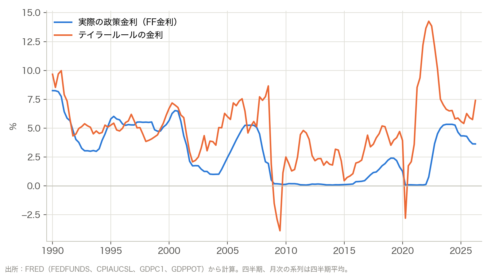

1990年代半ばから2000年ごろは、2本の線が近い動きをしています。2009年7〜9月期には式の金利が−3.89%まで下がりましたが、実際の金利はゼロ近くで止まりました。名目金利は、ゼロより大きく下げにくいためです。2022年4〜6月期には式の金利が14.26%まで上がり、実際の金利は遅れて上がりました。2026年4〜6月期は、式の金利が7.40%、実際の金利が3.63%です。

式の値は、どの物価指数を使うか、GDPギャップを誰の推計で測るか、係数をいくつにするかで変わります。

## 6. 記事の件数を指数にする

新聞記事の件数は、それ自体がデータになります。経済政策不確実性指数（Economic Policy Uncertainty Index）は、経済、不確実性、政策にかかわる語をそれぞれ1つ以上含む記事の割合を、月ごとに求めて作る指数です（Baker, Bloom and Davis 2016）。米国の指数は、New York TimesやWall Street Journalなど10紙の記事から作られています。FREDでは `USEPUNEWSINDXM` として取得できます。

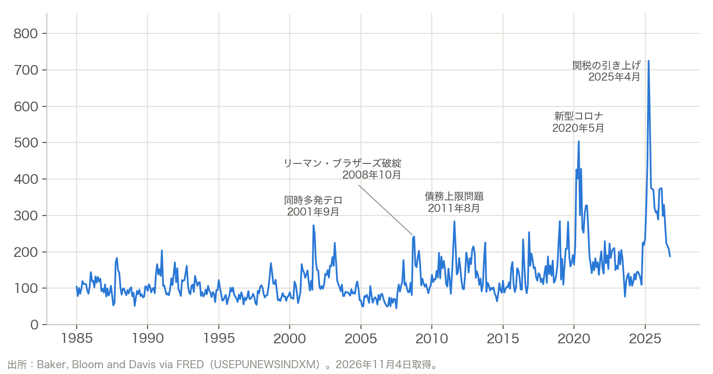

1985年以降で最も高いのは、2025年4月の724.9です。2020年5月の504.0を上回っています。2001年9月、2008年10月、2011年8月にも山があります。

日本の指数は、読売新聞、朝日新聞、毎日新聞、日本経済新聞の4紙から作られています（Arbatli et al. 2022）。[新聞DBの一覧](04_news_search.md)にあるヨミダス、朝日新聞クロスサーチ、毎索、日経テレコンが収録している新聞です。FREDにある日本の指数（`JPNEPUINDXM`）は、2016年4月で止まっています。

## 7. 保存したデータから作り直す

取得したデータを保存しておくと、図を直すたびにFREDへ問い合わせずに済みます。

```text
FREDに再アクセスせず、data/ の保存済みCSVから2つの図を作り直してください。
前の図と同じ値になるかを確かめ、取得と作図のプログラムの場所を settings.md に書いてください。
```

## 参考資料

- Baker, S. R., N. Bloom and S. J. Davis (2016) "[Measuring Economic Policy Uncertainty](https://www.policyuncertainty.com/methodology.html)," *Quarterly Journal of Economics* 131(4), 1593–1636.
- Arbatli Saxegaard, E. C., S. J. Davis, A. Ito and N. Miake (2022) "Policy Uncertainty in Japan," *Journal of the Japanese and International Economies* 64, 101192. 作業論文版は[NBER Working Paper 23411](https://www.nber.org/papers/w23411)。
- 図4の数値：FRED（`USEPUNEWSINDXM`）。2026年11月4日取得。
- FREDのCSV：`https://fred.stlouisfed.org/graph/fredgraph.csv`（ウェブの「Download」と同じ形式）、[利用規約](https://fred.stlouisfed.org/legal/)。2026年11月4日確認。
- FREDのグラフ編集：[系列の追加と式の入力](https://fred.stlouisfed.org/help/graphs/customize-a-fred-graph/data-transformation-add-series-to-existing-line)、[集計・変換・式の処理順序](https://fred.stlouisfed.org/help/data/understanding-the-data/what-is-the-order-of-processing-in-fred-graph)。2026年11月4日確認。
- Taylor, J. B. (1993) "Discretion versus policy rules in practice," *Carnegie-Rochester Conference Series on Public Policy* 39, 195–214.
- 図の数値：FRED（`CPIAUCSL`、`FEDFUNDS`、`GDPC1`、`GDPPOT`）。作成機関はBLS、FRB、BEA、CBO。2026年9月28日取得。図3の `GDPC1` は、ALFREDの2026年9月30日の版。


# 第4部　新聞記事の検索と、AIによるニュース検索の問題 {.part-title}


## この資料で扱うこと

新聞記事は、出来事がいつどう報じられたか、当時どんな論点があったかを知るために使います。

前半は、大学が契約している新聞データベース（新聞DB）で記事を探す手順です。後半は、AIにニュースを探させたときに一覧がどう偏るかを、保存してある2つの例で見ます。

## 1. 図書館から新聞DBに入る

新聞DBは、[東北大学附属図書館のデータベース一覧](https://www.library.tohoku.ac.jp/search/database.html)から開きます。

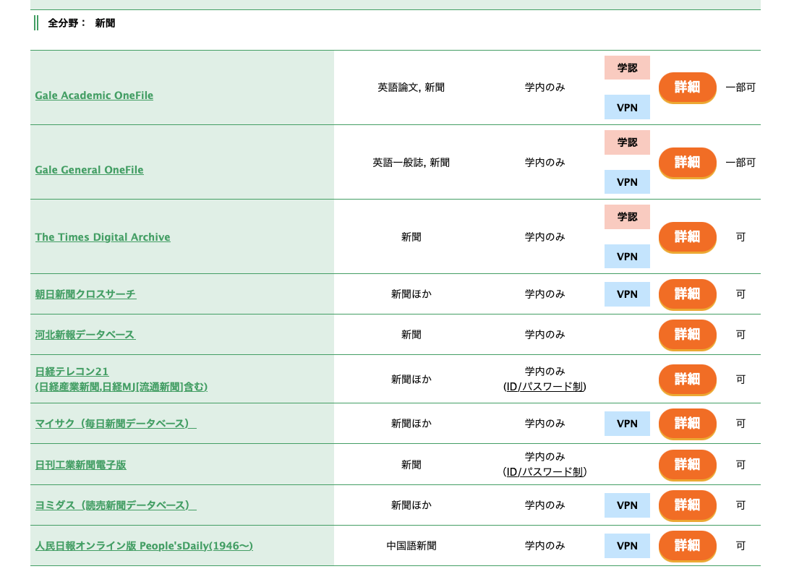

| DB | 主な収録 | 同時アクセス数 |
|---|---|---|
| 日経テレコン21 | 日本経済新聞（1981年10月〜）、日経産業新聞、日経MJ など | 2 |
| 朝日新聞クロスサーチ | 朝日新聞（1879年〜） | 3 |
| ヨミダス | 読売新聞（1874年〜）、The Japan News | 2 |
| 毎索 | 毎日新聞（1872年〜） | 1 |
| 河北新報 | 河北新報（1991年8月〜） | 5 |
| Gale Academic OneFile | 英語の新聞・雑誌 | 制限なし |

同時アクセス数は、同じ時間に使える人数の上限です。

学外からは、学認（東北大ID）かVPNで入ります。使える方法はDBごとに違い、河北新報は学内からだけ使えます。方法は[学外からの利用の案内](https://www.library.tohoku.ac.jp/search/ejournal/remote2.php)にまとまっています。表は2026年9月に確かめた内容です。

## 2. 日経テレコンで記事を探す

1. 図書館のDB一覧で「日経テレコン21」を開きます。
2. 図書館が案内するID・パスワードを、認証画面に自分で入力してログインします。
3. 記事検索の画面で、検索語、対象期間、媒体を指定します。
4. 結果の一覧から、読む記事を絞ります。
5. 読む記事のチェックボックスを選びます。「一括チェック」を使うときは、選ばれる範囲を画面で確かめます。
6. 「本文表示」で、選んだ記事をまとめて表示します。
7. 「印刷」から印刷画面を開きます。
8. 保存先をPDFにして、自分が読むために保存します。
9. 終わったら「ログアウト」を押します。

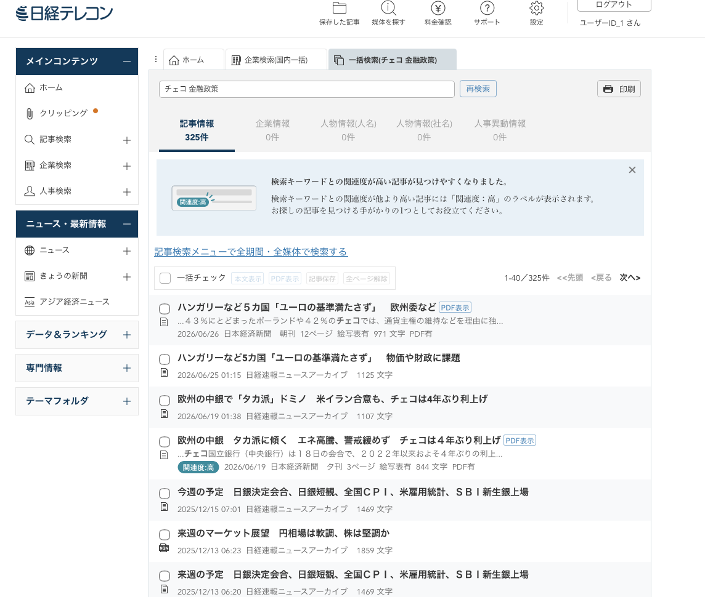


図の例は「チェコ　金融政策」の検索です。

### PDFの保存：MacとWindows

Macでは、印刷画面の「PDF」から「PDFとして保存」を選ぶか、ブラウザの送信先で「PDFに保存」を選びます。Windowsでは、送信先で「PDFに保存」か「Microsoft Print to PDF」を選びます。名前はブラウザによって少し違います。

## 3. 検索語と条件を変える

同じ出来事でも、検索語と条件によって件数と記事が変わります。例として、日本銀行が2024年3月19日にマイナス金利政策を解除した出来事を調べる場合を考えます。

| 変える条件 | 例 |
|---|---|
| 検索語 | 「マイナス金利 解除」「日銀 利上げ」「金融政策決定会合」 |
| 期間 | 決定日の前後1週間、全期間 |
| 検索する範囲 | 見出しだけ、本文も含める |
| 媒体 | 日本経済新聞の朝刊・夕刊、日経産業新聞 |

期間を決定日の前後に絞ると、当日の報道と、事前の予想記事を分けて読めます。見出しだけの検索は件数が少なく、本文も含めると関連する記事が広く入ります。言い換えた語で検索し直すと、別の角度から書かれた記事が見つかります。「圧力」「対立」のような語を入れると、その見方で書かれた記事が集まります。

## 4. 朝日新聞クロスサーチと英語の新聞

朝日新聞クロスサーチでも、検索語と期間を決め、記事を選び、本文表示、印刷、PDF保存、ログアウトの順に進みます。ボタンの名前は日経テレコンと違いますが、作業の順番は同じです。

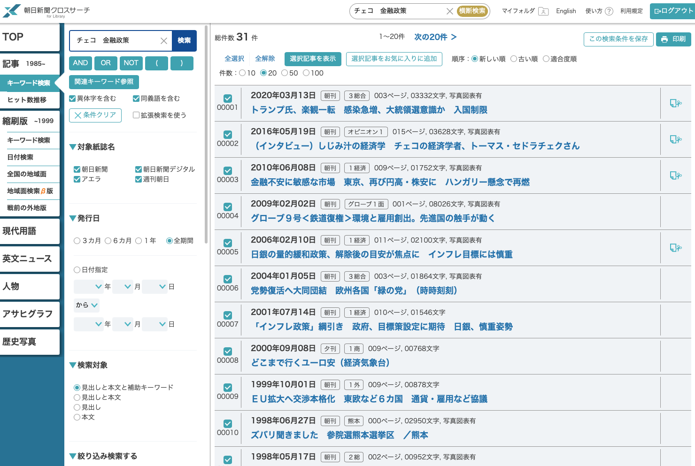

英語の新聞は、Gale Academic OneFileで探せます。検索結果を「News」に切り替えると、新聞記事だけが並びます。右側の「Publication Date」「Publication Title」で、期間や紙名を絞れます。

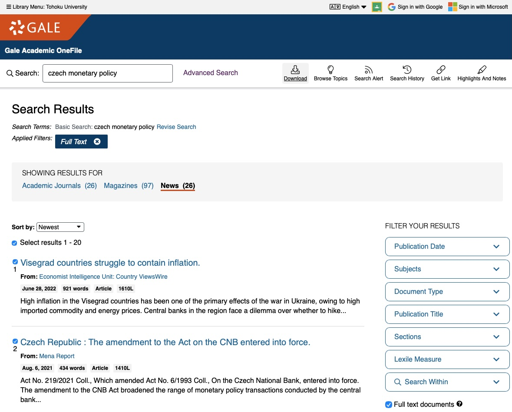

## 5. 検索結果を残す

検索結果の画面をスクリーンショットで保存すると、検索語、件数、記事の見出し、掲載日、紙面が残ります。

## 6. 新聞記事とAI

日経テレコンの[著作権・提供情報の案内](https://b2b-user-support-telecom-support-navi.user-support.b12s.jp/qanavi/copyright/)は、提供する情報を生成AIなどに入力し、学習・解析・加工させることを禁止しています。データを第三者に提供することや、ほかのサイトへ転載することも禁止されています。

## 7. AIが探したニュースは何に偏るか

### 同じ依頼から違う一覧ができる

[Codexの検索例](example/ai_news_test_codex.md)と[Claudeの検索例](example/ai_news_test_claude.md)は、歴代の政権による日本銀行の政策への発言を、AIに調べさせた記録です。期間、媒体、言語、一次資料に当たるかどうかは指定していません。どちらも2026年9月17日の出力です。

2つの記録の検索語と出典の一覧を比べると、次の違いがあります。

| 見るところ | Codexの例 | Claudeの例 |
|---|---|---|
| 調べた範囲 | 第2次安倍政権以降と、自分で決めています | 菅政権に触れず、岸田首相の発言は「見つからなかった」で終えています |
| 情報源 | 参照したニュース13件のうち8件が、Reutersの記事とその転載です | 参照した14件のうち4件が、同じ著者の解説コラムです |
| 一次資料 | 官邸・日銀・内閣府の資料と照合したと書いています | 一次資料を開いていないと、自ら書いています |
| 本文を読めた範囲 | 出典ごとの読んだ程度は示していません | 「読んだ」「要約のみ」を区別していて、読んだのは4件です |

AIが自分の記録について書いた説明にも、誤りが入ります。Claudeの例は末尾で「本文を読んだ4件のうち3件が同じ著者のコラム」と書いていますが、出典の表で「読んだ」とある4件のうち、その著者のコラムは2件です。

### 探しやすいものが、重要なものに見える

| 偏り | 一覧に起きること |
|---|---|
| 新近性 | 最近の出来事ほど詳しくなります。Codexの例の政権別の表は、安倍・菅政権が各1項目、高市氏・高市政権が6項目です |
| 公開Webへの集中 | 契約DBの中の記事より、無料で開ける記事や解説が多くなります |
| 言語 | 英語で探すと、海外の読者向けの論点が入りやすくなります |
| 通信社の転載 | URLが違っても、元は同じ記事ということがあります |
| 検索語 | 「圧力」「利上げ」で探すと、対立を扱う記事を拾いやすくなります。AIが前から知っている発言を検索語に入れると、既知の発言に検索が偏りやすくなります |
| 期間と対象 | 依頼にない期間や比較の対象を、AIが断らずに決めます |
| 本文の未確認 | 見出しや、検索結果の短い要約が、本文の代わりに使われます |

### 「しんぶん赤旗」を参照するAI

スタンフォード大学のAndrew B. Hallと早稲田大学のSho Miyazakiによる研究（2026年）は、日本の衆院選を題材に、検索機能を使うAIの5モデルに投票先を尋ねました。共産党のサイトが頻繁に引用され、同サイト内の「しんぶん赤旗」を報道機関として扱う例も見られました。左寄りの政策への賛成を示した利用者には、共産党を勧める回答が集中しました。

著者らは、大手新聞社がAIのアクセスを制限する一方、共産党のサイトや「しんぶん赤旗」はアクセスしやすいことを、背景として指摘しています。AIが選ぶ情報源には、記事の内容だけでなく、どのサイトを読めるかも影響します。[論文](https://andrewbenjaminhall.com/Miyazaki_Hall_Japan_AI.pdf)と[スタンフォード大学による紹介](https://fsi.stanford.edu/news/voters-increasingly-use-ai-political-advisor-new-study-shows-risks)で、実験の内容を読めます。

## 8. 余談：新聞の電子版の料金

図書館の新聞DBは、学生は料金なしで使えます。同じ新聞の電子版を個人で購読すると、料金は次のとおりです。どれも税込みの月額で、2026年11月4日に確かめた料金です。

| 新聞 | 電子版の月額 |
|---|---|
| 日本経済新聞（日経電子版） | 4,277円 |
| 朝日新聞（朝日新聞デジタル） | ベーシック980円、スタンダード1,980円、プレミアム3,800円 |
| 毎日新聞（毎日新聞デジタル） | スタンダード1,078円、プレミアム3,520円 |
| 読売新聞（読売新聞オンライン） | 電子版だけの購読はなく、紙の購読者が追加料金なしで使えます。紙は4,800円（朝夕刊）、3,800円（朝刊だけの地域） |
| 河北新報（河北新報オンライン） | 3,400円 |

朝日新聞デジタルのベーシックで読める有料記事は、1日2〜3本です。日経電子版には学生向けの申し込みページがあり、最初の1か月が無料で、その後は通常の4,277円です。

米国の新聞は、新規の購読者向けの料金がずっと安く、日本からも申し込めます。次は2026年11月4日に日本から見た料金で、1ドル158円（2026年10月の平均）で円に直しています。

| 新聞 | 最初の1年 | 2年目から |
|---|---|---|
| New York Times（All Access） | 4週ごとに2ドル（約320円） | 4週ごとに16ドル（約2,530円） |
| Wall Street Journal（WSJ Digital） | 月2ドル（約320円） | 月9.99ドル（約1,580円） |
| Washington Post（Core） | 4週ごとに2ドル（約320円） | 4週ごとに9ドル（約1,420円） |

## 参照先

- [東北大学附属図書館：データベース一覧](https://www.library.tohoku.ac.jp/search/database.html)
- [東北大学附属図書館：学外からの利用](https://www.library.tohoku.ac.jp/search/ejournal/remote2.php)
- 電子版の料金：[日経電子版（学生向け）](https://www.nikkei.com/promotion/campaign/student/)、[朝日新聞デジタル](https://digital.asahi.com/info/price/)、[読売新聞の購読申し込み](https://434381.yomiuri.co.jp/product/newspaper/subscribe/)、[河北新報オンライン](https://id.kahoku.news/service/plan/)。
- [日経テレコン：著作権・ご提供する情報について](https://b2b-user-support-telecom-support-navi.user-support.b12s.jp/qanavi/copyright/)
- Miyazaki, S. and A. B. Hall (2026), "[Why Do AI Models Tell Left-Wing Voters to Support the Communist Party? AI Voting Advice in Japan’s 2026 General Election](https://andrewbenjaminhall.com/Miyazaki_Hall_Japan_AI.pdf)," ワーキングペーパー、2026年3月17日版。

サービスの情報は、2026年9月に確かめた内容です。
