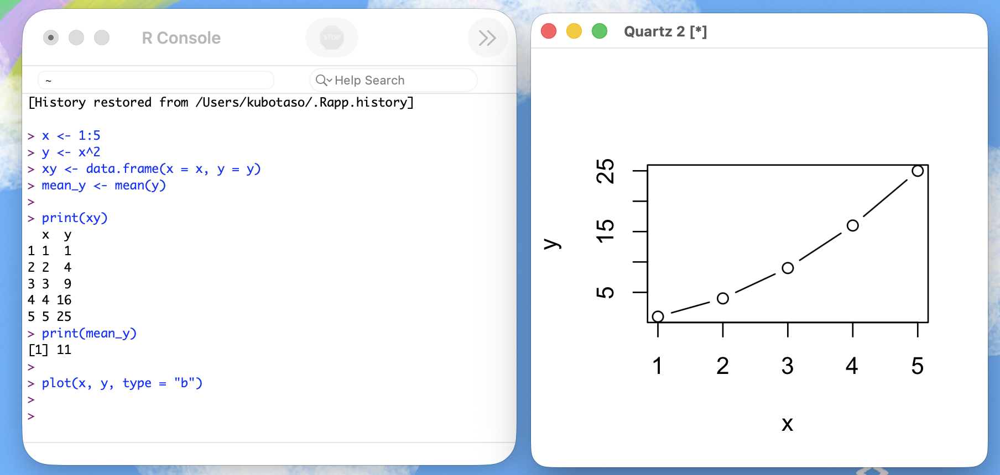
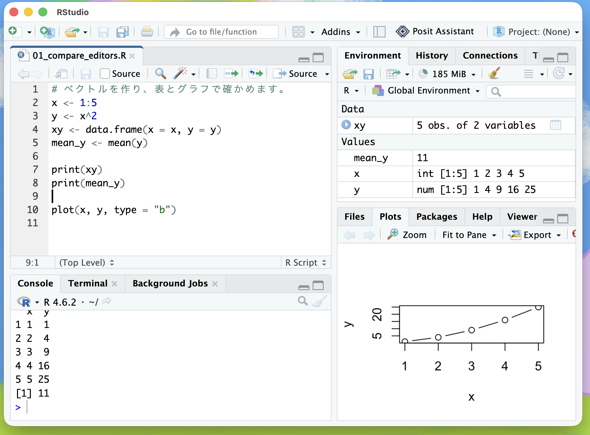
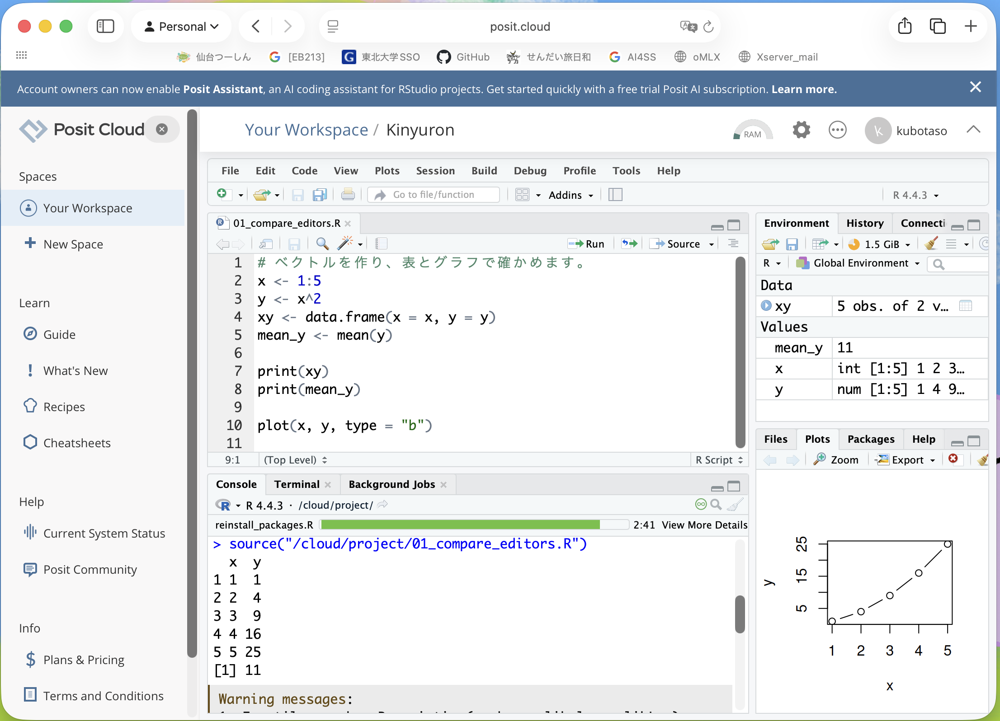
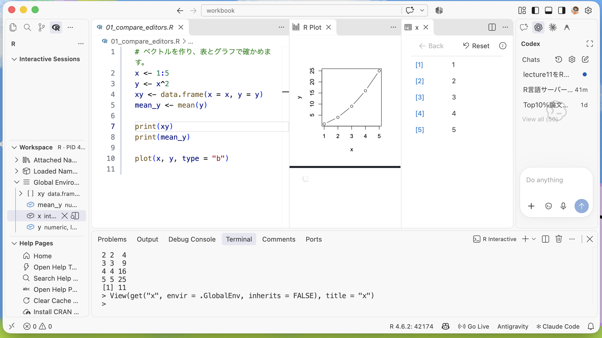
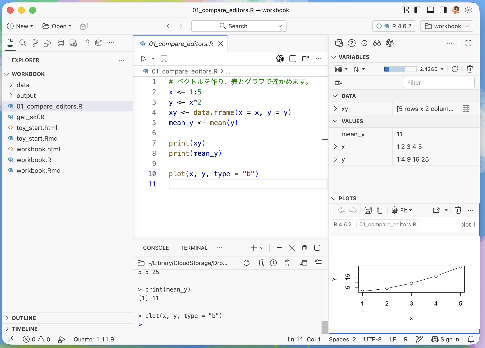
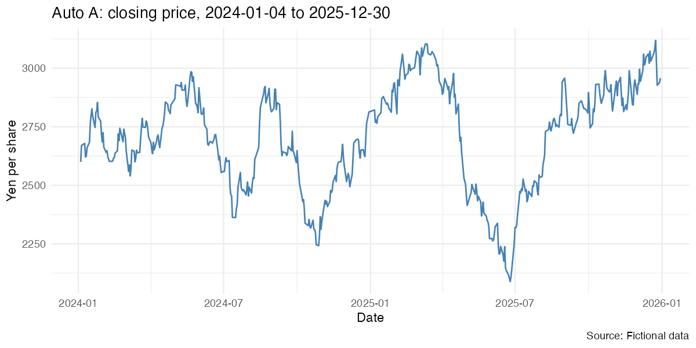
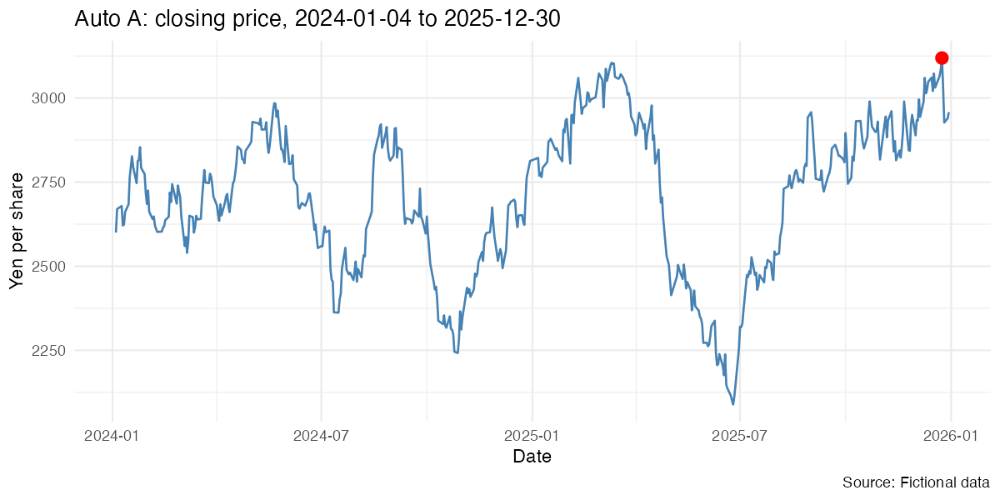
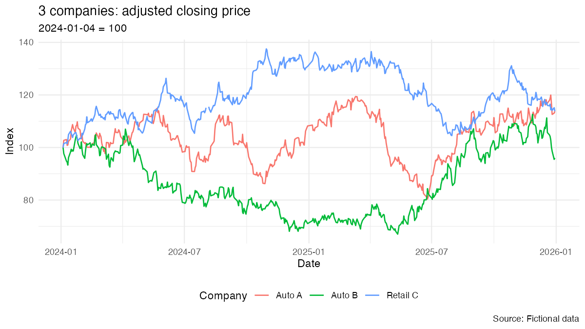
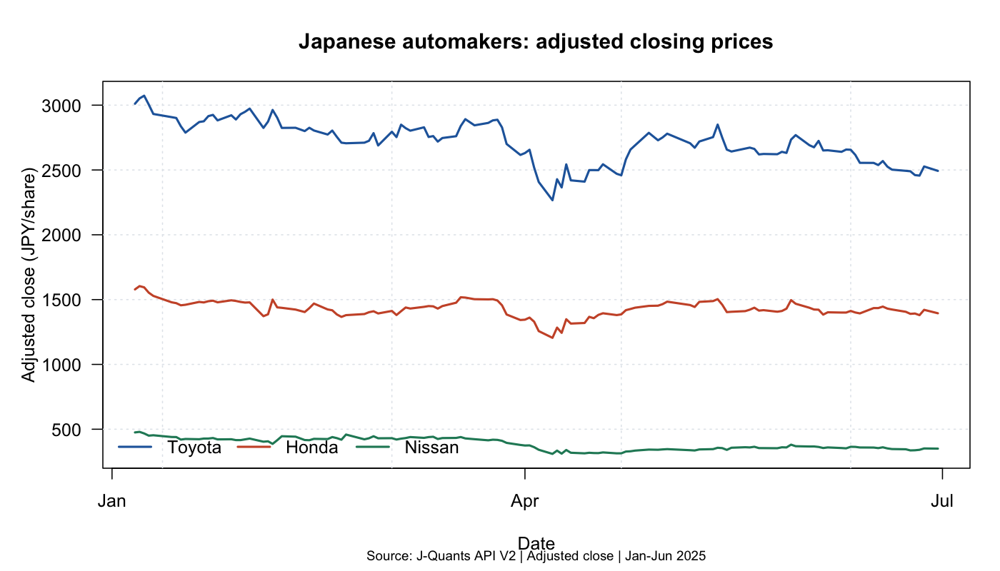
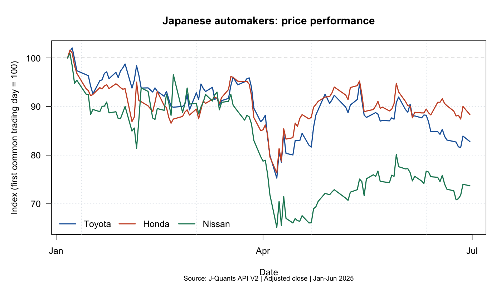

# この回で扱うこと

- Rの標準画面、RStudio、VS Code、Positronの特徴と長所・短所を知る
- base Rとtidyverseの成り立ちと関係を知る
- VS CodeでRのscriptとR Markdownを扱う
- パッケージのインストール・読み込み・更新を区別する
- Rの基本文法：代入、vector、型、繰り返し、条件分岐、関数
- 仮想の株価CSVを読み込み、行数・列・欠損を確かめる
- 行と列を選び、変数を作り、群ごとに集計する
- 数に見える文字列を変換し、前日からの収益率を計算する
- 手計算との照合と、確認表の保存
- ggplot2で株価の折れ線と、初日を100にそろえた比較図を描く
- 株価が最大の日を図に示し、元のCSVと照合する
- J-Quantsで自動車3社の株価を取得し、2通りの図で比べる

# Rを動かす4つの画面

Rは、統計計算や作図のための言語であり、プログラムを実行するソフトウェアでもあります。RStudio、VS Code、Positronは、コードを書き、Rに実行させ、結果を見るためのアプリです。どのアプリでも、計算を担当するR本体を使います。

以下の4枚は、同じコードで表とグラフを作った画面です。1から5までの数を `x`、その2乗を `y` とし、表 `xy` と平均 `mean_y` を作っています。計算結果はどれも同じで、平均は11です。アプリによって、コードや結果の見せ方、使い始めるまでの準備が違います。

## Rの標準画面

R本体に付属する画面で、MacではR.app、WindowsではRGuiと呼ばれます。Consoleにコードを入力すると、その場に計算結果が出ます。グラフは別のウィンドウに表示されます。

RはterminalからCLI（文字で操作する方法）でも使えます。terminalで `R` と入力すると対話モードが開き、`>` の後にコードを入力して実行できます。計算結果も同じterminalに表示されます。

長所は、専用のエディタを追加せずに、短い計算をすぐ試せることです。Console中心の画面なので、長いコードを編集しながら変数や表を見比べる作業には、次のような専用のエディタが向いています。



## RStudio

コードはSource、計算結果はConsole、変数一覧はEnvironment、グラフはPlotsに表示されます。表を開いて中身を確認する機能もあります。

長所は、Rの分析に使う機能がまとまっていて、コードと結果を見比べやすいことです。短所は、一つのウィンドウを複数の領域に分けるため、小さな画面ではコードやグラフの表示が狭くなることです。



Posit Cloudは、クラウド上のRStudioをブラウザから使うサービスです。自分のPCにRやRStudioをインストールせずに始められるのが長所です。一方、インターネット接続が必要で、無料プランには計算時間や使える資源に上限があります。



## VS CodeでR

R拡張を追加すると、これまでPythonやMarkdownで使ってきたVS CodeでRも扱えます。計算結果はRのターミナル、変数一覧はWorkspace Viewer、グラフはPlot Viewerに表示されます。

長所は、使い慣れたエディタで複数の言語や文書を扱えることです。短所は、R拡張や関連するパッケージの準備が必要なことです。コードの入力補完やグラフの表示には、それぞれの機能に合った設定が必要になります。



## Positron

VS Codeをもとに、RとPythonでのデータ分析向けに作られたアプリです。計算結果はConsole、変数一覧はVariables、グラフはPlotsに表示されます。表はData Explorerで閲覧できます。

長所は、RとPythonの両方で、変数・表・グラフを確認する機能が最初から組み込まれていることです。短所は、拡張機能の配布元がVS Codeと異なり、使い慣れた拡張機能の一部を利用できないことです。



# VS Codeで実習を進める

## 作業フォルダと教材

`金融論` フォルダの中に、今回の作業用フォルダ `Lecture11` を作ります。配布資料の `workbook/` の中から、次のファイルと株価CSVを `Lecture11` にコピーします。

```text
金融論/
└── Lecture11/
    ├── workbook.Rmd
    ├── workbook.R
    ├── 01_compare_editors.R
    ├── 02_base_r_and_tidyverse.R
    ├── 03_jquants_auto.R
    ├── 04_ggplot_prices.R
    └── data/
        ├── prices.csv
        └── prices_short.csv
```

`prices.csv` と `prices_short.csv` は、第6回で使った仮想の株価データです。基本演習は手元のCSVで進められます。実行結果は `Lecture11/output/` に保存されます。

VS Codeの「ファイル」→「フォルダーを開く」で、`金融論/Lecture11` を開きます。左のファイル一覧から `workbook.Rmd` を開くと、演習の文章とコードが表示されます。上から順にchunkを実行します。同じcodeを一度に実行できる `workbook.R` もあります。「やってみる」の答え合わせは、Codexに頼めます。

R本体とVS CodeのR拡張の準備や設定は、Codexに頼めます。

## Rのscriptを動かす

`.R` は、Rのコードを書いたファイルです。VS Codeでは、コードを選んでR拡張の「Run Selection/Line」で実行すると、Rのターミナルに結果が出ます。変数はWorkspace Viewer、グラフはPlot Viewerで見られます。

実行時に「Run R Code」という画面で、コードを実行する場所の選択肢が出る場合があります。「Create R terminal」を選ぶと、画面下部のTerminalにRが起動します。この講義では、このRのターミナルでコードを実行します。

`workbook.R` は、「実行する」のcodeだけを並べたscriptです。terminalで `Rscript workbook.R` と打つと、上から全部が実行されます。第5回の `python pv.py` と同じ使い方です。

## R Markdown

R Markdown（`.Rmd`）は、Markdownの文章の間にRのcodeを置いたfileです。codeは、次のようなchunkに書きます。

````markdown
## 複利

100円を年10%で20年間預けます。

```{r}
100 * 1.1^20
```
````

chunkは1つずつ実行できます。この講義のVS Codeでは、数値はRのターミナル、図はPlot Viewerに表示されます。RStudioでは、結果をchunkの下に表示する設定も使えます。実行して作った変数はRの中に残り、次のchunkから使えます。

新しいR processでKnitすると、上のchunkから順に全部を実行し、文章・code・結果を並べたHTMLを作ります。再現確認では新しいR processを使います。consoleからrenderを呼ぶだけでは、既存の環境を参照する場合があります。 notebookの Restart と Run All にあたる操作です。`.Rmd` のfile自体には文章とcodeだけが入り、結果はHTMLの側に残ります。

VS Codeでは、R拡張を入れるとchunkの上に Run Chunk が出ます。そこからchunkごとに実行できます。RStudioでも同じ `.Rmd` を開けます。

## 作業ディレクトリを確かめる

Knitするときの作業ディレクトリは、その `.Rmd` があるfolderです。今回は `金融論/Lecture11` です。`data/prices.csv` は、その中の `data` フォルダにあるファイルを指します。VS Codeでchunkを実行するときの作業ディレクトリも、`getwd()` で確かめられます。表示されたパスが `Lecture11` で終わっていれば、同じ相対pathを使えます。

# パッケージの準備とlibrary

## GUIで管理する

パッケージのインストールや更新は、画面上の操作でも行えます。入口はアプリによって違います。

| 環境 | パッケージ管理の画面 |
|---|---|
| RStudio・Posit Cloud | PackagesタブのInstallで追加、Updateで更新できます。一覧のチェックボックスで読み込むこともできます。 |
| VS Code＋R拡張 | Help PagesのInstall CRAN Packageから追加できます。同じ行のUpdate Installed Packagesで、インストール済みパッケージをまとめて更新できます。 |
| Positron | サイドバーのPackagesペインで、パッケージを検索して追加したり、更新したりできます。RとPythonの両方に対応しています。 |

## 主なコマンド

- `install.packages("tidyverse")`：パッケージをインストールします。
- `library(tidyverse)`：インストール済みのパッケージを読み込みます。
- `update.packages()`：パッケージを更新します。
- `packageVersion("tidyverse")`：パッケージの版を調べます。
- `sessionInfo()`：Rと読み込んだパッケージの情報を表示します。
- `dplyr::filter()`：パッケージ名を指定して関数を使います。

パッケージのインストール・更新・設定や、エラーの解消は**Codexに頼めます**。「必要なRパッケージを入れて、Knitできるようにして」のように依頼できます。

# Rの基本文法

## Pythonとの違い

| | Python | R |
|---|---|---|
| 代入 | `A = 1` | `A <- 1` |
| 値をまとめる | `[2, 3, 4]`（list） | `c(2, 3, 4)`（vector） |
| 最初の要素 | `D[0]` | `D[1]` |
| 範囲外の番号 | error | `D[4]` は `NA`、`D[0]` は空 |
| 1から5まで | `range(1, 6)` | `1:5` |
| 3ずつ増やす | `range(1, 14, 3)` | `seq(1, 13, by = 3)` |
| べき乗 | `1.1 ** 2` | `1.1^2` |
| 繰り返す範囲 | `:` と字下げ | `{ }` |
| 3つ目以降の条件 | `elif` | `else if` |
| 型を調べる | `type()` | `class()` |
| 文字列どうしの `+` | つなげる | error |
| 欠損 | `NaN`、`None` | `NA` |
| 関数を作る | `def f(x):` と `return` | `f <- function(x) { }` |

Rの番号は1から始まります。範囲外の番号を書いてもerrorで止まらないので、番号を間違えたときに気づきにくくなります。

## 型を調べて変換する

`class()` で値の型を調べます。Pythonの `type()` にあたります。

```r
class(3)       # "numeric"
class("3")     # "character"
class(TRUE)    # "logical"
as.numeric("3") + 3   # 6
```

`numeric` は数値、`character` は文字列、`logical` は `TRUE` または `FALSE` です。`"3"` は数字の形をした文字列なので、`as.numeric()` で数に変換してから足します。

## vectorの計算

```r
v1 <- c(2, 3, 4)
v2 <- c(6, 4, 2)
v1 * v2   # 12 12 8
v1 * 2    # 4 6 8
```

vectorどうしの計算は、同じ位置の要素どうしで行います。Pythonのlistに `* 2` をすると、listが2回繰り返されました。Rの表の列もvectorなので、`prices$C * 100` と書くと各行の終値から100株分の金額をまとめて計算できます。pandasの列の計算と同じです。

長さの違うvectorを足すと、短いほうが先頭に戻って繰り返し使われます。`c(1, 2, 3) + c(10, 20)` は `11 22 13` になり、warningが出ます。

## forで順に足す

1から5までを順に足し、途中の合計を表示します。Pythonで使った `total = total + i` の例を、Rで書くと次のようになります。

```r
total <- 0
for (i in 1:5) {
  total <- total + i
  print(total)
}
```

結果は順に `1`、`3`、`6`、`10`、`15` です。`i` に1から5までが1つずつ入り、そのたびに `total` に足されます。

Pythonの `range(1, 6)` に対応するのが、Rの `1:5` です。Rでは終わりの5も含みます。3ずつ増やす場合は、`seq(1, 13, by = 3)` と書くと `1, 4, 7, 10, 13` になります。

`for (i in 1:5)` の `( )` に繰り返しの条件を書き、実行する部分を `{ }` で囲みます。Pythonの `:` と字下げにあたる部分です。Rの字下げは読みやすくするためのもので、動作には関係しません。繰り返しの途中の値を表示するときは `print()` を使います。

## ifで条件を分ける

点数が60点以上なら `"Pass"`、それ以外なら `"Fail"` と表示します。

```r
test <- 61
if (test >= 60) {
  print("Pass")
} else {
  print("Fail")
}
```

この例では `"Pass"` が出ます。`test >= 60` が成り立つと最初の `{ }` の中を実行し、成り立たなければ `else` の中を実行します。

60点ちょうどの場合を分けると、3通りになります。Pythonの `elif` にあたる書き方が、Rの `else if` です。

```r
test <- 60
if (test > 60) {
  print("Pass")
} else if (test == 60) {
  print("Just barely Pass")
} else {
  print("Fail")
}
```

この例では `"Just barely Pass"` が出ます。`<-` は代入、`==` は等しいかどうかの比較です。比べる記号はPythonと同じで、`>`、`<`、`>=`、`<=`、`==`、`!=` を使います。

## forとifで複利を計算する

最初の10年は年10%、残りの10年は年20%で、100円を20年間運用します。

```r
Fuku <- 100
for (i in 1:20) {
  if (i <= 10) {
    Fuku <- Fuku * 1.1
  } else {
    Fuku <- Fuku * 1.2
  }
}
Fuku   # 1605.977
```

`i` が1から10の間は1.1を掛け、11から20の間は1.2を掛けます。20年後の金額は約1,605.98円です。Pythonで使った `for year in range(1, 21):` と同じ計算です。

20年間ずっと年10%なら、`100 * 1.1^20` と書いても計算できます。結果は約672.75円です。Pythonのべき乗 `**` は、Rでは `^` と書きます。

## 関数

```r
future_value <- function(principal, rate, years) {
  principal * (1 + rate)^years
}
future_value(100, 0.10, 2)   # 121
```

`function( )` で関数を作り、`<-` で名前を付けます。`principal` は元金、`rate` は年利、`years` は年数です。Pythonの `def future_value(principal, rate, years):` と同じように、計算に使う値を受け取ります。Rでは `{ }` の最後の行の値が返ります。

返された値は、変数に入れて別の計算に使えます。

```r
x <- future_value(100, 0.10, 2)
x * 2   # 242
```

## 関数とforで現在価値を合計する

将来受け取る金額を、今の価値に直す関数を作ります。`amount` は受取額、`rate` は割引率、`years` は受け取るまでの年数です。

```r
present_value <- function(amount, rate, years) {
  amount / (1 + rate)^years
}
present_value(110, 0.10, 1)   # 100
```

1年後の110円を10%で割り引くと、現在価値は100円です。

1年後から5年後まで、毎年1万円を受け取る場合は、各年の現在価値を `for` で足します。割引率は5%です。

```r
total <- 0
for (t in 1:5) {
  total <- total + present_value(10000, 0.05, t)
}
round(total, 2)   # 43294.77
```

`t` が1から5へ変わるので、受け取りが先の金額ほど長く割り引かれます。合計は約43,294.77円です。Pythonの例と同じく、関数が1回分を計算し、`for` が5回分を合計しています。

# base Rとtidyverse

base Rとtidyverseは、同じRの中で使う道具です。base RはR本体に備わる基本機能を指します。tidyverseは、データの読み込み・整理・作図に使う追加のパッケージをまとめたものです。パッケージとは、関数などをひとまとめにして配布する仕組みです。

Rは、統計解析のために作られた言語Sを受け継いで生まれました。R本体には、数値の計算や表の操作、統計分析、作図の機能が用意されました。その上に、利用者や開発者がパッケージで機能を追加してきました。

その後、Hadley Wickhamらが、データの整理や作図を扱いやすくするパッケージを開発しました。表の操作を担うdplyr、作図を担うggplot2などです。共通の考え方と書き方で使えるこれらのパッケージ群は、2016年にtidyverseという名前でまとめられました。

この経緯から、同じ処理にも複数の書き方があります。base Rでは、表の行や列を直接指定する書き方がよく使われます。tidyverseでは、「行を選ぶ」「列を作る」「集計する」といった操作を、名前の付いた関数で順に並べます。書き方の違いは、同じRの中で使っている道具と、その設計の違いから生まれています。

たとえば、仮想の株価の表をtidyverseで銘柄ごとに分け、R本体の関数で終値の平均を求められます。1つのスクリプトの中で、両方の道具を組み合わせて使います。

## データフレームとは

データフレームは、行と列からなる表をプログラムの中で扱うためのデータの形です。Excelのシートのように、列に名前があり、行にデータが並びます。

株価データなら、1行は「ある銘柄の、ある1日」です。日付、銘柄コード、終値、出来高を別々の列に入れると、同じ行にその日の情報がそろいます。

各列は同じ長さで、列ごとに型を持ちます。日付の列、文字列の銘柄コード、数値の終値を、1つの表にまとめられます。数値の列はベクトルとして計算できるので、全行の終値をまとめて1,000で割る、といった操作ができます。

CSVは表をファイルに保存する形式です。読み込むと、Rのメモリの中にデータフレームができます。この表に対して、行を選ぶ、列を追加する、平均を求める、といった処理を行います。

## tibbleとdata.frame

tidyverseでよく使う表の形式は、tibble（ティブル）です。Rの `data.frame` を拡張したもので、表示すると行数・列数・各列の型が分かります。`tibble()` で作るほか、`read_csv()` でCSVを読み込んだときもtibbleになります。

表を操作するdplyrの関数は、tibbleと通常の `data.frame` の両方に使えます。次の比較では、同じ表を操作した結果を比べるため、`data.frame()` で作った表を両方の書き方で使います。

## 小さな株価の表で比べる

第6回の仮想の株価データから、Auto Aの3日分を使います。まず、R本体の `data.frame()` で表 `d` を作ります。

```r
d <- data.frame(
  Date = as.Date(c("2024-08-01", "2024-08-02", "2024-08-05")),
  Code = c("01110", "01110", "01110"),
  C = c(2454, 2492, 2467),
  Vo = c(20507300, 28425400, 27465800)
)
print(d)
```

`Date` は日付、`Code` は銘柄コード、`C` は終値（円）、`Vo` は出来高（株）です。

| Date | Code | C | Vo |
|---|---|---:|---:|
| 2024-08-01 | 01110 | 2,454 | 20,507,300 |
| 2024-08-02 | 01110 | 2,492 | 28,425,400 |
| 2024-08-05 | 01110 | 2,467 | 27,465,800 |

この表 `d` を、base Rとtidyverseの両方で扱います。tidyverseの関数は、次の行で読み込みます。

```r
library(tidyverse)
```

### 列を選ぶ

日付と終値の2列を取り出します。

```r
# base R
print(d[, c("Date", "C")])

# tidyverse
print(d |> select(Date, C))
```

base Rの `[行, 列]` は、コンマの前で行、後ろで列を指定します。前を空けると全行が対象になります。列名は文字列で指定します。

tidyverseの `select()` は、取り出す列の名前を並べます。`|>` は左の表を右の関数に渡す記号です。ここでは、`select(d, Date, C)` と同じ意味です。どちらも日付と終値の2列が出ます。

教科書では、同じように処理をつなぐ記号として `%>%` もよく使われます。この例の `|>` を `%>%` に置き換えても、同じ結果になります。この講義のコードは `|>` で統一しています。

### 行を選ぶ

終値が2,470円以上の日を取り出します。

```r
# base R
print(d[d$C >= 2470, ])

# tidyverse
print(d |> filter(C >= 2470))
```

`d$C` は表 `d` の終値の列です。base Rでは、その列で判定した条件を `[行, 列]` の行の側に置きます。列の側を空けると全列を残します。

tidyverseでは、`filter()` の中に行を選ぶ条件を書きます。どちらも、終値が2,492円の2024年8月2日だけが残ります。

### 列を追加する

終値を千円単位にした列を作ります。

```r
# base R
base_result <- d
base_result$C_thousand_yen <- base_result$C / 1000
print(base_result)

# tidyverse
tidy_result <- d |> mutate(C_thousand_yen = C / 1000)
print(tidy_result)
```

base Rでは、表をコピーし、`$` で新しい列に値を入れます。tidyverseでは、`mutate()` に新しい列の名前と計算式を書きます。作った表を `tidy_result` に入れています。

どちらにも、2.454、2.492、2.467という列が加わります。元の表 `d` と、円単位の列 `C` はそのまま残ります。

### 平均を求める

3日間の終値の平均を計算します。

```r
# base R
print(mean(d$C))

# tidyverse
print(d |> summarise(mean_close = mean(C)))
```

計算はどちらもR本体の `mean()` が担当します。base Rの例は数値を返し、tidyverseの `summarise()` は `mean_close` という列を持つ1行の表を返します。値はどちらも、(2,454 + 2,492 + 2,467) ÷ 3 = 2,471円です。

ここまでの比較は、[02_base_r_and_tidyverse.R](workbook/02_base_r_and_tidyverse.R) にもまとめてあります。続いて、同じ操作を3銘柄・2年分のCSVに使います。


# 株価CSVを読み込む

## 読み込みと型

```r
library(tidyverse)
prices <- read_csv(
  "data/prices.csv",
  col_types = cols(Date = col_date(), Code = col_character())
)
nrow(prices)   # 1464
ncol(prices)   # 14
glimpse(prices)
```

3銘柄・488日分で、1,464行あります。1行は1つの銘柄の1日です。日付は実際の営業日で、価格は仮想の値です。`read_csv()` はCSVをtibbleとして読み込みます。pandasでCSVをDataFrameとして読む操作にあたります。

`col_types` で、`Date` を日付、`Code` を文字列として読みます。銘柄コードの先頭の0を保つためです。ほかの列は数値として読み込まれます。

pandasとtidyverseの操作は、次のように対応します。

| 操作 | pandas | R（tidyverse） |
|---|---|---|
| 読む | `pd.read_csv()` | `read_csv()` |
| 行数・列数 | `df.shape` | `nrow()`、`ncol()` |
| 型と先頭の値 | `df.info()`、`df.head()` | `glimpse()` |
| 列を選ぶ | `df[["A", "B"]]` | `select(A, B)` |
| 行を絞る | `df[df["A"] == 1]` | `filter(A == 1)` |
| 列を作る | `df.assign(C = ...)` | `mutate(C = ...)` |
| 群ごとに集計する | `df.groupby("A").agg(...)` | `group_by(A)` と `summarise(...)` |
| 欠損を数える | `df.isna().sum()` | `colSums(is.na(df))` |

## 数に見える文字列を直す

小さなCSV `prices_short.csv` の終値は、`"2,467"` のように桁区切りのコンマが付いています。いったん文字列として読み、`parse_number()` で数値に変換します。

```r
short <- read_csv(
  "data/prices_short.csv",
  col_types = cols(Date = col_date(), Code = col_character(),
                   C = col_character())
)
class(short$C)   # "character"
short <- short |> mutate(C = parse_number(C))
class(short$C)   # "numeric"
short |> select(Date, Code, C)
```

`parse_number("2,467")` は `2467` になります。終値の空欄は `NA` のままです。銘柄コードは計算する数ではなく名前として使うので、`"01110"` などの文字列を保ちます。

## 銘柄と日付を確かめる

```r
n_distinct(prices$Code)   # 3
n_distinct(prices$Date)   # 488
prices |> count(Code)
```

`n_distinct()` は異なる値の数を数えます。銘柄コードは3種類、日付は488日あります。`count(Code)` では、銘柄ごとの行数がどれも488と分かります。

`prices |> count(Code)` は、表 `prices` を `count()` に渡して銘柄ごとに数える書き方です。

# 株価CSVで行と列を選ぶ

## select

```r
prices1 <- prices |> select(Date, Code, C, AdjC, Vo)
```

14列から、次の5列を残します。

| 列 | 内容 |
|---|---|
| `Date` | 日付 |
| `Code` | 銘柄コード。01110はAuto A、02220はAuto B、03330はRetail C |
| `C` | 終値（円） |
| `AdjC` | 株式分割を調整した終値（円） |
| `Vo` | 出来高（株） |

Auto Bは2025年4月1日に1株を2株に分割しています。`AdjC` は分割前の価格も分割後と同じ1株の単位にそろえた値です。期間を通じた平均には `AdjC` を使います。

## filter

```r
auto_a <- prices1 |> filter(Code == "01110")
nrow(auto_a)   # 488
```

条件に合うAuto Aの488行が残ります。銘柄コードは文字列なので引用符で囲み、値が等しいかを `==` で調べています。

## 欠損と0

```r
colSums(is.na(prices1))
prices1 |> filter(is.na(C))
```

`C` と `AdjC` に欠損が1つずつあります。同じ行にある、2024年8月5日のRetail Cの値です。この日は売買が成立せず、終値は `NA`、出来高は0です。終値がないことと、取引された株数が0であることを、それぞれ別の列で表しています。

# 列を作る

## mutate

```r
prices2 <- prices1 |> mutate(C_thousand_yen = C / 1000)
```

3日分の比較と同じ計算を、3銘柄・2年分の終値に使います。千円単位の列 `C_thousand_yen` が加わり、元の `C` は円単位のまま残ります。

## case_when

```r
prices2 <- prices2 |>
  mutate(Name = case_when(
    Code == "01110" ~ "Auto A",
    Code == "02220" ~ "Auto B",
    Code == "03330" ~ "Retail C",
    TRUE ~ "その他"
  ))
```

`case_when()` は上から条件を調べ、最初に当てはまった行の `~` の右の値を入れます。ここでは銘柄コードに対応する名前を付けています。

## if_else

```r
prices2 <- prices2 |>
  mutate(volume_group = if_else(Vo >= 10000000,
                                "1000万株以上", "1000万株未満"))
```

`if_else(条件, 当てはまるとき, 当てはまらないとき)` で2つに分けます。ここでは、その日の出来高で行を分類しています。

# 前日からの収益率を計算する

前の営業日の調整済み終値で当日の値を割り、1を引くと収益率になります。100を掛けて%で表示します。Pythonの `shift(1)` にあたるのが、dplyrの `lag()` です。

```r
returns <- prices2 |>
  arrange(Code, Date) |>
  group_by(Code) |>
  mutate(
    previous_close = lag(AdjC),
    Change = (AdjC / previous_close - 1) * 100
  ) |>
  ungroup()
```

`arrange()` で銘柄ごとに日付順に並べ、`group_by()` で銘柄を分けます。`lag(AdjC)` は、同じ銘柄の1つ前の行の値を返します。各銘柄の最初の行は、比べる前日の価格がないので `Change` が `NA` になります。価格が欠損した日は、その日と次の営業日の収益率が `NA` になります。

Auto Bの株式分割の日を取り出します。

```r
returns |>
  filter(Code == "02220", Date == as.Date("2025-04-01")) |>
  select(Date, AdjC, previous_close, Change)
```

前日の調整済み終値は1,113.5円、当日は1,117円です。収益率は約0.31%です。調整済み終値を使うと、株式分割の前後を同じ株数の基準で比べられます。

# 銘柄ごとに集計する

## group_byとsummarise

```r
price_summary <- prices2 |>
  group_by(Code, Name) |>
  summarise(
    days = n(),
    priced_days = sum(!is.na(AdjC)),
    mean_adjusted_close = mean(AdjC, na.rm = TRUE),
    .groups = "drop"
  )
price_summary
```

`group_by()` で銘柄ごとに分け、`summarise()` で1銘柄1行へまとめます。`n()` は行数、ここではCSVに記録されている日数です。`priced_days` は調整済み終値がある日数です。

| Code | Name | days | priced_days | 調整済み終値の平均（円、小数第2位まで） |
|---|---|---:|---:|---:|
| 01110 | Auto A | 488 | 488 | 2,703.98 |
| 02220 | Auto B | 488 | 488 | 1,296.36 |
| 03330 | Retail C | 488 | 487 | 4,077.83 |

`na.rm = TRUE` で欠損を除いて計算します。Retail Cの平均には、価格がある487日分を使っています。`.groups = "drop"` は、集計後の表にグループ分けを残さない指定です。

## 欠損の行を除く

```r
priced <- prices2 |> drop_na(AdjC)
nrow(priced)   # 1463
priced |> count(Code)
```

`drop_na(AdjC)` は、調整済み終値が欠損している行を除きます。Auto AとAuto Bは488行、Retail Cは487行になります。

# 元のCSVと照合する

## 3日分の終値

CSVからAuto Aの同じ3日分を取り出し、最初に作った表 `d` と比べます。

```r
three_days <- auto_a |>
  filter(Date >= as.Date("2024-08-01"), Date <= as.Date("2024-08-05"))
three_days |> select(Date, C)
mean(three_days$C)   # 2471
```

日付と終値は、比較に使った表 `d` の3行と一致します。CSVから計算した平均も同じ2,471円になります。

## NAを含む平均

```r
mean(c(3872, 3914, NA))
mean(c(3872, 3914, NA), na.rm = TRUE)   # 3893
```

同じ3日間のRetail Cには、終値のない日が1日あります。通常の `mean()` は `NA` を返します。欠損を除くと、(3,872 + 3,914) ÷ 2 = 3,893円です。平均に使った日数は2日です。

# 確認表を残す

```r
dir.create("output", showWarnings = FALSE)
check_rows <- tibble(
  step = c("all rows", "AdjC not NA", "Auto A"),
  rows = c(nrow(prices), nrow(priced), nrow(auto_a))
)
write_csv(check_rows, "output/price_check_rows.csv")
write_csv(price_summary, "output/price_summary.csv")
```

読み込んだ行数1,464、価格がある行数1,463、Auto Aの行数488を保存します。銘柄別の平均も `output/price_summary.csv` に残ります。元のCSVと集計結果を見比べると、どの日の価格が平均に含まれているかを辿れます。

# ggplot2で株価を描く

第6回では、PythonのmatplotlibでAuto Aの終値を折れ線にし、3社の調整済み終値を初日100にそろえて比べました。同じCSVから、Rのggplot2でこの2枚を描きます。ggplot2はtidyverseに含まれるので、`library(tidyverse)` で使えます。

## Auto Aの終値を折れ線にする

`auto_a` は、先ほど銘柄コード `01110` で取り出した表です。横軸を日付 `Date`、縦軸を終値 `C` にします。

```r
p_close <- ggplot(auto_a, aes(x = Date, y = C)) +
  geom_line(color = "steelblue", linewidth = 0.6) +
  labs(
    title = "Auto A: closing price, 2024-01-04 to 2025-12-30",
    x = "Date", y = "Yen per share",
    caption = "Source: Fictional data"
  ) +
  theme_minimal()
print(p_close)
```

`ggplot()` に表を渡し、`aes()` で列を軸に対応させます。Pythonの `ax.plot(auto_a["Date"], auto_a["C"])` にあたるのが、`aes(x = Date, y = C)` と `geom_line()` の組み合わせです。

`geom_line()` は日付順に線を結びます。`labs()` はタイトル・軸の名前・出典を付け、`theme_minimal()` は背景や目盛りの見た目を整えます。図を構成する部品は `+` でつなぎます。表の処理で使う `|>` とは記号が変わります。



## 最大値の点を元のCSVで確かめる

Auto Aの調整済み終値が最大の日を取り出します。Pythonの `idxmax()` で最大値の行を探した例を、Rでは `slice_max()` で書けます。

```r
peak <- prices |>
  mutate(csv_line = row_number() + 1L) |>
  filter(Code == "01110") |>
  slice_max(AdjC, n = 1)
peak |> select(Date, Code, AdjC, csv_line)
```

`row_number()` でCSVを読み込んだ順に1から番号を付けます。CSVの1行目は列名なので、1を足すとファイルの行番号になります。行を絞る前に番号を付けることで、元のCSVの位置が残ります。

最大値は2025年12月24日の3,119円で、`data/prices.csv` の485行目です。ファイルの同じ行でも、日付・銘柄コード・価格を確認できます。

Auto Aは `C` と `AdjC` が同じなので、先ほどの終値の折れ線にこの点を重ねられます。

```r
p_peak <- p_close +
  geom_point(data = peak, aes(y = AdjC), color = "red", size = 3)
print(p_peak)
```

`geom_point()` に最大値の表を渡すと、その日付と価格の位置に赤い点が加わります。線と点は、同じ図の部品として `+` で重ねられます。



## 初日を100にして3社を比べる

`prices2` には、3社の調整済み終値 `AdjC` と会社名 `Name` が入っています。銘柄ごとに日付順に並べ、各日の価格を最初の日の価格で割って100を掛けます。

```r
indexed <- prices2 |>
  arrange(Code, Date) |>
  group_by(Code) |>
  mutate(Index = AdjC / first(AdjC) * 100) |>
  ungroup()
```

`first(AdjC)` は、それぞれの銘柄の最初の日の調整済み終値です。`Index` が110なら、初日から10%上がっています。

```r
p_index <- ggplot(indexed, aes(x = Date, y = Index, color = Name)) +
  geom_line(linewidth = 0.6) +
  labs(
    title = "3 companies: adjusted closing price",
    subtitle = "2024-01-04 = 100",
    x = "Date", y = "Index", color = "Company",
    caption = "Source: Fictional data"
  ) +
  theme_minimal() +
  theme(legend.position = "bottom")
print(p_index)
```

`aes(color = Name)` で会社ごとに線の色が変わり、凡例も付きます。Pythonでは `for` で銘柄を1つずつ選んで線を重ねました。ggplot2では、会社名の列を色に対応させると、3社分の線をまとめて描けます。

最初の図の `color = "steelblue"` は、線全体に決まった色を付ける指定です。2枚目の `aes(color = Name)` は、データの値に応じて色を分ける指定です。



2025年12月30日の値は、Auto AとRetail Cが113.8、Auto Bが96.0です。初日からの変化は、それぞれ13.8%の上昇、13.8%の上昇、4.0%の下落です。

## 図を保存する

`ggsave()` にファイル名と図を渡すと、PNGとして保存できます。

```r
dir.create("output", showWarnings = FALSE)
ggsave("output/ggplot_auto_a_close.png", plot = p_close,
       width = 8, height = 4, dpi = 150)
ggsave("output/ggplot_auto_a_peak.png", plot = p_peak,
       width = 8, height = 4, dpi = 150)
ggsave("output/ggplot_prices_index.png", plot = p_index,
       width = 8, height = 4.5, dpi = 150)
```

3枚の図は `Lecture11/output/` で確認できます。型の変換、収益率の計算、CSVの読み込みから作図・保存までのコードは、[04_ggplot_prices.R](workbook/04_ggplot_prices.R) にまとめています。

書き方の詳細は、ggplot2の公式資料の [aes()](https://ggplot2.tidyverse.org/reference/aes.html)、[geom_line()](https://ggplot2.tidyverse.org/reference/geom_path.html)、[ggsave()](https://ggplot2.tidyverse.org/reference/ggsave.html) で確認できます。

# J-Quantsで自動車3社の株価を比べる

仮想の株価で使った読み方を、実在する自動車メーカー3社の比較に広げます。トヨタ自動車、ホンダ、日産自動車の2025年1〜6月の日次株価をJ-Quantsから取得します。

| 会社 | 証券コード | J-Quantsのコード |
|---|---|---|
| トヨタ自動車 | 7203 | 72030 |
| ホンダ（本田技研工業） | 7267 | 72670 |
| 日産自動車 | 7201 | 72010 |

3社は、J-Quantsの33業種では「輸送用機器」に分類されます。無料プランには12週間の遅れがあるため、この例では2025年上半期を使います。

## APIキーを用意する

[J-Quants](https://jpx-jquants.com/ja)で利用登録し、利用プランを選びます。この例は無料のFreeプランで取得できます。ログイン後、ダッシュボードの「API Keys」でAPIキーを発行し、コピーします。取得済みのキーがあれば、そのキーを使えます。

キーの保存先は、各回のフォルダをまとめている `金融論` の直下にある `api_key.txt` です。VS Codeで `金融論` フォルダを開くと、この場所にファイルを作成・編集できます。

```text
金融論/
├── api_key.txt
└── Lecture11/
    ├── 03_jquants_auto.R
    ├── data/
    └── output/
```

`api_key.txt` に次の形で保存します。`=` の右側を、発行されたAPIキーに置き換えます。ほかのAPIの設定が入っている場合は、別の行に追加できます。

```text
JQUANTS_API_KEY=ここにコピーしたAPIキー
```

`Lecture11` を作業場所にすると、`03_jquants_auto.R` は1つ上のフォルダにある `api_key.txt` から、この行のキーを読み込めます。APIキーは利用者を認証する情報なので、コードや提出物と分けて自分の手元に保存します。

保存後の接続確認は、Codexに頼めます。

```text
金融論フォルダのapi_key.txtにJ-QuantsのAPIキーを保存したので、
Lecture11の03_jquants_auto.Rで3社の株価を取得できるか確認して。
キーの値は表示しないで。
```

## APIに送る情報

APIへの接続では、取得先のURL、銘柄や期間の条件、利用者を確認するAPIキーを送ります。J-Quants V2では、HTTPのGETという方法でデータを求めます。

トヨタの2025年上半期の株価なら、接続先は次の形になります。

```text
https://api.jquants.com/v2/equities/bars/daily?code=72030&from=2025-01-01&to=2025-06-30
```

`/equities/bars/daily` が日次株価の取得先です。`?` の後ろに銘柄コードと期間を付け、`&` で条件をつないでいます。会社名や業種を取得するときは、取得先が `/equities/master` に変わります。

APIキーは、リクエストに添えるヘッダーの `x-api-key` に入れます。サーバーはキーから利用者と契約プランを確認します。スクリプトは `金融論/api_key.txt` から読み込んだ値を送ります。

## JSONをRの表にする

接続が成功すると、J-QuantsからJSONが返ります。その中の `data` に、1日分ずつの株価が並んでいます。R本体の `url()` で接続先とヘッダーを指定し、jsonliteパッケージの `fromJSON()` でJSONをRのデータに変換します。

スクリプトの処理を1社分に絞ると、次のようになります。`api_key` は、ファイルから読み込んだキーを入れる変数です。

```r
address <- paste0(
  "https://api.jquants.com/v2/equities/bars/daily",
  "?code=72030&from=2025-01-01&to=2025-06-30"
)
connection <- url(address, headers = c("x-api-key" = api_key),
                  method = "libcurl")
body <- jsonlite::fromJSON(connection)
toyota <- body$data
```

`body` は返答全体、`body$data` はその中の株価の表です。続いて `Date` を日付型に直し、日付順に並べると、CSVから読んだ表と同じように集計や作図ができます。

返答が複数ページに分かれると、続きの位置を示す `pagination_key` が返ります。作例の `fetch()` は、その値を付けて続きを取得し、1つの表にまとめます。接続処理を関数にしてあるので、同じ方法で3社を順番に取得できます。

## 接続結果を確かめる

返答にはHTTPステータスという番号も付いています。200は取得成功、401や403はキーや利用権限などの確認が必要な場合、429は短時間の依頼が多すぎる場合です。今回のスクリプトでは依頼の間を13秒あけ、無料プランの回数制限に合わせています。

取得できたら、会社名・銘柄コード・日付の範囲・行数を表で確かめます。今回の3社はそれぞれ119行で、2025年1月6日から6月30日までの価格が入っています。

## 取得から作図まで

[03_jquants_auto.R](workbook/03_jquants_auto.R) は、会社名と業種を確認し、調整済み終値を取得して2枚の図を作るスクリプトです。接続とJSONから表への変換を関数にまとめています。`Lecture11/` を作業場所にして、次のように実行できます。

```r
source("03_jquants_auto.R")
```

図は `output/jquants_auto_close.png` と `output/jquants_auto_index.png` に保存されます。取得した株価と比較表も同じフォルダに残ります。

## 円で株価を見る

1枚目は、調整済み終値を円単位で重ねた図です。各社の価格の水準と、期間中の動きを見られます。



## 最初の日を100にそろえる

2枚目は、各社の調整済み終値を最初の日の値で割り、100を掛けた図です。3社に共通して価格がある119営業日を使い、2025年1月6日を出発点にしています。110なら初日より10%高く、90なら10%低い価格です。



6月30日の指数は、トヨタが82.8、ホンダが88.3、日産が73.7です。この期間は3社とも初日の100を下回り、下落率が最も大きいのは日産です。

線を描く部分では、R本体の `plot()` と `lines()` を使います。`plot()` でトヨタの線と座標軸を描き、`lines()` でホンダと日産の線を加えています。

```r
plot(auto_dates, auto_index[, "Toyota"], type = "l",
     ylim = range(auto_index), col = "#2266AA", lwd = 2,
     xlab = "Date", ylab = "Index (first day = 100)")
lines(auto_dates, auto_index[, "Honda"], col = "#CC5533", lwd = 2)
lines(auto_dates, auto_index[, "Nissan"], col = "#228866", lwd = 2)
legend("bottomleft", legend = c("Toyota", "Honda", "Nissan"),
       col = c("#2266AA", "#CC5533", "#228866"), lty = 1, lwd = 2)
```

同じ期間でも、株価の水準と、出発点からの変化率では見える関係が変わります。1枚目は円での水準、2枚目は初日からの値動きを比較する図です。

# この回の要点

- base Rとtidyverseは同じRの中で組み合わせて使えます。
- 株価CSVの1行は1銘柄の1日です。銘柄コードは文字列、日付は日付の型で読みます。
- `select()`、`filter()`、`mutate()` で表を整え、`group_by()` と `summarise()` で銘柄別に集計します。
- 欠損を除くと、平均に使う日数も変わります。行数と価格のある日数を一緒に確かめます。

# 補論　CodexでVS Codeを操作する

Codexには、VS Codeの画面を操作してもらう使い方もあります。開きたいファイルと画面での並べ方を伝えると、Codexがエディターを分割してファイルを開きます。

たとえば、自動車3社の株価を描いたあと、2枚の図を見比べたいとします。`Lecture11` をVS Codeで開いた状態で、Codexにこう頼みます。

```text
VS Codeを操作して、output/jquants_auto_close.png を左に、
output/jquants_auto_index.png を右に並べて。2枚を同時に見られるようにして。
```

左に円建ての調整済み終値、右に初日を100とした指数が表示されます。両方の図の右端（6月30日）を見ると、株価が最も高いのはトヨタ（2,493円）、初日からの下落率が最も小さいのはホンダ（指数88.3）です。
